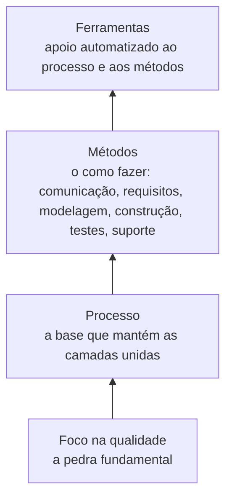
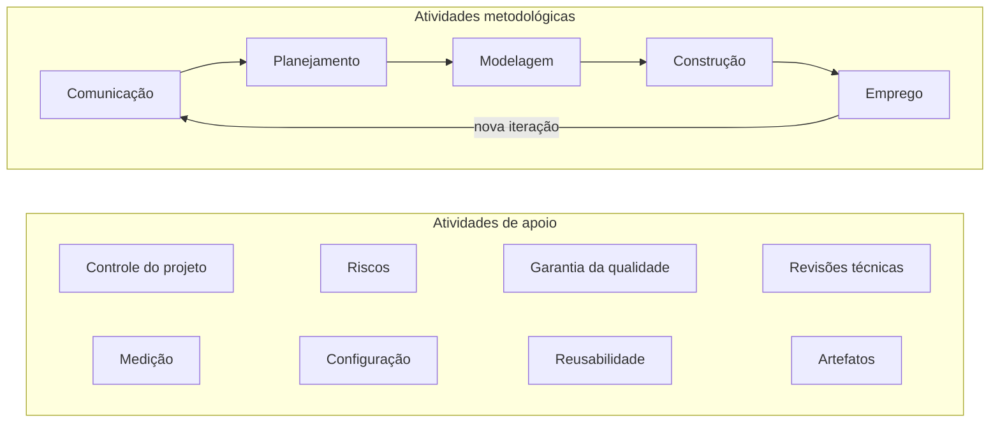

# Aula 01: Software e Engenharia de Software

O que é software, onde ele é usado e o que a engenharia de software acrescenta: um processo, métodos e ferramentas apoiados no foco em qualidade.

Tipo: canvas · Material do professor: [slides](https://github.com/Herysson/Engenharia-de-Software/blob/main/Aula%2001%20-%20Software%20e%20Engenharia%20de%20Software.pdf) · [lista de exercícios I](https://github.com/Herysson/Engenharia-de-Software/blob/main/Exerc%C3%ADcios/Software%20-%20%20Engenharia%20de%20Software.docx)

## Tópicos

- O que é software e como ele difere do hardware
- As sete categorias de software, software legado e WebApps
- Engenharia de software: definições e as camadas
- Processo de software: atividade, ação e tarefa; as cinco atividades metodológicas e as atividades de apoio
- Os sete princípios de David Hooker

---

## Software

**Software** é o produto que os profissionais de TI desenvolvem e mantêm no longo prazo. Ele é formado por três coisas:

| Parte | O que é |
|---|---|
| Instruções | os programas, que quando executados entregam as funções e o desempenho desejados |
| Estruturas de dados | o que permite aos programas manipular as informações |
| Informação descritiva | a documentação, impressa ou virtual, de como os programas funcionam e são usados |

### Software × hardware

| | Software | Hardware |
|---|---|---|
| Como é produzido | é desenvolvido por um processo de engenharia, não é fabricado | é fabricado, e a fabricação pode criar defeitos de qualidade |
| Onde está o custo | no processo de engenharia | também na fabricação |
| Desgaste | não se desgasta: não sofre com o ambiente e não tem peça de reposição | se desgasta com o tempo e o ambiente |
| Defeito | sempre indica um erro no projeto ou na tradução do projeto para código | pode vir do desgaste |
| Construção | a maioria ainda é feita sob encomenda, mas a indústria caminha para componentes reutilizáveis | montado a partir de componentes padronizados |

### Campos de aplicação

| Categoria | O que é | Exemplos dos slides |
|---|---|---|
| De sistema | programas que atendem outros programas | compiladores, editores, gerenciadores de arquivos, sistema operacional, drivers, software de rede |
| De aplicação | programas sob medida para uma necessidade de negócio | pontos de venda, controle de fabricação em tempo real |
| Científico/de engenharia | algoritmos de processamento numérico pesado (*number crunching*) | astronomia, análise de tensões em carros, dinâmica orbital, biologia molecular |
| Embutido | fica dentro de um produto e controla as funções dele | painel do micro-ondas, nível de combustível e freios de um carro |
| Linha de produtos | uma capacidade específica usada por muitos clientes diferentes | controle de estoque, processador de texto, planilhas, bancos de dados |
| Aplicações para a Web (WebApps) | software centrado em redes, desde páginas de hipertexto até aplicações completas | — |
| Inteligência artificial | algoritmos não numéricos para problemas que não têm solução direta | robótica, sistemas especialistas, reconhecimento de imagem e voz, redes neurais, jogos |

### Software legado

Sistemas feitos há décadas e modificados sem parar para acompanhar o negócio e as plataformas.

- **Problemas**: projeto que não cresce, código confuso, documentação pobre ou inexistente, testes que nunca foram guardados, histórico de mudanças mal cuidado.
- **Mas** sustentam funções vitais do negócio.
- **O que fazer?** Nada, até que precise de uma modificação significativa. Se atende os usuários e roda de forma confiável, não está "quebrado" e não precisa ser "consertado".

### O que torna as WebApps diferentes

| Atributo | Em uma linha |
|---|---|
| Uso intensivo de redes | vive numa rede e atende uma comunidade diversificada |
| Simultaneidade | muita gente acessa ao mesmo tempo, cada um de um jeito |
| Carga não previsível | o número de usuários varia em ordem de grandeza de um dia para outro |
| Desempenho | se demorar, o usuário vai embora |
| Disponibilidade | os usuários esperam acesso 24/7, mesmo que 100% não seja razoável |
| Orientadas a dados | usam hipermídia para mostrar texto, gráficos, áudio e vídeo |
| Sensibilidade ao conteúdo | a qualidade e a estética do conteúdo definem a qualidade da WebApp |
| Evolução contínua | evoluem o tempo todo, e não em versões planejadas e espaçadas |
| Imediatismo | chegam ao mercado em dias ou semanas |
| Segurança | é difícil limitar quem acessa, porque estão na Internet |
| Estética | a aparência pode pesar tanto quanto o projeto técnico |

---

## Engenharia de software

Duas definições dos slides:
- **Fritz Bauer**: aplicar sólidos princípios de engenharia para obter software econômico, confiável e eficiente em máquinas reais.
- **IEEE**: aplicar uma abordagem **sistemática, disciplinada e quantificável** ao desenvolvimento, à operação e à manutenção de software. Ou seja, aplicar engenharia ao software.

### As camadas (Pressman)

| Camada | Papel |
|---|---|
| Foco na qualidade | o compromisso da organização com a qualidade sustenta todo o resto |
| Processo | define a metodologia, é a base do gerenciamento do projeto e o contexto em que os métodos são aplicados, os artefatos são produzidos e as mudanças são geridas |
| Métodos | as informações técnicas de como desenvolver |
| Ferramentas | suporte automatizado ou semiautomatizado para o processo e os métodos |

---

## Processo de software

**Processo** é um conjunto de atividades, ações e tarefas para criar um produto de trabalho. Não é uma receita rígida: é uma abordagem **adaptável**, em que a equipe escolhe as ações e tarefas certas para entregar no prazo e com qualidade.

| Nível | Foco | Exemplo dos slides |
|---|---|---|
| Atividade | um objetivo amplo, que vale para qualquer projeto | comunicar-se com os interessados |
| Ação | um conjunto de tarefas que gera um artefato importante | projeto de arquitetura → modelo de arquitetura |
| Tarefa | um objetivo pequeno e bem definido, com resultado tangível | realizar um teste de unidade |

### Metodologia genérica: cinco atividades + apoio

| Atividade | O que acontece |
|---|---|
| Comunicação | antes de qualquer trabalho técnico, entender os objetivos dos interessados e levantar as necessidades |
| Planejamento | cria o "mapa" do projeto (o plano): tarefas técnicas, riscos, recursos, produtos e cronograma |
| Modelagem | esboçar o todo para entender o problema e a solução, refinando com mais detalhes se preciso |
| Construção | gerar o código (manual ou automático) e testar para revelar erros |
| Emprego | entregar o software (inteiro ou um incremento) ao cliente, que avalia e dá feedback |

Em muitos projetos as cinco atividades se repetem a cada **iteração**, e cada iteração produz um **incremento** do software. As atividades de apoio acompanham o processo inteiro, ajudando a gerenciar o progresso, a qualidade, as mudanças e os riscos.

| Atividade de apoio | Para quê |
|---|---|
| Controle e acompanhamento do projeto | comparar o progresso com o plano e agir para cumprir o cronograma |
| Administração de riscos | avaliar riscos que afetam o resultado ou a qualidade |
| Garantia da qualidade de software | definir e conduzir as atividades que garantem a qualidade |
| Revisões técnicas | achar e eliminar erros nos artefatos antes que passem para a próxima atividade |
| Medição | definir e coletar medidas do processo, do projeto e do produto |
| Gerenciamento de configuração | gerenciar os efeitos das mudanças |
| Gerenciamento da reusabilidade | definir critérios e mecanismos para reutilizar artefatos e componentes |
| Preparo e produção de artefatos | criar modelos, documentos, logs, formulários e listas |

---

## Os sete princípios de David Hooker

| # | Princípio | Em uma linha |
|---|---|---|
| 1 | A razão de existir | software existe para gerar valor aos usuários. Antes de qualquer decisão: "isso agrega valor real?". Se não, não faça. Os outros princípios se apoiam neste |
| 2 | KISS (*Keep It Simple, Stupid!*) | o mais simples possível, mas não simples demais. Simples não é "rápido e malfeito": dá trabalho e resulta em software fácil de manter |
| 3 | Mantenha a visão | sem uma visão clara e integridade conceitual, o projeto vira uma colcha de retalhos |
| 4 | O que um produz, outros consomem | alguém vai usar, manter ou documentar o seu sistema. Especifique, projete e implemente pensando nessa pessoa |
| 5 | Esteja aberto para o futuro | sistema que dura mais vale mais. Pergunte "e se?" e resolva o problema geral, não só o específico |
| 6 | Planeje para a reutilização | reúso economiza tempo e esforço, mas não vem de graça: precisa ser planejado |
| 7 | Pense! | pensar antes de agir quase sempre dá resultados melhores, e ensina a reconhecer o que você não sabe |

## Para lembrar

- Software é desenvolvido, não fabricado, e não se desgasta: cada defeito é um erro de projeto ou de construção.
- A engenharia de software tem quatro camadas, e a base de tudo é o foco na qualidade.
- Processo → atividade → ação → tarefa, do mais amplo ao mais concreto.
- Cinco atividades metodológicas (comunicação, planejamento, modelagem, construção, emprego), repetidas a cada iteração e acompanhadas pelas atividades de apoio.

## Pontos em aberto

- No slide que lista os sete princípios, "Terceiro princípio: mantenha a visão" aparece duas vezes e o quarto não aparece. O slide do quarto princípio existe ("o que um produz outros consomem") e foi usado aqui.
- Os slides têm figuras que o texto não descreve. O diagrama das camadas foi montado a partir do texto dos slides.
- O slide final pede os exercícios 1 a 10 da lista I. A lista é discursiva e algumas questões pedem pesquisa fora dos slides, por isso não há respostas aqui.
