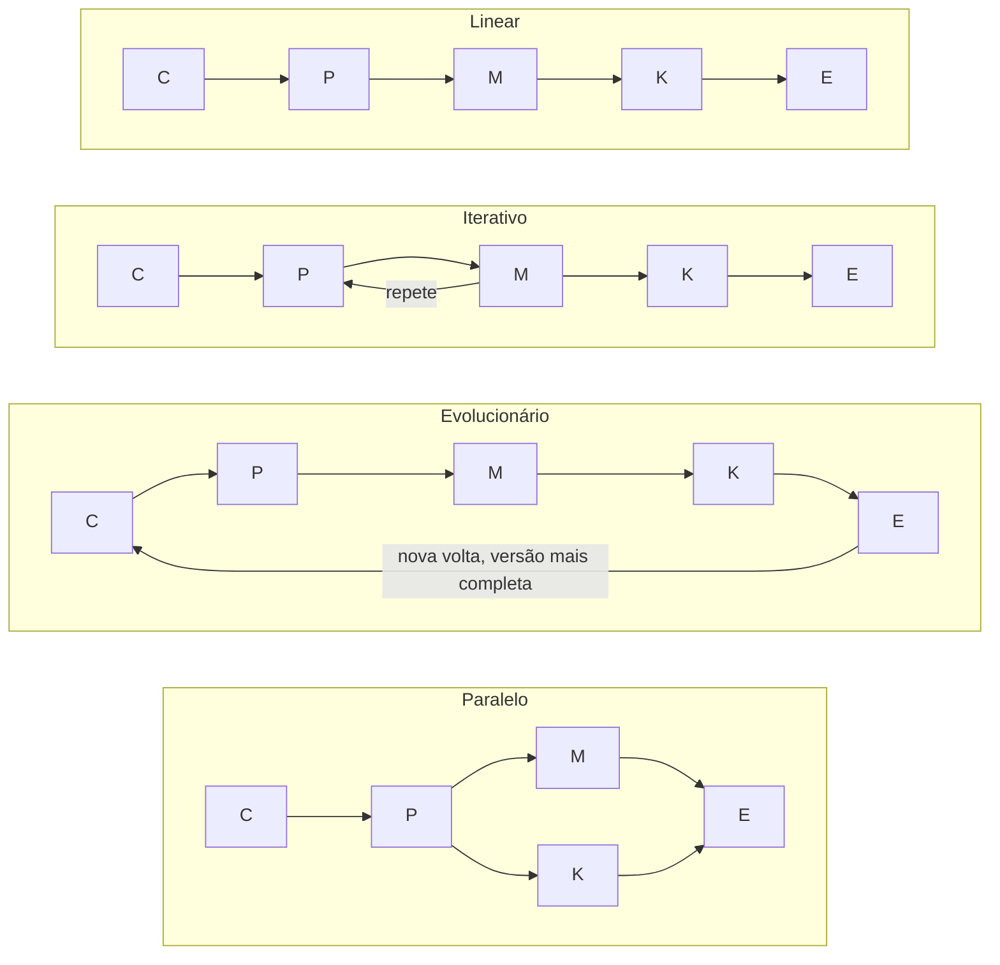
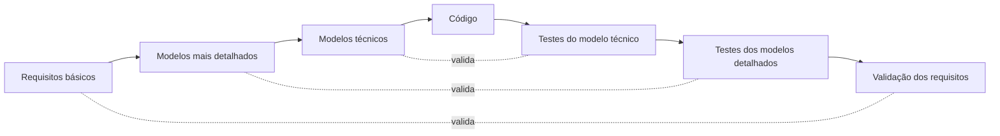
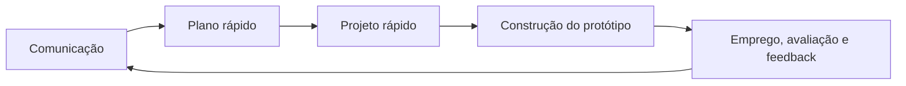

# Aula 02: Modelos de Processo

Um processo de software é o roteiro que a equipe segue para entregar com qualidade e no prazo. Esta aula compara os principais modelos: os prescritivos (tradicionais), os especializados e o Processo Unificado.

Tipo: canvas · Material do professor: [slides](https://github.com/Herysson/Engenharia-de-Software/blob/main/Aula%2002%20-%20Modelos%20de%20Processo.pdf) · [lista de exercícios II](https://github.com/Herysson/Engenharia-de-Software/blob/main/Exerc%C3%ADcios/Processo%20de%20Software%20.pdf)

## Tópicos

- O que é um processo de software, quem o realiza e por que ele importa
- Modelo genérico e os quatro fluxos de processo
- Modelos prescritivos: cascata, V, incremental, prototipação, espiral e concorrente
- Modelos especializados: baseado em componentes, métodos formais e orientado a aspectos
- Processo Unificado

---

## Processo de software em seis perguntas

| Pergunta | Resposta dos slides |
|---|---|
| O que é? | uma série de passos previsíveis, um roteiro para um resultado de qualidade e no prazo |
| Quem realiza? | os engenheiros de software e seus gerentes, que adaptam o processo e o seguem. Os solicitantes participam da definição, construção e teste |
| Por que é importante? | dá estabilidade, controle e organização a uma atividade que pode virar caos. Mas deve ser "ágil": só as atividades, controles e produtos que fazem sentido para a equipe e o produto |
| Quais são as etapas? | dependem do software: o processo para o sistema aviônico de um avião é diferente do processo para um site |
| Qual é o artefato? | os programas, documentos e dados produzidos pelas atividades e tarefas do processo |
| Como saber se deu certo? | existem avaliações de maturidade do processo, mas os melhores indicadores são a qualidade, os prazos cumpridos e a viabilidade do produto no longo prazo |

## Modelo genérico e fluxos de processo

As mesmas cinco atividades da [aula 01](../aula01) (comunicação, planejamento, modelagem, construção, entrega), organizadas de quatro jeitos:

C = comunicação · P = planejamento · M = modelagem · K = construção · E = entrega

| Fluxo | Como funciona |
|---|---|
| Linear | as cinco atividades em sequência, da comunicação ao emprego |
| Iterativo | repete uma ou mais atividades antes de seguir para a próxima |
| Evolucionário | percorre as atividades em círculo, e cada volta gera uma versão mais completa do software |
| Paralelo | executa atividades ao mesmo tempo, como modelar uma parte enquanto outra já está em construção |

---

## Modelos prescritivos (tradicionais)

| Modelo | Ideia central | Problemas citados |
|---|---|---|
| **Cascata** (ciclo de vida clássico) | sequencial e sistemático: levantamento de necessidades → planejamento → modelagem → construção → emprego → suporte | projetos reais raramente são sequenciais, e as mudanças causam confusão · o cliente tem dificuldade de dizer tudo o que precisa logo no início · a versão operacional só sai perto do fim, e um erro grave descoberto tarde pode ser desastroso |
| **V** | variação do cascata que liga cada etapa de modelagem a uma ação de garantia da qualidade (teste) | — |
| **Incremental** | combina fluxo linear e paralelo: várias sequências lineares escalonadas no tempo, e cada uma entrega um incremento do software | — |
| **Prototipação** (evolucionário) | comunicação → plano rápido → projeto rápido do que o usuário vê (telas, layout) → protótipo → avaliação e feedback → requisitos melhores | os interessados acham que o protótipo já é o produto e pedem "umas poucas correções" · o engenheiro aceita escolhas ruins (linguagem, algoritmo) para o protótipo rodar logo, e elas ficam |
| **Espiral** (evolucionário, Barry Boehm) | junta a iteração da prototipação com o controle do cascata, guiado por **riscos** | é difícil convencer o cliente de que a evolução é controlável · exige muita experiência em análise de riscos · um risco importante não descoberto gera problemas |
| **Concorrente** (engenharia concorrente) | todas as atividades existem ao mesmo tempo, cada uma num estado diferente | — |

### Modelo V

- **Lado esquerdo, descendo**: os requisitos são refinados em representações cada vez mais detalhadas e técnicas.
- **Lado direito, subindo**: depois do código, uma série de testes valida cada modelo criado na descida.

### Prototipação: o ciclo

- O protótipo serve para **descobrir os requisitos** quando eles estão obscuros.
- Pode ser usado como modelo isolado, mas é mais comum como **técnica** dentro de qualquer outro modelo.

### Evolucionário × incremental

| | Incremental | Evolucionário (prototipação, espiral) |
|---|---|---|
| Base | sequências lineares escalonadas no tempo | iterações |
| O que entrega | incrementos do software, prontos para uso | versões cada vez mais completas |
| Fluxos combinados | linear + paralelo | evolucionário (circular) |

---

## Modelos especializados

Usam características dos modelos tradicionais, mas para uma abordagem específica ou definida de forma restrita.

| Modelo | Em uma linha | Destaque |
|---|---|---|
| Baseado em componentes | evolucionário e iterativo, como o espiral, mas monta a aplicação a partir de componentes prontos | reúso: menos tempo de ciclo e menos custo, se o reúso virar cultura |
| Métodos formais | especificação matemática formal do software | permite especificar, desenvolver e verificar com notação matemática rigorosa |
| Orientado a aspectos (AOSD / AOP) | define, especifica, projeta e constrói **aspectos** | trata as **restrições cruzadas**, que atravessam várias funções, recursos e informações do sistema |

## Processo Unificado

Tenta juntar os melhores recursos dos modelos tradicionais com muitos dos melhores princípios do desenvolvimento ágil. É detalhado na [aula 04 (RUP)](../aula04).

## Para lembrar

- Não existe um processo único: ele depende do software a ser feito.
- Cascata é sequencial e sofre com mudanças e com requisitos incertos. O V acrescenta a ligação de cada etapa com um teste.
- Incremental entrega pedaços prontos. Evolucionário entrega versões cada vez mais completas.
- Prototipação serve para descobrir requisitos. Espiral é guiado por riscos.
- Os especializados focam em algo específico: componentes, matemática formal ou aspectos.

## Pontos em aberto

- O sumário chama o tópico de "Modelos de Processo Especificado", mas os slides do conteúdo dizem "Especializados". Aqui foi usado "especializados".
- No modelo genérico a quinta atividade aparece como "entrega", e no fluxo linear como "emprego". São a mesma atividade.
- Os slides do cascata, V, incremental, espiral, concorrente e Processo Unificado têm figuras que o texto não descreve, e alguns (incremental, espiral, concorrente) não têm "Problemas" listados. Os nomes das etapas do diagrama do modelo V foram escritos a partir do texto, e não da figura.
- A lista de exercícios II é discursiva e não tem respostas aqui.
