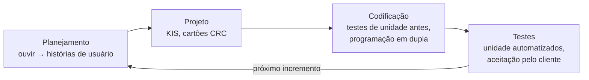
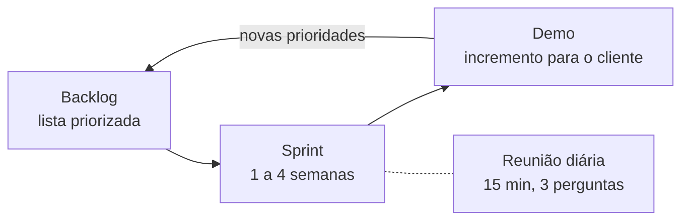
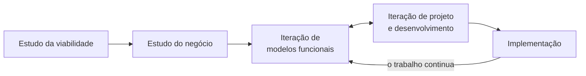
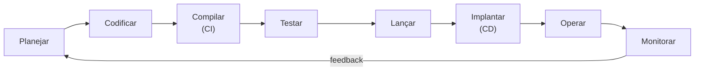
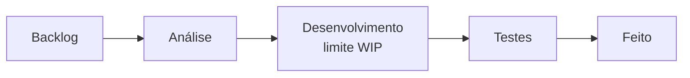

# Aula 03: Desenvolvimento Ágil

Agilidade é responder bem a mudanças. Esta aula mostra a filosofia ágil, os 12 princípios e os principais métodos: XP, Scrum, DSDM, FDD, DevOps e Kanban.

Tipo: canvas · Material do professor: [slides](https://github.com/Herysson/Engenharia-de-Software/blob/main/Aula%2003%20-%20Desenvolvimento%20%C3%81gil.pdf)

## Tópicos

- O que é desenvolvimento ágil, agilidade e o custo das mudanças
- Processo ágil e os 12 princípios da agilidade
- XP: planejamento, projeto, codificação e testes
- Scrum: backlog, sprint, reunião diária e demo
- DSDM, FDD, DevOps e Kanban

---

## O que é

A engenharia de software ágil junta uma **filosofia** com um conjunto de **princípios de desenvolvimento**.

| Filosofia | Princípios de desenvolvimento |
|---|---|
| satisfação do cliente e entregas incrementais desde cedo | priorizam a **entrega** mais que a análise e o projeto (que não são desencorajados) |
| equipes pequenas e motivadas | comunicação ativa e contínua entre desenvolvedores e clientes |
| métodos informais e artefatos mínimos | |
| acima de tudo, **simplicidade** | |

| Pergunta | Resposta dos slides |
|---|---|
| Quem realiza? | engenheiros, gerentes, clientes e usuários juntos numa **equipe auto-organizada**, que controla o próprio destino |
| Por que é importante? | o ambiente muda o tempo todo, e o ágil é uma alternativa razoável à engenharia convencional para certos tipos de software e projeto |
| Quais são as etapas? | as mesmas cinco atividades (comunicação, planejamento, modelagem, construção, emprego), reduzidas a um conjunto mínimo de tarefas. Daí o nome "engenharia de software flexível" |
| Qual é o artefato? | o único que realmente importa: um **incremento de software operacional** entregue na data combinada |
| Como saber se deu certo? | se a equipe concorda que o processo funciona e entrega incrementos que satisfazem o cliente |

## Agilidade e mudança

- **Equipe ágil**: rápida e capaz de responder apropriadamente a mudanças (no software, na equipe, na tecnologia).
- Os métodos ágeis também são chamados de **métodos light** ou **enxutos** (*lean*).
- **Custo das mudanças**: pela sabedoria convencional, ele cresce de forma não linear conforme o projeto avança.
- **Processo ágil**: se adapta de forma incremental. Para isso precisa de feedback do cliente, e o melhor catalisador é um protótipo ou parte do sistema funcionando. Os incrementos saem em **períodos curtos**, para acompanhar o ritmo das mudanças.

## Os 12 princípios da agilidade

| # | Princípio |
|---|---|
| 1 | Satisfazer o cliente com entregas adiantadas e contínuas de software valioso |
| 2 | Acolher mudanças, mesmo tarde: elas viram vantagem competitiva para o cliente |
| 3 | Entregar software funcionando com frequência, de semanas a meses, preferindo intervalos curtos |
| 4 | Pessoal de negócio e desenvolvedores trabalhando juntos todos os dias |
| 5 | Projetos em torno de pessoas motivadas: dê ambiente e apoio e confie nelas |
| 6 | Conversa presencial é a forma mais eficiente de passar informação |
| 7 | Software funcionando é a principal medida de progresso |
| 8 | Desenvolvimento sustentável: um ritmo constante que dá para manter indefinidamente |
| 9 | Atenção contínua à excelência técnica e ao bom projeto aumenta a agilidade |
| 10 | Simplicidade: a arte de maximizar o trabalho **não** feito |
| 11 | As melhores arquiteturas, requisitos e projetos vêm de equipes auto-organizadas |
| 12 | A equipe reflete em intervalos regulares e ajusta o seu comportamento |

---

## Métodos ágeis lado a lado

| | XP | Scrum | DSDM | FDD | DevOps | Kanban |
|---|---|---|---|---|---|---|
| Origem | Kent Beck, 1996 (projeto C3 da Chrysler), livro em 1999 | Jeff Sutherland, início dos anos 1990; depois com Ken Schwaber | — | Peter Coad e colegas, 1997–1999 (banco em Cingapura), livro em 1999 | Patrick Debois, 2007–2009 | Toyota, anos 1940 (manufatura); livro de David J. Anderson em 2010 para software |
| Ideia central | boas práticas levadas ao extremo, com testes antes do código | trabalho em sprints curtos guiados por um backlog priorizado | prototipagem incremental para prazos apertados, regra dos 80% | decompor o sistema em funcionalidades pequenas, de até duas semanas | levar o ágil e o enxuto a toda a cadeia, do código à operação | visualizar o fluxo de trabalho num quadro e limitar o trabalho em progresso |
| Unidade de entrega | incremento com as histórias da versão | incremento demonstrado na demo | incremento que pode não estar 100% completo | uma funcionalidade a cada duas semanas | nova versão implantada de forma contínua | cartão que chega à coluna "Feito" |

### XP (Extreme Programming)

Usa orientação a objetos e quatro atividades:

| Atividade | Destaques |
|---|---|
| Planejamento (jogo do planejamento) | começa por **ouvir** o negócio, o que gera as **histórias de usuário** |
| Projeto | segue o princípio **KIS** (*keep it simple*): só o necessário para a história atual, nada de funcionalidade "para o futuro". Quase sem notação: só **cartões CRC** (*Class Responsibilities and Collaborators*) e soluções pontuais. O projeto é transitório e muda com a construção |
| Codificação | primeiro se escrevem os **testes de unidade** de cada história, depois o código que passa neles. **Programação em dupla**: resolve problemas e revisa o código em tempo real |
| Testes | testes de unidade **automatizados**, fáceis de repetir. **Testes de aceitação** (de cliente) especificados pelo cliente, focados no que ele vê |

### Scrum

O nome vem da formação do rugby, em que o time avança junto com a bola. Atividades estruturais: requisitos, análise, projeto, evolução e entrega, todas organizadas em **sprints**. É indicado para prazos apertados, requisitos que mudam e negócio crítico.

| Padrão | O que é |
|---|---|
| Backlog | lista priorizada de requisitos que dão valor ao cliente. Itens entram a qualquer momento (é assim que as mudanças chegam), e o gerente de produto reavalia as prioridades |
| Sprint | unidade de trabalho para cumprir itens do backlog numa janela de tempo fechada, de 1 a 4 semanas |
| Reunião Scrum | diária, uns 15 minutos, conduzida pelo **Scrum master**. Cada um responde: o que fez desde a última reunião? Que obstáculos encontrou? O que vai fazer até a próxima? Revela problemas cedo e espalha o conhecimento |
| Demo | entrega do incremento ao cliente, que avalia. Pode não ter tudo o que foi planejado, só o que coube no prazo |

### DSDM (Dynamic Systems Development Method)

- Para **prazos apertados**, com prototipagem incremental num ambiente controlado.
- Filosofia: uma versão do **princípio de Pareto**. 80% da aplicação sai em 20% do tempo que levaria a aplicação completa.
- Cada iteração faz só o trabalho suficiente para passar ao próximo incremento.

| Etapa | O que faz |
|---|---|
| Estudo da viabilidade | requisitos básicos e restrições; a aplicação serve para o DSDM? |
| Estudo do negócio | requisitos funcionais e de informação, arquitetura básica e requisitos de manutenção |
| Iteração de modelos funcionais | protótipos incrementais para o cliente, que geram mais requisitos com o feedback |
| Iteração de projeto e desenvolvimento | revisa os protótipos para que deem valor real em operação. Pode acontecer junto com a anterior |
| Implementação | coloca o incremento em operação. Ele pode não estar completo e pode receber pedidos de mudança. Depois volta para os modelos funcionais |

### FDD (Feature Driven Development)

- **Funcionalidade**: uma função valorizada pelo cliente que pode ser implementada em **duas semanas ou menos**.
- Filosofia: colaboração na equipe, decomposição por funcionalidades seguida da integração dos incrementos, comunicação verbal, gráfica e por texto.

| Modelo | Formato | Exemplo dos slides |
|---|---|---|
| Funcionalidade | `<ação> o <resultado> <por / para quem / de / para que> um <objeto>` | "Adicione o produto ao carrinho", "Mostre as especificações técnicas do produto" |
| Conjunto de funcionalidades | `<ação> um <objeto>` | "Fazer a venda de um produto" |

Um **objeto** é "uma pessoa, local ou coisa", incluindo papéis, momentos e intervalos de tempo.

Benefícios: blocos pequenos são mais fáceis de descrever, relacionar e revisar · podem ser agrupados numa hierarquia de negócio · a equipe entrega funcionalidades operacionais a cada duas semanas · o código pequeno é mais fácil de inspecionar · o planejamento segue a hierarquia de funcionalidades, e não tarefas arbitrárias.

### DevOps

Combina **Dev**elopment e **Op**erations num ciclo contínuo:

| Fase | Em uma linha |
|---|---|
| Planejar | objetivos, requisitos e funcionalidades, de forma colaborativa |
| Codificar | escrever o código com controle de versão (Git) |
| Compilar | gerar o *build* automaticamente a cada alteração (**Integração Contínua**) |
| Testar | testes automatizados (unidade, integração, desempenho) para achar falhas cedo |
| Lançar | preparar e versionar o artefato para produção |
| Implantar | instalar em produção com **Entrega** ou **Implantação Contínua** |
| Operar | manter a aplicação estável, por exemplo com Infraestrutura como Código |
| Monitorar | coletar desempenho, uso e erros, alimentando o próximo planejamento |

### Kanban

Técnica **visual** para gerenciar o fluxo de trabalho.

| Elemento | O que é |
|---|---|
| Backlog | tarefas que ainda não foram escolhidas para execução |
| Fluxo (*workflow*) | colunas com os estágios; os cartões andam da esquerda para a direita |
| Limite WIP | máximo de tarefas em progresso em cada estágio, para evitar sobrecarga |
| Faixa urgente | área para o que precisa de atenção imediata |
| Cartões | cada tarefa é um cartão que se move pelas colunas |

| Benefícios | Desvantagens |
|---|---|
| visibilidade do progresso | foca no fluxo, não em prazos |
| mostra onde o trabalho acumula (gargalos) | depende da autodisciplina da equipe |
| prioridades fáceis de destacar | não dá visão ampla do planejamento futuro |
| limitar o WIP aumenta a eficiência | |

## Para lembrar

- Ágil não abandona as cinco atividades: reduz as tarefas ao mínimo e entrega incrementos curtos.
- O artefato que importa é o incremento de software funcionando.
- XP: testes antes do código, programação em dupla e KIS. Scrum: backlog, sprint, reunião diária e demo.
- DSDM: regra dos 80%. FDD: funcionalidades de até duas semanas.
- DevOps leva o ágil até a operação. Kanban visualiza o fluxo e limita o WIP.

## Pontos em aberto

- O slide "Exercício" pede para desenvolver "os exercícios da lista", mas não diz qual lista. Nenhuma lista de exercícios do repositório trata de métodos ágeis.
- A lista de modelos ágeis no início cita XP, Scrum, DSDM e FDD; DevOps e Kanban aparecem só depois, numa seção própria.
- O texto dos slides de DevOps descreve "Compilar" antes de "Codificar". Aqui a ordem foi ajustada para a do próprio texto, que diz que o código escrito é que é compilado.
- Os slides têm figuras que o texto não descreve (curva do custo das mudanças, manifesto ágil, ciclos do XP, Scrum, DSDM, FDD e DevOps). Os diagramas daqui foram montados a partir do texto.
