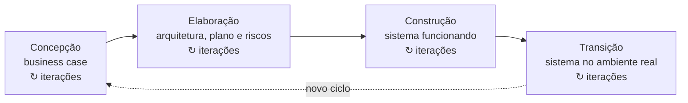

# Aula 04: Rational Unified Process (RUP)

O RUP é um processo híbrido: junta elementos do cascata e do incremental, apoia a prototipação e a entrega incremental, e é descrito em três perspectivas (dinâmica, estática e prática).

Tipo: canvas · Material do professor: [slides](https://github.com/Herysson/Engenharia-de-Software/blob/main/Aula%2004%20-%20Rational%20Unified%20Process%20%28RUP%29.pptx) · [lista de exercícios II](https://github.com/Herysson/Engenharia-de-Software/blob/main/Exerc%C3%ADcios/Processo%20de%20Software%20.pdf)

## Tópicos

- Revisão: processo de software e as atividades fundamentais
- O que é o RUP e de onde ele vem
- As três perspectivas: dinâmica (fases), estática (workflows) e prática (boas práticas)
- As quatro fases: concepção, elaboração, construção e transição
- As seis boas práticas

---

## Revisão

- **Processo de software**: as atividades envolvidas na produção de um sistema. Um **modelo de processo** é uma representação abstrata delas (cascata, incremental, orientado a reúso).
- Além das cinco atividades da [aula 01](../aula01), os slides usam quatro conceitos:

| Atividade | O que é |
|---|---|
| Engenharia de requisitos | desenvolver a especificação, que comunica as necessidades do cliente aos desenvolvedores |
| Projeto e implementação | transformar a especificação num sistema executável |
| Validação | verificar se o sistema segue a especificação e atende às necessidades reais dos usuários |
| Evolução | alterar o sistema para novos requisitos. As mudanças são contínuas, e o software precisa evoluir para continuar útil |

Os processos precisam lidar com mudanças: uma fase de prototipação evita más decisões sobre requisitos e projeto, e a entrega iterativa permite mudar partes sem afetar o sistema todo.

## O que é o RUP

- **Rational Unified Process** (Processo Unificado da Rational), derivado dos trabalhos sobre a **UML** e o *Unified Software Development Process*.
- Processo **proprietário**, criado pela Rational Software Corporation. Depois que a IBM comprou a Rational, ganhou o nome IRUP, mas o nome mais conhecido continua sendo RUP.
- Usa **orientação a objetos** e é documentado com a notação **UML**.
- É **híbrido**: reúne elementos dos modelos genéricos (cascata, incremental), boas práticas de especificação e projeto, e apoia prototipação e entrega incremental.
- Trabalha com **ciclos curtos**: cada ciclo é uma iteração e gera um incremento. *Iteração* são os passos; *incremento* é a evolução do produto.

## Três perspectivas

Os modelos convencionais têm uma visão única do processo. O RUP tem três:

| Perspectiva | Mostra |
|---|---|
| Dinâmica | as **fases** do modelo ao longo do tempo |
| Estática | as **atividades** (workflows) realizadas no processo |
| Prática | as **boas práticas** a usar durante o processo |

---

## Perspectiva dinâmica: as quatro fases

| Fase | Objetivo | Ao final, você deve ter |
|---|---|---|
| **Concepção** | estabelecer o *business case*: identificar as entidades externas (pessoas e sistemas) que interagem com o sistema e avaliar a contribuição para o negócio | uma decisão: se a contribuição for pequena, o projeto pode ser cancelado aqui |
| **Elaboração** | entender o problema, montar o framework da arquitetura, fazer o plano do projeto e identificar os maiores riscos | um modelo de requisitos (por exemplo, casos de uso da UML), a descrição da arquitetura e o plano de desenvolvimento |
| **Construção** | projetar, programar e testar. As partes são desenvolvidas em paralelo e integradas | software funcionando e a documentação pronta para os usuários |
| **Transição** | levar o sistema da equipe de desenvolvimento para os usuários, no ambiente real. É cara, às vezes problemática, e a maioria dos modelos ignora | software documentado e funcionando no ambiente operacional |

**Iteração no RUP**, de dois jeitos:
- cada fase pode ser executada de forma iterativa, com resultados incrementais
- o conjunto das quatro fases também pode ser repetido de forma incremental

## Perspectiva estática: workflows

- As atividades do processo são chamadas de **workflows**: **seis centrais** e **três de apoio**.
- A descrição dos workflows gira em torno de modelos da UML (modelos de sequência, de objetos etc.), porque o RUP foi projetado junto com a UML.

### Estática × dinâmica

| | Fases (dinâmica) | Workflows (estática) |
|---|---|---|
| Natureza | dinâmicas, com metas | estáticos, são atividades técnicas |
| Ligação com o tempo | acontecem em sequência | não ficam presos a uma fase: em princípio, todos podem estar ativos em todas as fases |
| Onde está o esforço | — | no começo, mais em modelagem de negócio e requisitos; no fim, mais em teste e implantação |

A vantagem de separar as duas visões é justamente essa: as fases não ficam amarradas a workflows específicos.

## Perspectiva prática: seis boas práticas

| # | Prática | O que fazer |
|---|---|---|
| 1 | Desenvolver iterativamente | planejar os incrementos pelas prioridades do cliente e fazer primeiro o que tem prioridade alta |
| 2 | Gerenciar os requisitos | documentar os requisitos, acompanhar as mudanças e analisar o impacto antes de aceitar uma mudança |
| 3 | Usar arquiteturas baseadas em componentes | estruturar a arquitetura em componentes |
| 4 | Modelar visualmente | usar modelos gráficos da UML para as visões estáticas e dinâmicas |
| 5 | Verificar a qualidade | garantir que o software atende aos padrões de qualidade da organização |
| 6 | Controlar as mudanças | gerenciar mudanças com um sistema de gerenciamento de mudanças e ferramentas de gerenciamento de configuração |

## Conclusão dos slides

- O RUP **não serve para todo tipo de desenvolvimento**, por exemplo software embutido.
- Suas inovações mais importantes:
  - a **separação entre fases e workflows**
  - reconhecer que a **implantação no ambiente do usuário** faz parte do processo

## Para lembrar

- RUP = processo híbrido, iterativo e incremental, orientado a objetos e documentado em UML.
- Três perspectivas: dinâmica (fases), estática (workflows), prática (boas práticas).
- Quatro fases: concepção (vale a pena?), elaboração (arquitetura e riscos), construção (sistema funcionando), transição (no ambiente real).
- Fases têm metas e seguem o tempo; workflows são atividades técnicas que podem acontecer em qualquer fase.

## Pontos em aberto

- Os slides dizem que existem seis workflows centrais e três de apoio, mas os nomes deles estão só na figura. O texto cita apenas modelagem de negócio, requisitos, teste e implantação como exemplos.
- As figuras das fases, da visão estática e do gráfico estática × dinâmica não são descritas no texto. O diagrama das fases foi montado a partir do texto.
- O slide "Exercícios" pede a "lista de exercícios 2", que é a lista de processos de software (a mesma da aula 02). Ela é discursiva e não tem respostas aqui.
