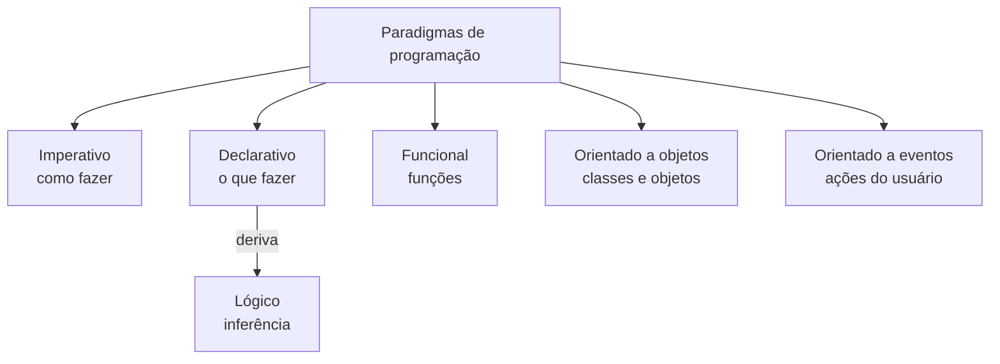

# Aula 05: Paradigmas de Programação

Um paradigma é a forma de estruturar a solução de um problema. Esta aula compara os seis principais: imperativo, declarativo, funcional, lógico, orientado a objetos e orientado a eventos.

Tipo: canvas · Material do professor: [slides](https://github.com/Herysson/Engenharia-de-Software/blob/main/Aula%2005%20-%20Paradigmas%20de%20Programa%C3%A7%C3%A3o.pptx)

## Tópicos

- Linguagem de programação
- O que é um paradigma e por que aprender sobre eles
- Os seis paradigmas: o que são, quando usar e exemplos de linguagens

---

## Linguagem de programação

- **Linguagem**: qualquer meio sistemático de comunicar ideias por signos convencionais (sons, gráficos, gestos).
- **Programação**: escrever código que o computador entende, para que ele faça o que foi pedido.
- **Linguagem de programação**: um conjunto padronizado de regras **sintáticas** e **semânticas** para escrever código fonte, que é compilado num programa ou interpretado como script.

## O que é um paradigma

É o tipo de estruturação que a solução vai seguir. O que define o paradigma é **como o problema é tratado**.

> **Exemplo dos slides**: levar um piano do primeiro para o terceiro andar. Dá para carregar na mão, subir com um carrinho ou içar pelo lado de fora com um motor. Todos chegam ao mesmo resultado, mas a melhor escolha depende de custo, pessoas disponíveis, tamanho do piano e estrutura do prédio.

**Por que aprender**:
- cada paradigma nasceu de uma necessidade e tem vantagens para certos tipos de sistema
- o paradigma certo dá **produtividade**, código **uniforme** na equipe, mais **legível** e fácil de **manter**
- escolher o paradigma é pensar na **modelagem** da solução antes da solução
- o paradigma escolhido deve ser mantido durante todo o trabalho

---

## Os seis paradigmas

| Paradigma | Ideia central | Quando usar | Linguagens citadas |
|---|---|---|---|
| **Imperativo** (procedural) | passo a passo na ordem de execução. Foco no **como** | programas estáticos (sem grandes mudanças), operações complexas em que os estados precisam ficar explícitos, poucos elementos compartilhados | Cobol, Fortran, Pascal |
| **Declarativo** | descreve **o que** se quer e o resultado esperado, não como computar. Parte de verdades lógicas imutáveis: as mesmas declarações dão sempre o mesmo resultado | — | HTML, XML, XSLT, XAML (de marcação) |
| **Funcional** | divide o problema em blocos resolvidos por **funções**, que definem variáveis no seu escopo e retornam um resultado | soluções com forte base **matemática** | LISP, Scheme, JavaScript, Haskell |
| **Lógico** | deriva do declarativo. Usa lógica simbólica como entrada e saída e faz **inferências**, como numa prova de teorema: premissas verdadeiras levam a uma conclusão verdadeira | inteligência artificial, sistemas especialistas, prova de teoremas | QLISP, Mercury, Prolog (o mais popular) |
| **Orientado a objetos** | retrata a programação como se vê o mundo real, com **classes** e **objetos**. Estados = atributos; comportamentos = métodos | produzir programas mais rápido, com mais confiabilidade e menor custo | Java, C++, C#, Python |
| **Orientado a eventos** | o programa executa conforme o **usuário dispara eventos**, e eventos podem disparar outros eventos | aplicações gráficas: jogos e formulários | — (toda linguagem com recursos gráficos) |

### Imperativo × declarativo

| | Imperativo | Declarativo |
|---|---|---|
| Foco | **como** fazer | **o que** fazer |
| Abstração | menor | maior |
| Resultado | o mesmo trecho de código pode retornar resultados diferentes | as mesmas declarações dão sempre o mesmo resultado |
| Depende de | experiência e criatividade de quem programa | descrever a lógica e o resultado esperado |

### Destaques de cada um

| Paradigma | Vantagens | Cuidados |
|---|---|---|
| Imperativo | eficiente, modela como o mundo real, bem estabelecido e flexível | código de difícil leitura |
| Funcional | alocação de memória automática, sem "efeitos colaterais" nos cálculos. A recursão pode ser mais eficiente que os laços do imperativo | quem programa precisa integrar as funções no final |
| Orientado a objetos | os **três alicerces**: herança, polimorfismo e encapsulamento. Popularizado nos anos 90 pelo Java, com programação multiplataforma | a linguagem só é OO se implementar os três alicerces |
| Orientado a eventos | quem usa decide quando o programa executa | — |

> **Exemplo de eventos**: num formulário, o código roda conforme o usuário preenche os campos e de novo quando clica em "Enviar".

## Para lembrar

- Paradigma é a forma de pensar a solução, e o melhor depende do problema, como no exemplo do piano.
- Imperativo = como; declarativo = o quê. O lógico deriva do declarativo.
- Funcional: funções e base matemática. OO: classes, objetos e os três alicerces (herança, polimorfismo, encapsulamento).
- Eventos: o usuário dispara a execução.
- Uma mesma linguagem pode usar mais de um paradigma.

## Pontos em aberto

- Os slides não dão um caso de uso específico para o paradigma declarativo, nem exemplos de linguagens para o orientado a eventos. As células ficaram com "—".
- Os slides têm figuras (12 no total) que o texto não descreve.
- A aula não tem lista de exercícios.
