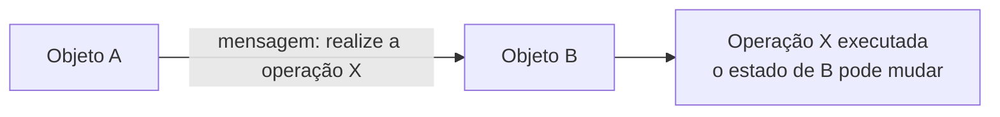
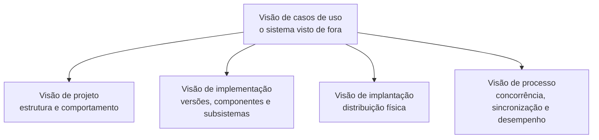

# Aula 06: Visão Geral do Sistema

Por que modelar, os conceitos básicos da orientação a objetos e como a UML descreve um sistema em cinco visões. É a base para os diagramas das próximas aulas.

Tipo: canvas · Material do professor: [slides](https://github.com/Herysson/Engenharia-de-Software/blob/main/Aula%2006%20-%20Vis%C3%A3o%20Geral.pptx) · [lista de exercícios "Visão do Sistema"](https://github.com/Herysson/Engenharia-de-Software/blob/main/Exerc%C3%ADcios/LE%20-%20%20Vis%C3%A3o%20do%20Sistema.docx)

## Tópicos

- Modelagem de sistemas e as razões para usar modelos
- O paradigma da orientação a objetos e os princípios de Alan Kay
- Classe, objeto, operação, mensagem e estado
- Abstração: encapsulamento, polimorfismo, generalização e composição
- UML, as cinco visões de um sistema e os artefatos

---

## Por que modelar

Software fica mais complexo conforme cresce, e sistemas complexos pedem um planejamento inicial: um **modelo**.

| Razão | Em uma linha |
|---|---|
| Gerenciar a complexidade | o ser humano tem limites para lidar com complexidade. Um sistema pode ter vários modelos, cada um com uma perspectiva (como um avião tem um modelo da parte elétrica e outro da aerodinâmica) |
| Comunicação entre as pessoas | grande parte da informação sobre o sistema está nos modelos |
| Reduzir custos | pessoas erram, sozinhas ou na comunicação, e o modelo ajuda a pegar esses erros |
| Prever o comportamento | o modelo é um "laboratório" para testar soluções antes de construir |

---

## Orientação a objetos

O **paradigma da orientação a objetos** é uma forma de abordar um problema: o sistema é uma coleção de **objetos** que colaboram. Cada objeto cuida de tarefas específicas e, quando precisa, pede serviços a outros. É pela interação entre eles que a computação acontece.

**Analogia biológica de Alan Kay**: o software funciona como um ser vivo, em que cada "célula" é autônoma e troca mensagens com as outras para atingir um objetivo comum.

Princípios de Alan Kay:
1. Qualquer coisa é um objeto.
2. Objetos realizam tarefas requisitando serviços a outros objetos.
3. Cada objeto pertence a uma classe, que agrupa objetos similares.
4. A classe é o repositório do comportamento do objeto.
5. Classes são organizadas em hierarquias.

### Conceitos básicos

| Conceito | O que é |
|---|---|
| Classe | "um molde a partir do qual objetos são construídos" |
| Objeto | uma instância construída a partir da classe |
| Operação | uma ação que o objeto sabe realizar quando solicitado |
| Mensagem | o estímulo enviado a um objeto pedindo que ele realize uma operação. Objetos "trocam mensagens" para fazer uma tarefa juntos |
| Estado | o conjunto de valores dos atributos do objeto num dado momento. Uma mensagem pode mudar o estado |

### Abstração e seus mecanismos

**Abstração** é o processo mental de focar no que é relevante e ignorar o resto. A orientação a objetos usa quatro formas:

| Mecanismo | O que é | Pista dos slides |
|---|---|---|
| Encapsulamento | restringe o acesso ao comportamento interno de um objeto | privacidade |
| Polimorfismo | classes derivadas da mesma superclasse têm métodos com a **mesma assinatura** e **comportamentos diferentes** | `@override` |
| Generalização (herança) | as características e o comportamento comuns a vários objetos são abstraídos numa classe | `@override` |
| Composição | objetos formados por outros objetos | um livro tem páginas, que têm parágrafos, que têm frases |

---

## UML

- **Unified Modeling Language** (Linguagem de Modelagem Unificada).
- Principais autores: Grady Booch, James Rumbaugh e Ivar Jacobson, os **"três amigos"**. Juntaram o melhor das notações que já tinham criado: Booch Method, OMT e OOSE.
- Aprovada como padrão pelo **OMG** (*Object Management Group*) em 1997. A versão citada nos slides é a 2.5 (OMG, 2013).

### As cinco visões de um sistema

Um sistema complexo precisa ser estudado por várias perspectivas. Os autores da UML sugerem cinco visões **interdependentes**:

| Visão | O que descreve |
|---|---|
| Casos de uso | o sistema de um ponto de vista **externo**: as interações com os agentes externos. É criada cedo e **direciona** as outras visões |
| Projeto | as características estruturais e comportamentais que sustentam as funcionalidades visíveis |
| Implementação | o gerenciamento de versões, montadas a partir de módulos (componentes) e subsistemas |
| Implantação | a distribuição física do sistema em subsistemas e a conexão entre eles |
| Processo | concorrência (paralelismo), sincronização e desempenho |

### Artefatos e diagramas

- Um processo com UML gera vários documentos, textuais ou gráficos. Na UML eles se chamam **artefatos de software**, e são eles que compõem as visões.
- Os artefatos **gráficos** de um sistema orientado a objetos são feitos com os **diagramas da UML**. A UML 2.0 tem **13 diagramas**.

## Para lembrar

- Modelos servem para gerenciar a complexidade, comunicar, reduzir custos e prever o comportamento.
- Sistema OO = objetos que colaboram trocando mensagens. A classe é o molde, o objeto é a instância.
- Estado = valores dos atributos agora. Uma mensagem pode mudá-lo.
- Abstração: encapsulamento, polimorfismo, generalização e composição.
- UML: os três amigos, padrão OMG, cinco visões, e a de casos de uso direciona as outras.

## Pontos em aberto

- Os nomes dos 13 diagramas da UML 2.0 estão só na figura do slide. Vários deles são assunto das próximas aulas: atividades e estados (aula 08), casos de uso (aula 09), classes (aulas 10 e 11), sequência (aula 13) e objetos (aula 14).
- Os slides de classe e objeto, abstração e das visões têm figuras que o texto não descreve. O diagrama das visões foi montado a partir do texto.
- A lista "Visão do Sistema" é reflexiva (algumas questões pedem conversar com profissionais ou escrever documentos de requisitos) e não tem respostas aqui.
