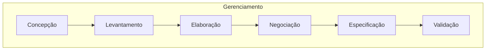
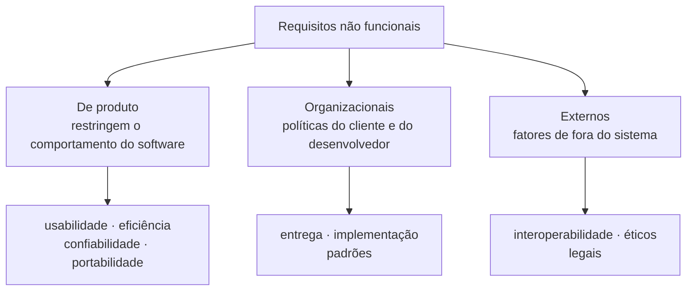

# Aula 07: Engenharia de Requisitos

Requisitos dizem o que o sistema deve fazer e sob quais restrições. Esta aula mostra quem são os stakeholders, as tarefas da engenharia de requisitos e a diferença entre requisitos funcionais e não funcionais.

Tipo: exercícios e exemplos · Exercícios com solução em [exercicios.md](exercicios.md)

Material do professor: [slides](https://github.com/Herysson/Engenharia-de-Software/blob/main/Aula%2007%20-%20Engenharia%20de%20requisitos.pdf) · [lista de exercícios](https://github.com/Herysson/Engenharia-de-Software/blob/main/Exerc%C3%ADcios/Requisitos%20-%20Lista%20de%20Exerc%C3%ADcios.pdf) · [modelo de documento de requisitos](https://github.com/Herysson/Engenharia-de-Software/blob/main/Exerc%C3%ADcios/Doc.%20Analise%20de%20Requisito%20de%20Software.docx) · [trabalho de elicitação](https://github.com/Herysson/Engenharia-de-Software/blob/main/Exerc%C3%ADcios/Elicita%C3%A7%C3%A3o%20de%20Requisitos.md)

## Tópicos

- O que são requisitos e o que é engenharia de requisitos
- Stakeholders e domínio de negócio
- As sete tarefas da engenharia de requisitos
- Problemas clássicos e as atividades do levantamento
- Requisitos funcionais × não funcionais e a classificação dos não funcionais
- Técnicas de levantamento
- Exemplos resolvidos: classificar requisitos e escrever bons requisitos

---

## Requisitos e engenharia de requisitos

Duas definições dos slides:
- "as descrições do que o sistema deve fazer, os serviços que oferece e as restrições a seu funcionamento"
- "condição ou capacidade que um sistema deve alcançar ou possuir para satisfazer um contrato, padrão, especificação ou outro documento formalmente imposto"

Os requisitos refletem as necessidades do cliente para um sistema com uma finalidade (controlar um dispositivo, fazer um pedido, encontrar informações).

**Engenharia de requisitos** (RE, *requirements engineering*): o processo de **descobrir, analisar, documentar e verificar** esses serviços e restrições. Os requisitos vêm do **domínio de negócio**, e os **stakeholders** têm papel-chave para descobri-los.

## Stakeholders

Pessoas, grupos ou organizações que **influenciam ou são afetados** pelo produto, positiva ou negativamente, em qualquer fase.

| Tipo | Quem é |
|---|---|
| Internos | equipe e organização |
| Externos | clientes, usuários finais, fornecedores, órgãos reguladores |
| Diretos (primários) | usam, operam ou recebem o resultado |
| Indiretos (secundários) | sofrem impacto sem usar diretamente |
| Patrocinadores/decisores | têm poder sobre orçamento e prioridades |
| Reguladores/auditores | definem normas, conformidade e padrões |
| Opositores/afetados negativamente | podem perder poder ou rotina com a mudança |

| Sistema acadêmico (UFN) | Jogo single player |
|---|---|
| Patrocinador: coordenação/Pró-Reitoria | Product Owner/Produtor: visão e backlog |
| Usuários finais: docentes, discentes, secretaria | Jogadores: público-alvo |
| TI/DevOps: infraestrutura e integrações | Equipe de arte, áudio e engine |
| Jurídico/LGPD: privacidade e consentimento | Loja/plataforma: políticas de publicação |
| Financeiro: mensalidades e bolsas | Classificação indicativa: regulador |
| Pais/responsáveis: boletos e comunicados (indiretos) | Comunidade/streamers: influenciadores indiretos |

## Domínio de negócio

Também chamado de **domínio do problema** ou **da aplicação**: a área específica em que o software será usado, com seus conceitos e termos. É a parte do mundo real relevante para o software.

| Domínio | Conceitos típicos |
|---|---|
| Bancário | contas, transações, crédito, tarifas, compliance |
| Saúde | pacientes, atendimentos, exames, prescrições, prontuários |
| Educação | cursos, turmas, matrículas, avaliações, histórico |
| Varejo | produtos, preços, estoque, pedidos, pagamentos, devoluções |
| Help desk | tickets, SLAs, filas, priorização, base de conhecimento |

(Os slides também citam manufatura, RH, gestão de projetos, imobiliário e energia.)

---

## As sete tarefas da engenharia de requisitos

O gerenciamento envolve as outras seis porque acontece durante todo o projeto.

| Tarefa | O que faz |
|---|---|
| Concepção | entender o problema e o objetivo em alto nível: stakeholders, contexto, restrições e valor de negócio |
| Levantamento (elicitação) | descobrir requisitos com stakeholders e outras fontes: entrevistas, workshops, observação, documentos, protótipos |
| Elaboração (análise/modelagem) | organizar e detalhar: classificar (RF/RNF), modelar casos de uso, cenários, regras de negócio, prioridades e dependências |
| Negociação | resolver conflitos e priorizar por custo, prazo, risco e valor, ajustando o escopo |
| Especificação | registrar de forma clara, completa e verificável (SRS, histórias, critérios de aceitação, modelos) |
| Validação | checar se "capturamos o requisito certo": revisões, protótipos, testes de aceitação, consistência e ambiguidade |
| Gerenciamento | controlar mudanças, versionar, rastrear até projeto, código e testes, manter a *baseline* atualizada |

**Problemas clássicos do levantamento**: comunicação entre cliente e analista · evolução dos requisitos · gerenciamento de alterações · falta de conhecimento do domínio.

**O que se obtém**: um documento com todos os requisitos, muitas vezes em linguagem natural ou em casos de uso, para que pessoas não técnicas entendam.

| Atividade do levantamento | O que faz |
|---|---|
| Elicitação | conversar com os stakeholders para descobrir os requisitos |
| Análise | determinar o estado de cada requisito: inacabado, incompleto, ambíguo ou contraditório |
| Registro | documentar em linguagem natural, casos de uso ou outro processo de especificação |

---

## Funcionais × não funcionais

- **Requisito funcional (RF)**: o que o sistema **deve fazer**. Serviços, reações a entradas e comportamento em situações específicas. Sem ele, o sistema não funciona como deveria.
- **Requisito não funcional (RNF)**: **características de qualidade** ligadas às funcionalidades, como confiabilidade, tempo de resposta e ocupação de espaço. Exemplos de características: desempenho, confiabilidade, escalabilidade, portabilidade, usabilidade e segurança. Costumam ser **mensuráveis**.

| Funcionais | Não funcionais |
|---|---|
| mandatórios | não mandatórios |
| aparecem nos casos de uso | são atribuídos (características) |
| funcionalidade do produto | propriedade do produto |
| relativamente fáceis de descobrir | em geral mais difíceis de descobrir |
| necessidades do negócio | expectativas do negócio |
| **verbo** | **substantivo** |

### Classificação dos não funcionais

Na prática, todos ficam listados no mesmo documento.

## Técnicas de levantamento

Workshop de requisitos · entrevistas com stakeholders · questionários · brainstorming · prototipagem · etnografia · JAD (*Joint Application Design*) · VORD (*Viewpoint-Oriented Requirements Definition*).

> **Trabalho da disciplina**: em duplas ou trios, criar e aplicar com a turma uma dinâmica de 40 a 50 minutos usando uma técnica de elicitação, e entregar um relatório de 2 a 3 páginas. Detalhes e critérios no [enunciado](https://github.com/Herysson/Engenharia-de-Software/blob/main/Exerc%C3%ADcios/Elicita%C3%A7%C3%A3o%20de%20Requisitos.md).

---

## Exemplos resolvidos

### Exemplo 1: classificar os requisitos dos slides

Os slides dão cinco RF e cinco RNF de um sistema acadêmico. Os RF descrevem ações (verbos); os RNF, qualidades ou restrições. Classificando os RNF pelas categorias da aula:

| Requisito | Categoria | Por quê |
|---|---|---|
| [RNF001] O sistema pode ser acessado pela web | produto: portabilidade | restringe onde o software roda |
| [RNF002] O sistema deve ser implementado usando Python | organizacional: implementação | é uma decisão da organização sobre como construir |
| [RNF003] O acesso não pode demorar mais de 10 segundos | produto: eficiência (desempenho) | mede o tempo de resposta |
| [RNF004] Professores devem conseguir usar o sistema com 4 horas de treinamento | produto: usabilidade | mede a facilidade de uso pelo tempo de treinamento |
| [RNF005] Um aluno não pode acessar os dados de outros alunos | produto: segurança | protege os dados. Como envolve privacidade, também pode ser visto como externo (legal/ético) |

### Exemplo 2: transformar um pedido vago em requisitos

> Pedido do cliente: "quero um sistema rápido para a secretaria lançar as notas".

| Problema | Requisito melhor |
|---|---|
| "lançar as notas" é uma função, mas está solta | [RF001] O sistema deve permitir que os professores lancem as notas e as faltas dos alunos. |
| "rápido" não dá para verificar | [RNF001] O lançamento das notas de uma turma deve ser salvo em no máximo 3 segundos. |

- Um RF começa com "O sistema deve permitir..." ou "Deve ser possível...", seguido de um **verbo**.
- Um RNF bom tem um **critério mensurável** (tempo, horas de treinamento, quantidade). Sem número, não dá para validar.

## Para lembrar

- Requisito = o que o sistema deve fazer + as restrições.
- Sete tarefas: concepção, levantamento, elaboração, negociação, especificação, validação e gerenciamento.
- RF é verbo (funcionalidade); RNF é substantivo (qualidade), de preferência mensurável.
- RNF: de produto, organizacionais ou externos.

## Pontos em aberto

- A lista de exercícios pede "requisitos normativos" e "regras de negócio", que esta aula não define. As regras de negócio são definidas na aula 09 (políticas, condições ou restrições da organização). "Normativo" não aparece em nenhum slide: nas soluções, ele é tratado como requisito imposto por lei, norma ou regulamento, que nos slides corresponde ao RNF externo (legal/ético).
- As tabelas "Tipos de requisitos não funcionais" e "Métricas para especificar requisitos não funcionais" estão só como figura nos slides. O valor de 3 segundos do exemplo 2 é ilustrativo, não vem da aula.
