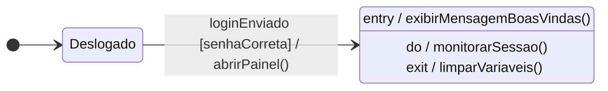
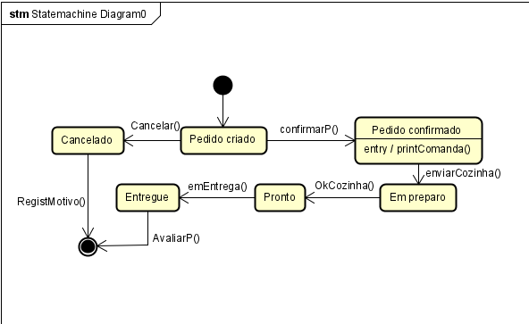
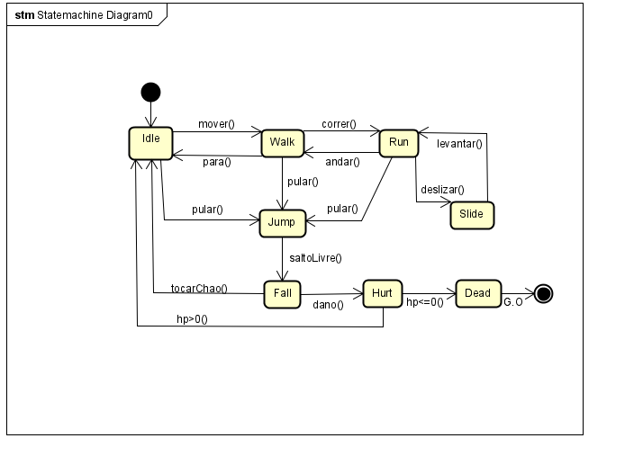

# Aula 08: Diagrama de Atividades e Máquina de Estado

Dois diagramas comportamentais da UML. O de **atividades** mostra o fluxo de um processo, passo a passo. O de **máquina de estado** mostra o ciclo de vida de um objeto: em que situação ele está e o que o faz mudar.

Tipo: exercícios e exemplos · Exercícios com solução em [exercicios.md](exercicios.md)

Material do professor: [Diagrama de Atividades](https://github.com/Herysson/Engenharia-de-Software/blob/main/Aula%2008%20-%20Diagrama%20de%20Atividades.pdf) · [Máquina de Estado](https://github.com/Herysson/Engenharia-de-Software/blob/main/Aula%2008%20-%20Maquina%20de%20Estado.pdf) · [versão com os dois](https://github.com/Herysson/Engenharia-de-Software/blob/main/Aula%2008%20-%20Diagrama%20de%20Atividades%20e%20Maquina%20de%20Estado.pdf) · [lista de exercícios](https://github.com/Herysson/Engenharia-de-Software/blob/main/Exerc%C3%ADcios/Diagrama%20de%20Atividades%20e%20Diagrama%20de%20Estado_.docx)

## Tópicos

- Diagrama de atividades: atividade e ação, elementos e regras para o diagrama ficar correto
- Diagrama de máquina de estado: estado, transição (`evento [guarda] / ação`), comportamento interno (`entry`, `do`, `exit`)
- Elementos avançados de estados: estado composto, submáquina, choice e junction, entry e exit point, histórico, fork e join
- Exemplos resolvidos: acionamento do seguro, pedido no restaurante e personagem de jogo

---

## Diagrama de atividades

Representa o **fluxo de controle** de uma atividade para outra, com as ações passo a passo. Parece um fluxograma, mas aceita **concorrência** (ações em paralelo) e **sincronismo**.

- **Atividade**: um processo de negócio, como a venda de livros online. Muitas vezes descreve a implementação de um caso de uso.
- **Ação**: um passo individual (atômico) dentro da atividade, como pesquisar livros.

Para que serve:
- mostrar como as ações são executadas, o que cada uma faz, quando (a sequência) e onde ou quem as realiza
- capturar o trabalho que é executado quando uma operação do sistema é disparada
- modelar fluxos de trabalho e processos

Quando usar:
- para explicar um processo de negócio (matrícula, compra, manutenção)
- para detalhar o comportamento de um caso de uso ou de uma operação
- para alinhar a equipe sobre regras, caminhos alternativos e concorrência

### Elementos

| Elemento | O que é | Nos diagramas daqui |
|---|---|---|
| Nó inicial | ponto de início da atividade | círculo escuro |
| Fluxo (aresta, transição) | liga duas ações e dá a ordem em que acontecem | seta |
| Ação | um passo da atividade | retângulo arredondado |
| Decisão (*branch*) | uma entrada e várias saídas. Cada saída tem uma **guarda** entre colchetes, e as guardas são mutuamente exclusivas | losango, guarda na seta: `[aprovado]` |
| Intercalação (*merge*) | várias entradas e uma saída. Fecha o condicional aberto por uma decisão | losango |
| Divergência (*fork*) | ponto em que duas ou mais tarefas começam em paralelo | barra escura |
| Convergência (*join*) | ponto em que as tarefas paralelas se juntam para começar uma nova | barra escura |
| Nó final de atividade | onde a atividade termina | círculo duplo escuro |
| Final de fluxo | um dos fluxos terminou, mas a atividade continua | — |
| Partição (raia, *swimlane*) | mostra quem faz cada ação. Na UML 1.1 se chamava "raia" | caixa com o nome de quem faz |
| Sinal ou mensagem | envio ou recebimento de um sinal ou mensagem | bandeira |
| Chamada de subatividade | sub-rotina que compõe uma das ações da atividade principal | — |

### Regras para o diagrama ficar correto

- cada decisão (*branch*) tem a sua intercalação (*merge*)
- cada *fork* tem o seu *join*
- os pares ficam perfeitamente aninhados: um *branch* não termina em *join*, um *fork* não termina em *merge*, e eles não se entrelaçam
- só existe **um** nó inicial e **um** nó final
- cada ação tem um único fluxo de entrada e um único fluxo de saída. Isso não vale para *fork*, *join*, *merge* e *branch*, que não são atividades
- *fork*, *join*, *branch* e *merge* podem ficar em qualquer raia, porque a raia não muda o significado deles

### Exemplo resolvido: acionamento do seguro

> **Enunciado** (slide "Prática"): depois de um acidente, o segurado entra em contato com a seguradora. A seguradora recolhe o veículo e o envia para a oficina parceira, que avalia os danos. Se houve perda total, a seguradora deposita o valor da apólice e o processo termina. Se o carro pode ser consertado, a seguradora cobra a franquia, o segurado paga e só então a oficina faz o conserto.

```mermaid
flowchart TB
    subgraph SEG["Segurado"]
        ini((" "))
        a1("Entrar em contato com a seguradora")
        a7("Pagar a franquia")
    end
    subgraph SGR["Seguradora"]
        a2("Recolher o veículo")
        a3("Enviar para a oficina parceira")
        d1{" "}
        a5("Depositar o valor da apólice")
        a6("Cobrar a franquia")
        m1{" "}
        fim(((" ")))
    end
    subgraph OFI["Oficina parceira"]
        a4("Avaliar os danos")
        a8("Consertar o automóvel")
    end
    ini --> a1 --> a2 --> a3 --> a4 --> d1
    d1 -->|"[perda total]"| a5 --> m1
    d1 -->|"[pode ser consertado]"| a6 --> a7 --> a8 --> m1
    m1 --> fim
    class ini,fim preto
    classDef preto fill:#333,stroke:#999
```

- A decisão depois de "Avaliar os danos" abre dois caminhos, e o *merge* antes do fim fecha os dois. Assim fica um nó final só, como pedem as regras.
- As partições mostram que o conserto só começa depois que o **segurado** paga a franquia.

---

## Diagrama de máquina de estado

Também é chamado de **diagrama de transição de estados** ou só **diagrama de estados**. Descreve como um objeto se comporta quando um evento ocorre, com todos os seus estados, transições e ações possíveis.

Para que serve:

| Uso | Exemplo dos slides |
|---|---|
| Representar o **ciclo de vida** de um objeto | um pedido: Criado → Confirmado → Enviado → Entregue → Finalizado |
| Modelar **sistemas reativos**, que respondem a eventos (embarcados, interfaces, controladores) | semáforo inteligente que muda de estado com base em sensores ou no tempo |
| Achar **falhas de lógica**: transições inválidas, eventos sem tratamento, estados sem saída | — |
| Documentar **regras de negócio** | o que acontece quando o usuário clica em "Cancelar"? Que eventos encerram uma sessão? |
| **Complementar** outros diagramas | classes (estrutura estática), casos de uso (interação com atores), atividades (fluxo geral) |

### Estado e transição

- **Estado**: condição ou situação na vida de um objeto, em que ele satisfaz alguma condição, realiza alguma atividade ou espera um evento
- **Estado inicial**: onde começa a modelagem dos estados. **Estado final**: onde ela termina
- **Transição**: a passagem de um estado para outro, causada por um evento

Uma transição acontece assim: o objeto está num estado → um evento ocorre → uma ação é realizada → o objeto passa para outro estado.

O rótulo da transição tem três partes, no formato `E() [G] / A`:

| Parte | O que é | Exemplo |
|---|---|---|
| **Trigger** (gatilho, evento) | o que dispara a transição. Sem ele, a transição não ocorre | `botaoPressionado`, `cartaoInserido`, `tempoEsgotado` |
| **Guard** (guarda) | condição lógica que precisa ser verdadeira depois do evento. É opcional: se existir e for falsa, a transição não acontece, mesmo que o evento ocorra | `[senhaCorreta]` |
| **Action** (ação, efeito) | o que é executado quando a transição ocorre (o evento aconteceu e a guarda é verdadeira): chamada de método, mensagem, log etc. | `/ abrirPainel()` |

Exemplos dos slides: `clicarBotao [usuarioLogado] / abrirMenu()` e `loginEnviado [senhaCorreta] / abrirPainel()`.

### Comportamento interno: entry, do e exit

São ações que acontecem enquanto o objeto está num estado, independentemente das transições externas.

| Comando | Quando é executado | Exemplo |
|---|---|---|
| `entry` | ao entrar no estado | `entry / exibirMensagemBoasVindas()` |
| `do` | enquanto o estado está ativo | `do / monitorarSessao()` |
| `exit` | ao sair do estado | `exit / limparVariaveis()` |

Os exemplos dos slides juntos num diagrama:

### Elementos

| Nº | Elemento | Nome em português | Símbolo UML |
|---|---|---|---|
| 1 | Initial State | Estado inicial | ● círculo preto sólido |
| 2 | Final State | Estado final | ◎ círculo com centro |
| 3 | State | Estado simples | retângulo arredondado |
| 4 | Composite State | Estado composto | retângulo com subdivisão |
| 5 | Submachine State | Submáquina | retângulo com "aba" |
| 6 | Transition | Transição | ➝ seta com rótulo |
| 7 | Junction | Junção | ⚫ círculo pequeno |
| 8 | Choice | Ponto de decisão | ◊ losango |
| 9 | Entry Point | Ponto de entrada | círculo com seta |
| 10 | Exit Point | Ponto de saída | círculo com um X |
| 11 | History State | Estado de histórico | H ou H* em um círculo |

- **Estado composto**: estado que tem subestados dentro dele.
- **Submáquina**: um estado que representa outra máquina de estados inteira, encapsulada dentro de um único estado de outro diagrama.

**Choice × junction**: os dois ligam transições, mas só o choice decide na hora.

| | Choice (decisão) | Junction (junção) |
|---|---|---|
| Símbolo | losango | círculo preto |
| Tipo de decisão | dinâmica: a condição é avaliada na hora, depois da transição de entrada | estática: só encadeia transições, sem lógica condicional explícita |
| Guarda | obrigatória | opcional |
| Ação associada | não | não |
| Uso típico | decisão com vários caminhos | dividir ou juntar caminhos |

**Entry point × exit point**: controlam por onde o fluxo entra e sai de um estado composto ou de uma submáquina.

| Situação | Solução |
|---|---|
| Entrar num subestado específico, sem passar pelo estado inicial padrão | entry point |
| Sair imediatamente do estado composto por um evento específico (cancelamento, erro, exceção) | exit point |
| Controlar como e por onde o fluxo entra e sai de submáquinas | os dois |

**Estado de histórico**: guarda o último subestado ativo de um estado composto. Se o objeto for interrompido (pausa, erro, evento externo), ele volta para o subestado exato onde estava, em vez de recomeçar do início.

| Símbolo | Tipo | Volta para |
|---|---|---|
| H | histórico simples | o último subestado visitado, sem profundidade |
| H* | histórico profundo | o último subestado visitado, recursivamente, incluindo os subníveis |

**Fork e join** também existem aqui:
- **fork** (1 → N): divide uma transição em regiões paralelas, e todos os destinos são ativados ao mesmo tempo
- **join** (N → 1): espera todas as regiões paralelas terminarem e só então segue

### Como criar um diagrama de estados

1. Defina o estado inicial e o estado final
2. Identifique todos os estados possíveis do processo
3. Ligue origem e destino com setas (as transições)
4. Rotule cada transição com o evento que a dispara
5. Coloque guardas nas transições que só valem sob uma condição

### Exemplos resolvidos (feitos no Astah)

#### Pedido no restaurante

> **Enunciado** (slide "Atividade Prática"): modele o ciclo de vida de um pedido realizado em um restaurante. Estados sugeridos: Pedido Criado, Pedido Confirmado, Em Preparo, Pronto, Entregue e Cancelado. Desafio extra: adicionar guardas e ações.

- `Pedido confirmado` tem comportamento interno: `entry / printComanda()`. A comanda é impressa assim que o pedido entra nesse estado.
- O pedido só pode ser cancelado enquanto ainda está em `Pedido criado`.
- Há dois caminhos até o estado final: depois de `Entregue` (com `AvaliarP()`) ou depois de `Cancelado` (com `RegistMotivo()`).

#### Personagem de jogo

> **Enunciado** (slide "Atividade Prática"): criar um diagrama de estados para o personagem principal de um jogo.

- No chão: `Idle`, `Walk`, `Run` e `Slide`. No ar: `Jump` e `Fall`. Com dano: `Hurt` e `Dead`.
- `Hurt` tem duas saídas, que dependem da vida: com `hp>0` volta para `Idle`, com `hp<=0` vai para `Dead`, e `G.O` leva ao estado final.
- Notação: pela regra `evento [guarda] / ação`, `hp>0` e `hp<=0` são condições, então o mais fiel à aula seria escrever como guardas: `[hp > 0]` e `[hp <= 0]`.

---

## Atividades × estados

| | Diagrama de atividades | Diagrama de máquina de estado |
|---|---|---|
| Foco | o fluxo de ações de um processo | os estados de **um** objeto ao longo do tempo |
| Mostra | que passos são feitos, em que ordem e por quem | em que situação o objeto está e que evento o faz mudar |
| Peças principais | ações, decisão e merge, fork e join, partições | estados, transições (`evento [guarda] / ação`), entry/do/exit |
| Exemplo da aula | acionamento do seguro | pedido no restaurante |

## Pontos em aberto

- A Aula 08 tem três PDFs. A versão com os dois diagramas traz práticas de estados que não estão no PDF separado (pedido de e-commerce e drone de entrega). O PDF separado traz outras (restaurante, máquina de lanches, personagem de jogo, sinistro e livro no Livir). Este resumo usa os dois, e as práticas estão em [exercicios.md](exercicios.md).
- Os slides de exemplo (transição, comportamento interno, estado composto, decisão, junção, entry e exit point, submáquina, histórico, fork e join) são só figuras, e o texto deles não descreve o diagrama. Por isso esses exemplos não foram reproduzidos aqui: veja o PDF.
- Nos slides, os símbolos do diagrama de atividades também aparecem só como figura. A coluna "Nos diagramas daqui" descreve a convenção usada neste repositório, porque o Mermaid não tem um tipo próprio para diagrama de atividades. Final de fluxo e chamada de subatividade não aparecem em nenhum diagrama daqui.
