# Aula 08: Exercícios

Práticas dos slides e a [lista de exercícios do professor](https://github.com/Herysson/Engenharia-de-Software/blob/main/Exerc%C3%ADcios/Diagrama%20de%20Atividades%20e%20Diagrama%20de%20Estado_.docx). Os conceitos estão no [resumo da aula](README.md).

Cada exercício tem **uma** solução possível, escondida: clique em **Ver solução** para abrir. Tente fazer antes de olhar. Quando o enunciado não diz o que acontece num caminho (por exemplo, se o pagamento for recusado), a solução diz qual escolha foi feita.

Como ler os diagramas de atividades: círculo escuro = início · círculo duplo = fim · losango = decisão ou merge · barra escura = fork ou join · bandeira = envio de mensagem · caixa com nome = partição (quem faz)

## Sumário

| # | Exercício | Diagrama | Origem |
|---|---|---|---|
| 1 | [Bolo comum](#1-bolo-comum) | atividades | slides, Prática 1 |
| 2 | [Bolo simples](#2-bolo-simples) | atividades | slides, Prática 2 |
| 3 | [Venda de livros no Livir](#3-venda-de-livros-no-livir) | atividades | slides, Prática |
| 4 | [Locação de veículo](#4-locação-de-veículo) | atividades | lista |
| 5 | [Seguro automotivo do Juca](#5-seguro-automotivo-do-juca) | atividades | lista |
| 6 | [Compra online](#6-compra-online) | atividades | lista |
| 7 | [Matrícula universitária](#7-matrícula-universitária) | atividades | lista |
| 8 | [Agendamento de consultas](#8-agendamento-de-consultas) | atividades | lista |
| 9 | [Aprovação de empréstimo](#9-aprovação-de-empréstimo) | atividades | lista |
| 10 | [Reserva de hotel](#10-reserva-de-hotel) | atividades | lista |
| 11 | [Pedido de e-commerce](#11-pedido-de-e-commerce) | estados | slides, Prática 1 |
| 12 | [Drone de entrega](#12-drone-de-entrega) | estados | slides, Prática 2 |
| 13 | [Máquina de lanches](#13-máquina-de-lanches) | estados | slides, Atividade Prática |
| 14 | [Sinistro de veículo](#14-sinistro-de-veículo) | estados | slides, Atividade Prática |
| 15 | [Livro no Livir](#15-livro-no-livir) | estados | slides, Atividade Prática |
| 16 | [Contrato de locação](#16-contrato-de-locação) | estados | lista |
| 17 | [Reclamação de seguro](#17-reclamação-de-seguro) | estados | lista |
| 18 | [Gerenciamento de pedido](#18-gerenciamento-de-pedido) | estados | lista |
| 19 | [Controle de acesso](#19-controle-de-acesso) | estados | lista |
| 20 | [Tickets de suporte](#20-tickets-de-suporte) | estados | lista |
| 21 | [Vida útil de um documento](#21-vida-útil-de-um-documento) | estados | lista |
| 22 | [Termostato inteligente](#22-termostato-inteligente) | estados | lista |

---

## Diagrama de atividades

### 1. Bolo comum

> Bata ovos, manteiga e açúcar até formar um creme. Acrescente o leite e a farinha e bata até a massa ficar homogênea; reserve. Ligue o forno em alta temperatura e unte a forma com manteiga. Misture o pó royal na massa com uma espátula, sem bater, despeje na forma e leve ao forno. Não abra o forno nos primeiros 20 minutos. Para um bolo de chocolate, acrescente 1 xícara de chocolate em pó antes do pó royal.

<details>
<summary>Ver solução</summary>

```mermaid
flowchart TB
    ini((" ")) --> f1[" "]
    f1 --> a1("Bater ovos, manteiga e açúcar até formar um creme")
    a1 --> a2("Acrescentar leite e farinha e bater até a massa ficar homogênea")
    f1 --> b1("Ligar o forno em alta temperatura")
    b1 --> b2("Untar a forma com manteiga")
    a2 --> j1[" "]
    b2 --> j1
    j1 --> d1{" "}
    d1 -->|"[bolo de chocolate]"| c1("Acrescentar 1 xícara de chocolate em pó")
    d1 -->|"[bolo comum]"| m1{" "}
    c1 --> m1
    m1 --> a3("Misturar o pó royal com a espátula, sem bater")
    a3 --> a4("Despejar a massa na forma untada")
    a4 --> a5("Levar ao forno sem abrir nos primeiros 20 minutos")
    a5 --> fim(((" ")))
    class ini,fim,f1,j1 preto
    classDef preto fill:#333,stroke:#999
```

- O forno e a forma são preparados **em paralelo** com a massa: o *fork* abre os dois fluxos e o *join* espera os dois terminarem. Seguir a ordem do texto, sem paralelismo, também é válido.
- O chocolate é opcional: uma decisão com duas guardas, fechada por um *merge*.

</details>

### 2. Bolo simples

> Bata as claras em neve e reserve. Misture as gemas, a margarina e o açúcar até obter uma massa homogênea. Acrescente o leite e a farinha aos poucos, sem parar de bater. Por último, adicione as claras em neve e o fermento. Despeje numa forma de furo central untada e enfarinhada. Asse em forno médio a 180 °C, preaquecido, por uns 40 minutos ou até que um garfo saia limpo ao furar o bolo.

<details>
<summary>Ver solução</summary>

```mermaid
flowchart TB
    ini((" ")) --> f1[" "]
    f1 --> a1("Bater as claras em neve e reservar")
    f1 --> b1("Misturar gemas, margarina e açúcar até a massa ficar homogênea")
    b1 --> b2("Acrescentar leite e farinha aos poucos, sem parar de bater")
    a1 --> j1[" "]
    b2 --> j1
    j1 --> a2("Adicionar as claras em neve e o fermento")
    a2 --> a3("Despejar na forma de furo central untada e enfarinhada")
    a3 --> m1{" "}
    m1 --> a4("Assar em forno médio preaquecido a 180 °C")
    a4 --> a5("Furar o bolo com um garfo")
    a5 --> d1{" "}
    d1 -->|"[garfo saiu limpo]"| fim(((" ")))
    d1 -->|"[garfo saiu sujo]"| m1
    class ini,fim,f1,j1 preto
    classDef preto fill:#333,stroke:#999
```

- As claras são batidas em paralelo com a massa, porque só voltam a ser usadas no final.
- O teste do garfo vira um **laço**: se o garfo sai sujo, o fluxo volta para o *merge* antes de "Assar".

</details>

### 3. Venda de livros no Livir

> Modele o diagrama de atividade para o processo de venda de livros do Livir. Do texto do sistema: os compradores acessam um site e pagam com cartão de crédito; há promoções eventuais com desconto; o custo de entrega depende do peso dos livros e da distância, e pode haver entrega gratuita para algumas localidades; se o livro pedido existe em estoque, é entregue na hora; senão, é solicitado à editora e um prazo compatível é informado ao comprador.

<details>
<summary>Ver solução</summary>

```mermaid
flowchart TB
    subgraph COMP["Comprador"]
        ini((" "))
        a1("Acessar o site")
        a2("Escolher os livros")
        a6("Pagar com cartão de crédito")
    end
    subgraph SIS["Sistema Livir"]
        d1{" "}
        a3("Aplicar o desconto")
        m1{" "}
        a4("Calcular o frete pelo peso e pela distância")
        d2{" "}
        a5("Zerar o frete")
        m2{" "}
        d3{" "}
        a7("Entregar o livro na hora")
        a8("Solicitar o livro à editora")
        s1>"Informar o prazo ao comprador"]
        m3{" "}
        fim(((" ")))
    end
    ini --> a1 --> a2 --> d1
    d1 -->|"[livro em promoção]"| a3 --> m1
    d1 -->|"[sem promoção]"| m1
    m1 --> a4 --> d2
    d2 -->|"[localidade com entrega gratuita]"| a5 --> m2
    d2 -->|"[frete normal]"| m2
    m2 --> a6 --> d3
    d3 -->|"[em estoque]"| a7 --> m3
    d3 -->|"[sem estoque]"| a8 --> s1 --> m3
    m3 --> fim
    class ini,fim preto
    classDef preto fill:#333,stroke:#999
```

- São três decisões seguidas, cada uma fechada pelo seu *merge* antes da próxima abrir. Assim elas ficam aninhadas, sem se entrelaçar.
- O texto não diz o que acontece se o pagamento for recusado, nem como o livro chega depois que a editora o envia. A solução para no aviso do prazo.

</details>

### 4. Locação de veículo

> O cliente acessa o site ou a loja, navega pelo catálogo, escolhe o modelo e pode escolher adicionais (GPS, cadeira de bebê, seguro). Preenche um formulário com dados pessoais, carteira de motorista e pagamento, e os dados são verificados. O sistema faz a verificação de crédito; se aprovado, é gerado um contrato de locação, que o cliente lê e assina. Na retirada, o cliente leva contrato, carteira e cartão; um funcionário inspeciona o veículo com o cliente e os dois assinam o formulário de inspeção. O cliente usa o carro no período contratado e comunica qualquer problema. No fim, devolve o veículo, que passa por nova inspeção; se tudo estiver conforme, as chaves são devolvidas e o contrato é fechado.

<details>
<summary>Ver solução</summary>

```mermaid
flowchart TB
    subgraph CLI["Cliente"]
        ini((" "))
        a1("Acessar o site ou a loja")
        a2("Escolher o modelo no catálogo")
        a3("Escolher adicionais")
        a4("Preencher o formulário")
        a7("Ler e assinar o contrato")
        a8("Comparecer com contrato, carteira e cartão")
        a10("Assinar o formulário de inspeção")
        a12("Usar o veículo no período contratado")
        a13("Comunicar o problema à empresa")
        a14("Devolver o veículo")
    end
    subgraph SIS["Sistema"]
        a5("Verificar os dados")
        a6("Verificar o crédito")
        d2{" "}
        a6b("Gerar o contrato de locação")
        m4{" "}
        fim(((" ")))
    end
    subgraph FUN["Funcionário"]
        a9("Inspecionar o veículo com o cliente")
        a11("Assinar o formulário de inspeção")
        a11b("Entregar as chaves")
        a15("Inspecionar o veículo devolvido")
        d4{" "}
        a16("Receber as chaves e fechar o contrato")
    end
    ini --> a1 --> a2 --> d1{" "}
    d1 -->|"[quer adicionais]"| a3 --> m1{" "}
    d1 -->|"[sem adicionais]"| m1
    m1 --> a4 --> a5 --> a6 --> d2
    d2 -->|"[crédito aprovado]"| a6b --> a7 --> a8 --> a9 --> f1[" "]
    f1 --> a10 --> j1[" "]
    f1 --> a11 --> j1
    j1 --> a11b --> a12 --> d3{" "}
    d3 -->|"[houve problema]"| a13 --> m3{" "}
    d3 -->|"[sem problema]"| m3
    m3 --> a14 --> a15 --> d4
    d4 -->|"[tudo conforme]"| a16 --> m4
    d4 -->|"[com danos]"| m4
    d2 -->|"[crédito reprovado]"| m4
    m4 --> fim
    class ini,fim,f1,j1 preto
    classDef preto fill:#333,stroke:#999
```

- As duas assinaturas do formulário de inspeção ficam em paralelo (*fork* e *join*), uma em cada partição.
- O texto não diz o que acontece com crédito reprovado nem com danos na devolução. Os dois caminhos vão direto para o *merge* final.

</details>

### 5. Seguro automotivo do Juca

> Juca bate o carro. Ele verifica se há feridos, chama a emergência e sinaliza o local. Depois tira fotos e coleta informações de testemunhas e envolvidos. Liga para a seguradora, que abre o sinistro e orienta os próximos passos. Juca obtém o boletim de ocorrência e envia a documentação. A seguradora agenda a avaliação e um perito avalia o carro numa oficina autorizada. Com o laudo, a seguradora decide entre reparo, perda total ou compensação financeira e informa o Juca. Se o carro tem conserto, a seguradora organiza e paga o reparo; se é perda total, Juca recebe a indenização. No fim, Juca assina os documentos de satisfação e o caso é encerrado.

<details>
<summary>Ver solução</summary>

```mermaid
flowchart TB
    subgraph JUC["Juca"]
        ini((" "))
        a1("Verificar se há feridos")
        a2("Chamar o serviço de emergência")
        a3("Sinalizar o local")
        a4("Tirar fotos do local e dos danos")
        a5("Coletar dados de testemunhas e envolvidos")
        a6("Ligar para a seguradora")
        a9("Obter o boletim de ocorrência")
        s1>"Enviar a documentação"]
        a16("Assinar os documentos de satisfação")
    end
    subgraph SEG["Seguradora"]
        a7("Abrir o sinistro")
        a8("Orientar os próximos passos")
        a10("Agendar a avaliação")
        s2>"Informar a decisão ao Juca"]
        d1{" "}
        a13("Organizar e pagar o reparo")
        a14("Pagar a indenização")
        a15("Pagar a compensação financeira")
        m1{" "}
        a17("Encerrar o caso")
        fim(((" ")))
    end
    subgraph PER["Perito"]
        a11("Avaliar o carro na oficina autorizada")
        a12("Emitir o laudo")
    end
    ini --> a1 --> a2 --> a3 --> a4 --> a5 --> a6 --> a7 --> a8 --> a9 --> s1 --> a10 --> a11 --> a12 --> s2 --> d1
    d1 -->|"[reparo]"| a13 --> m1
    d1 -->|"[perda total]"| a14 --> m1
    d1 -->|"[compensação financeira]"| a15 --> m1
    m1 --> a16 --> a17 --> fim
    class ini,fim preto
    classDef preto fill:#333,stroke:#999
```

- A decisão tem três saídas, uma para cada resultado do laudo. Uma decisão pode ter quantas saídas precisar, desde que as guardas não se sobreponham.
- O texto cita a "compensação financeira" como terceira opção, mas não explica como ela é paga. Aqui ela virou uma ação só.

</details>

### 6. Compra online

> O cliente acessa o site, faz login, navega pelas categorias, escolhe itens e os adiciona ao carrinho. Depois vai para o checkout, informa os dados de pagamento e aguarda a verificação. Com o pagamento confirmado, o cliente recebe uma confirmação por e-mail e o pedido é preparado para envio.

<details>
<summary>Ver solução</summary>

```mermaid
flowchart TB
    subgraph CLI["Cliente"]
        ini((" "))
        a1("Acessar o site")
        a2("Fazer login")
        m1{" "}
        a3("Navegar pelas categorias")
        a4("Adicionar o item ao carrinho")
        d1{" "}
        a5("Ir para o checkout")
        a6("Informar os dados de pagamento")
    end
    subgraph SIS["Loja"]
        a7("Verificar o pagamento")
        d2{" "}
        f1[" "]
        s1>"Enviar confirmação por e-mail"]
        a8("Preparar o pedido para envio")
        j1[" "]
        m2{" "}
        fim(((" ")))
    end
    ini --> a1 --> a2 --> m1 --> a3 --> a4 --> d1
    d1 -->|"[quer mais itens]"| m1
    d1 -->|"[terminou]"| a5 --> a6 --> a7 --> d2
    d2 -->|"[pagamento confirmado]"| f1
    f1 --> s1 --> j1
    f1 --> a8 --> j1
    j1 --> m2
    d2 -->|"[pagamento recusado]"| m2
    m2 --> fim
    class ini,fim,f1,j1 preto
    classDef preto fill:#333,stroke:#999
```

- Escolher vários itens é um **laço**: enquanto o cliente quer mais itens, o fluxo volta para o *merge* antes de "Navegar".
- O e-mail e a preparação do pedido acontecem ao mesmo tempo (*fork* e *join*).
- O texto não diz o que acontece com o pagamento recusado. Aqui o fluxo só termina.

</details>

### 7. Matrícula universitária

> O estudante acessa o portal, faz login e pesquisa as disciplinas do semestre. Seleciona as disciplinas e submete a matrícula. O sistema verifica se ele cumpre os pré-requisitos. Com a matrícula confirmada, o estudante recebe uma notificação.

<details>
<summary>Ver solução</summary>

```mermaid
flowchart TB
    subgraph EST["Estudante"]
        ini((" "))
        a1("Acessar o portal")
        a2("Fazer login")
        a3("Pesquisar as disciplinas do semestre")
        a4("Selecionar as disciplinas")
        a5("Submeter a matrícula")
    end
    subgraph SIS["Sistema"]
        a6("Verificar os pré-requisitos")
        d1{" "}
        a7("Confirmar a matrícula")
        s1>"Notificar o estudante"]
        m1{" "}
        fim(((" ")))
    end
    ini --> a1 --> a2 --> a3 --> a4 --> a5 --> a6 --> d1
    d1 -->|"[cumpre os pré-requisitos]"| a7 --> s1 --> m1
    d1 -->|"[não cumpre]"| m1
    m1 --> fim
    class ini,fim preto
    classDef preto fill:#333,stroke:#999
```

- O texto não diz o que acontece quando o estudante não cumpre os pré-requisitos. Uma alternativa seria voltar para "Selecionar as disciplinas".

</details>

### 8. Agendamento de consultas

> O paciente usa o sistema online para pedir uma consulta e escolhe a especialidade e o médico. O sistema verifica a agenda do médico. Se houver horário, o agendamento é confirmado e o paciente recebe uma notificação e, um dia antes da consulta, um lembrete.

<details>
<summary>Ver solução</summary>

```mermaid
flowchart TB
    subgraph PAC["Paciente"]
        ini((" "))
        a1("Acessar o sistema de agendamento")
        a2("Escolher a especialidade")
        a3("Escolher o médico")
    end
    subgraph SIS["Sistema"]
        a4("Verificar a agenda do médico")
        d1{" "}
        a5("Confirmar o agendamento")
        s1>"Notificar o paciente"]
        s2>"Enviar lembrete um dia antes"]
        m1{" "}
        fim(((" ")))
    end
    ini --> a1 --> a2 --> a3 --> a4 --> d1
    d1 -->|"[horário disponível]"| a5 --> s1 --> s2 --> m1
    d1 -->|"[sem horário]"| m1
    m1 --> fim
    class ini,fim preto
    classDef preto fill:#333,stroke:#999
```

- A notificação e o lembrete são **mensagens** enviadas ao paciente, por isso aparecem como bandeira.
- O texto não diz o que acontece quando não há horário disponível.

</details>

### 9. Aprovação de empréstimo

> O cliente pede um empréstimo pelo portal do banco. O sistema analisa o histórico de crédito e outras informações financeiras e decide aprovar ou rejeitar. O cliente é notificado da decisão por e-mail ou SMS.

<details>
<summary>Ver solução</summary>

```mermaid
flowchart TB
    subgraph CLI["Cliente"]
        ini((" "))
        a1("Solicitar o empréstimo no portal")
    end
    subgraph BAN["Sistema do banco"]
        a2("Analisar o histórico de crédito e as informações financeiras")
        d1{" "}
        a3("Aprovar o empréstimo")
        a4("Rejeitar o empréstimo")
        m1{" "}
        s1>"Notificar o cliente por e-mail ou SMS"]
        fim(((" ")))
    end
    ini --> a1 --> a2 --> d1
    d1 -->|"[crédito aprovado]"| a3 --> m1
    d1 -->|"[crédito reprovado]"| a4 --> m1
    m1 --> s1 --> fim
    class ini,fim preto
    classDef preto fill:#333,stroke:#999
```

- Os dois caminhos terminam do mesmo jeito (notificar o cliente), então o *merge* vem **antes** da notificação, e ela aparece uma vez só.

</details>

### 10. Reserva de hotel

> O cliente acessa o sistema de reservas, seleciona as datas e verifica a disponibilidade de quartos. Escolhe um quarto, adiciona serviços extras, faz o pagamento e recebe uma confirmação por e-mail.

<details>
<summary>Ver solução</summary>

```mermaid
flowchart TB
    subgraph CLI["Cliente"]
        ini((" "))
        a1("Acessar o sistema de reservas")
        a2("Selecionar as datas")
        a4("Escolher um quarto")
        a5("Adicionar serviços extras")
        a6("Fazer o pagamento")
    end
    subgraph SIS["Sistema do hotel"]
        a3("Verificar a disponibilidade de quartos")
        s1>"Enviar a confirmação por e-mail"]
        fim(((" ")))
    end
    ini --> a1 --> a2 --> a3 --> a4 --> a5 --> a6 --> s1 --> fim
    class ini,fim preto
    classDef preto fill:#333,stroke:#999
```

- O enunciado descreve um caminho único, sem condições, então não há decisão.
- Se você considerar que os serviços extras são opcionais, use uma decisão com `[quer serviços extras]` e um *merge*, como no exercício 4.

</details>

---

## Diagrama de máquina de estado

### 11. Pedido de e-commerce

> Modele os estados de um pedido desde a criação até o desfecho. Estados sugeridos: criado, pagamento, separação, expedição, entregue, cancelado. Eventos possíveis: aprovação ou reprovação do pagamento, falhas na entrega, nova tentativa.

<details>
<summary>Ver solução</summary>

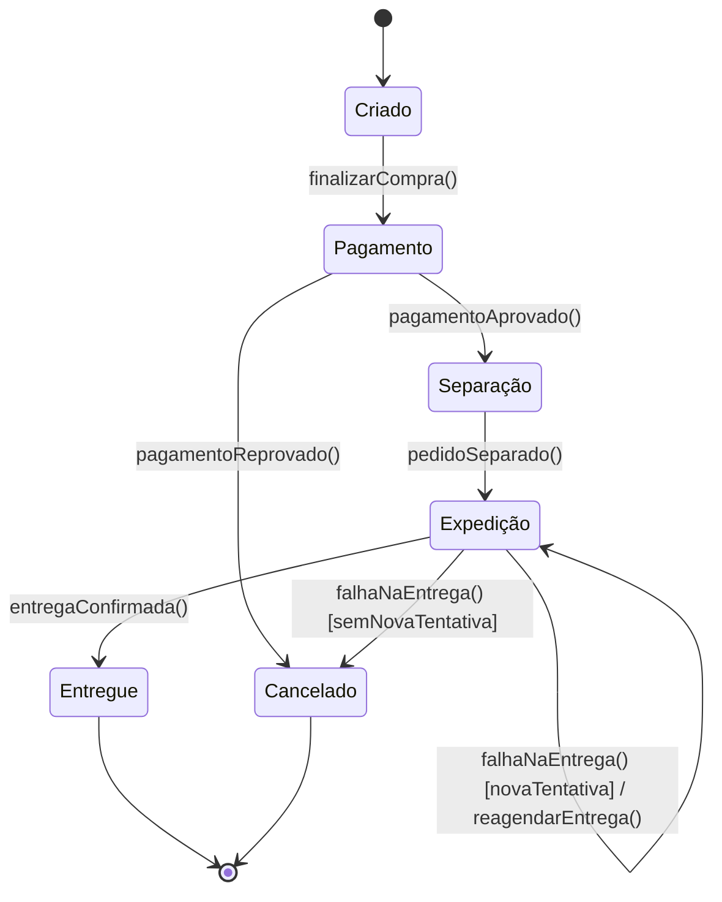

- A nova tentativa de entrega é uma **autotransição**: o pedido sai e volta para `Expedição`, executando a ação `reagendarEntrega()`.
- O mesmo evento (`falhaNaEntrega()`) leva a estados diferentes conforme a **guarda**. O enunciado não diz quantas tentativas são permitidas, então a guarda ficou genérica.

</details>

### 12. Drone de entrega

> Modele o ciclo de missão de um drone: antes, durante e depois do voo. Estados mínimos (opcionais): aguardando missão, decolando, em rota, retorno, aterrissando, falha. Eventos possíveis: missão atribuída, GPS ok, baixa bateria, vento forte, perda de sinal, pouso ok.

<details>
<summary>Ver solução</summary>

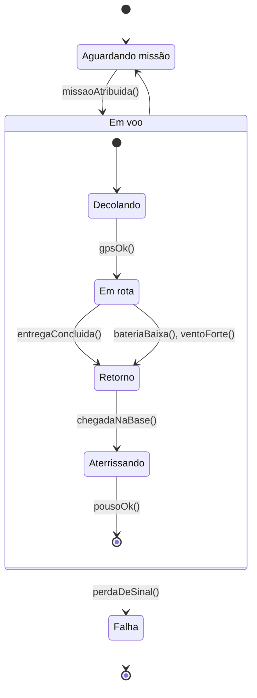

- `Em voo` é um **estado composto**. A perda de sinal pode acontecer em qualquer fase do voo, então a transição para `Falha` sai do estado composto inteiro, e não de cada subestado.
- Quando o drone pousa, o estado composto termina e ele volta a aguardar uma missão.
- `entregaConcluida()` e `chegadaNaBase()` não estão no enunciado. Foram criados para fechar o ciclo.

</details>

### 13. Máquina de lanches

> Uma máquina vende lanches ou bebidas. Crie estados como Ociosa, Esperando Seleção, Verificando Estoque, Liberando Produto e Encerrando Transação. Use triggers como `inserirMoeda` e `selecionarProduto`. Adicione um estado composto para "Preparando Produto".

<details>
<summary>Ver solução</summary>

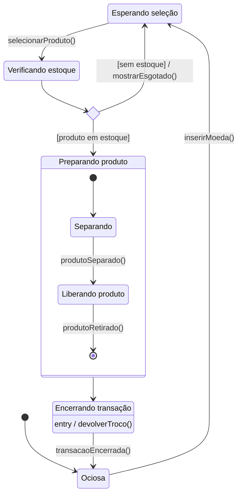

- O losango é um **choice**: a condição do estoque é avaliada na hora, e cada saída tem a sua guarda.
- `Preparando produto` é o estado composto pedido. Os subestados `Separando` e `Liberando produto`, e a ação `devolverTroco()`, são escolhas desta solução.

</details>

### 14. Sinistro de veículo

> Modele os estados de um sinistro no sistema da seguradora (acidente, furto ou outro dano em que o segurado aciona a cobertura). Mostre os estados, os eventos (triggers), as condições (guards) e as ações, tanto nas transições quanto dentro dos estados (entry, do, exit).

<details>
<summary>Ver solução</summary>

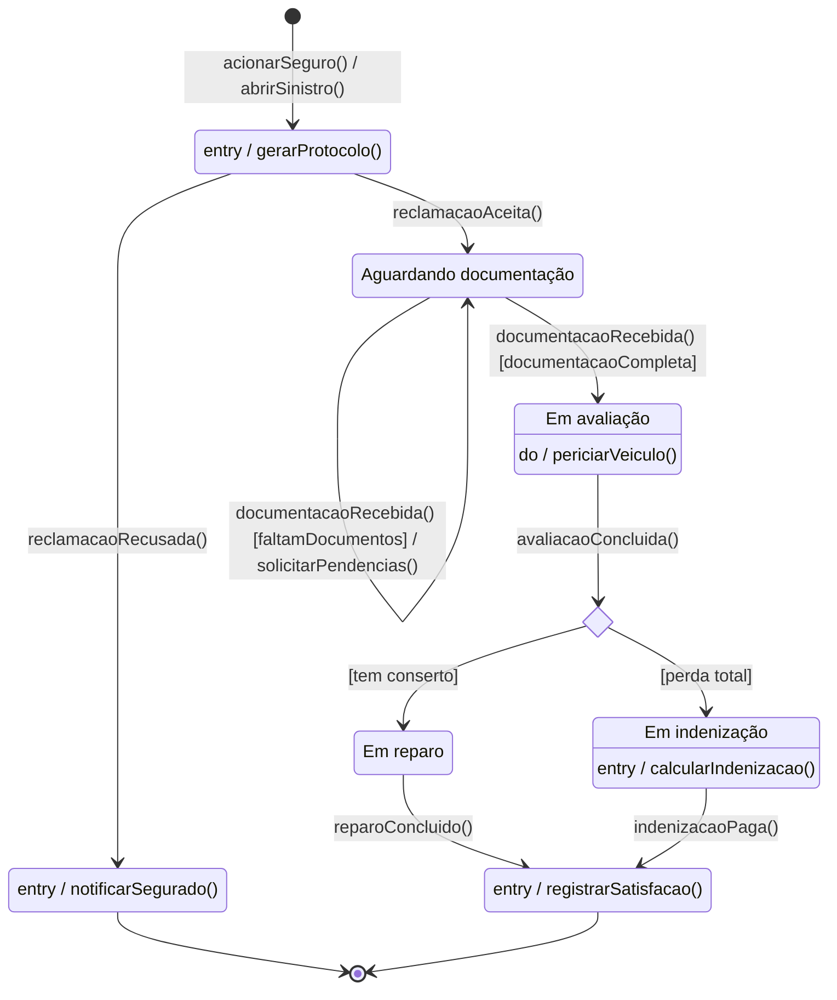

- Usa os três tipos de comportamento interno: `entry / gerarProtocolo()` ao abrir, `do / periciarVeiculo()` enquanto a avaliação dura e `entry / calcularIndenizacao()` ao entrar na indenização.
- A mesma documentação recebida pode manter o sinistro esperando ou levar à avaliação: o que decide é a guarda.

</details>

### 15. Livro no Livir

> Modele o ciclo de vida de um livro no sistema Livir. Considere livros danificados e livros em oferta.

<details>
<summary>Ver solução</summary>

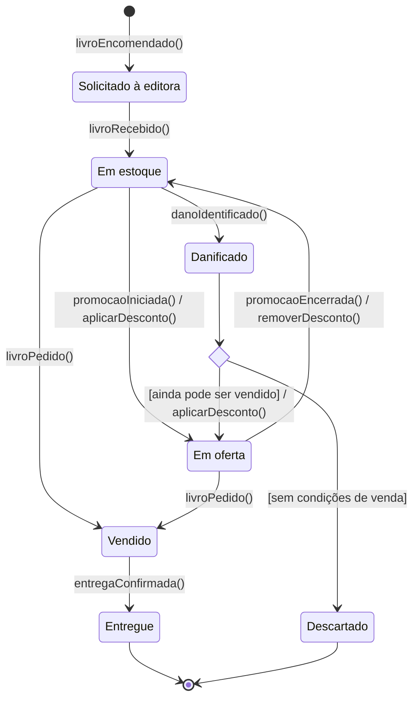

- Pelo texto do Livir, a livraria só trabalha com livros novos comprados das editoras, então o ciclo começa em `Solicitado à editora`.
- O slide só cita "livros danificados" e "livro em oferta". O que fazer com um livro danificado (vender com desconto ou descartar) é escolha desta solução.

</details>

### 16. Contrato de locação

> Crie um diagrama de estados para o contrato de locação de veículos, da reserva até a devolução. Cada transição deve ter o evento que a dispara, como "pagamento confirmado", "veículo retirado pelo cliente" e "veículo devolvido".

<details>
<summary>Ver solução</summary>

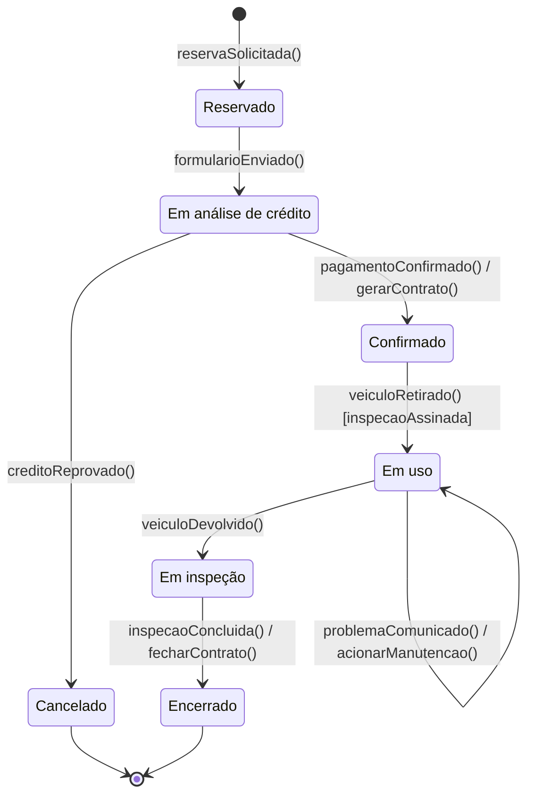

- O objeto aqui é o **contrato**, não o processo inteiro. Por isso os estados são situações do contrato (reservado, confirmado, em uso), e não ações do cliente.
- A guarda `[inspecaoAssinada]` garante que o veículo só sai depois que os dois assinaram o formulário de inspeção.

</details>

### 17. Reclamação de seguro

> Crie um diagrama de estados com os estados de uma reclamação de seguro, do acidente até a resolução final. As transições devem incluir eventos como "reclamação aceita", "documentação recebida" e "avaliação concluída".

<details>
<summary>Ver solução</summary>

É o mesmo objeto do [exercício 14](#14-sinistro-de-veículo): a reclamação de seguro é o sinistro. Aquela solução já usa os três eventos pedidos (`reclamacaoAceita()`, `documentacaoRecebida()` e `avaliacaoConcluida()`).

</details>

### 18. Gerenciamento de pedido

> Um pedido é criado, processado, enviado e finalmente entregue. Modele esses estados e as transições até a entrega.

<details>
<summary>Ver solução</summary>

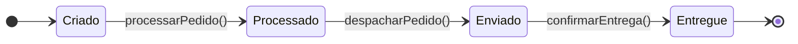

- O enunciado descreve uma sequência sem desvios, então o diagrama é uma linha só. Compare com o [exercício 11](#11-pedido-de-e-commerce), que tem pagamento reprovado e falha na entrega.

</details>

### 19. Controle de acesso

> O sistema tem três estados: deslogado, logado e bloqueado. Vai de deslogado para logado após uma autenticação bem-sucedida, e para bloqueado após várias tentativas falhas. Depois de um período ou de um reset manual, volta para deslogado.

<details>
<summary>Ver solução</summary>

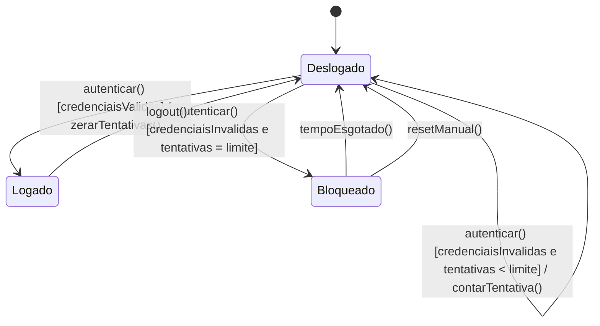

- O mesmo evento, `autenticar()`, tem três destinos diferentes. Quem escolhe é a **guarda**.
- O número de tentativas não é dado no enunciado, por isso aparece como `limite`.
- `logout()` não está no enunciado, mas sem ele não haveria saída do estado `Logado`.

</details>

### 20. Tickets de suporte

> Um ticket começa aberto, passa para análise, depois para resposta pendente, é resolvido e por fim fechado.

<details>
<summary>Ver solução</summary>

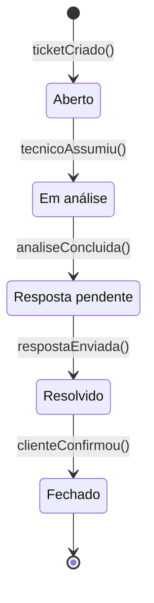

- Segue a ordem do enunciado. Se o cliente puder reabrir o ticket, basta uma transição `Resolvido --> EmAnalise : clienteReabriu()`.

</details>

### 21. Vida útil de um documento

> Um documento passa pelos estados de rascunho, em revisão, aprovado e arquivado. Desenhe as fases e as transições.

<details>
<summary>Ver solução</summary>

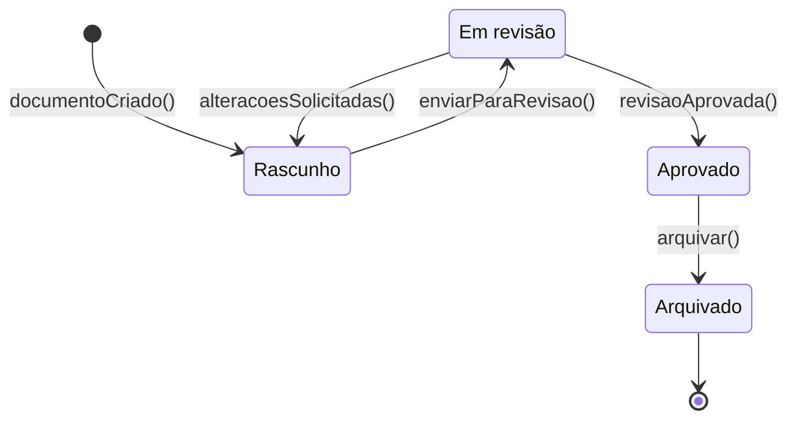

- A volta de `Em revisão` para `Rascunho` não está no enunciado, mas é o que acontece quando o revisor pede mudanças.

</details>

### 22. Termostato inteligente

> Um termostato tem os estados desligado, em espera, ativo e em manutenção. Modele como ele passa de um para outro conforme a conexão à energia, o uso e a necessidade de reparo.

<details>
<summary>Ver solução</summary>

```mermaid
stateDiagram-v2
    state "Em manutenção" as EmManutencao
    [*] --> Desligado
    Desligado --> Ligado : conectarEnergia()
    state Ligado {
        state "Em espera" as EmEspera
        [*] --> EmEspera
        EmEspera --> Ativo : usar()
        Ativo --> EmEspera : usoEncerrado()
    }
    Ligado --> Desligado : desconectarEnergia()
    Ligado --> EmManutencao : precisaDeReparo()
    EmManutencao --> Desligado : reparoConcluido()
```

- `Ligado` é um estado composto: desconectar ou precisar de reparo vale tanto em espera quanto ativo, então essas transições saem do estado composto inteiro.
- Não há estado final: o aparelho não "termina", ele sempre volta para `Desligado`.
- Com um estado de histórico (H) dentro de `Ligado`, o termostato voltaria para o último subestado depois de religado. O Mermaid não desenha o histórico, por isso ele ficou de fora.

</details>
