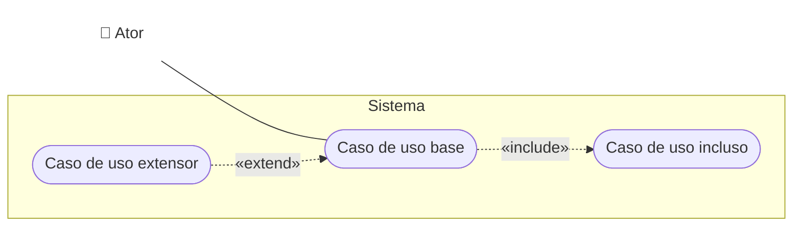
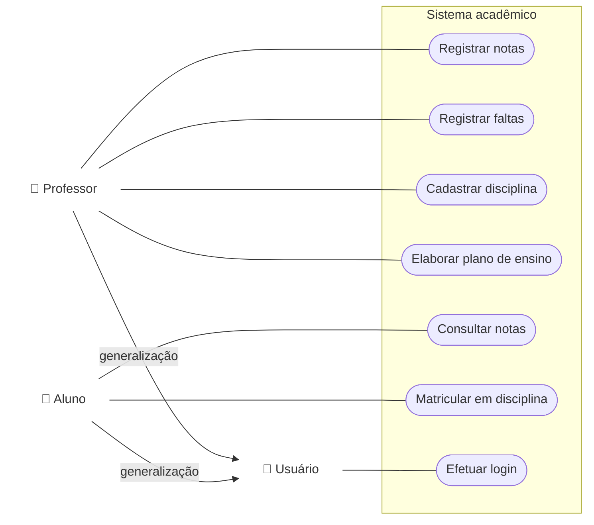

# Aula 09: Modelo de Caso de Uso

O modelo de casos de uso (MCU) mostra o que o sistema faz visto de fora: quem interage com ele (atores) e para quê (casos de uso). Tem duas partes: o diagrama e a especificação (descrição) de cada caso de uso.

Tipo: exercícios e exemplos · Exercícios com solução em [exercicios.md](exercicios.md)

Material do professor: [slides](https://github.com/Herysson/Engenharia-de-Software/blob/main/Aula%2009%20-%20Modelo%20de%20Caso%20de%20Uso.pptx) · [lista de exercícios MCU](https://github.com/Herysson/Engenharia-de-Software/blob/main/Exerc%C3%ADcios/Caso%20de%20Uso%20-%20Lista%20de%20Exerc%C3%ADcios.docx)

## Tópicos

- Modelo de casos de uso, caso de uso, cenário e ator
- Relacionamentos: comunicação, inclusão, extensão e generalização
- Diagrama de caso de uso: elementos e quando usar
- Como identificar atores e casos de uso (primários e secundários)
- Especificação de caso de uso: a estrutura de Bezerra e o exemplo "Lançar Notas"
- Documentação suplementar: regras de negócio, desempenho e interface
- Exemplos resolvidos: sistema da universidade e especificação de "Matricular em disciplina"

---

## Conceitos

| Conceito | O que é |
|---|---|
| **Modelo de casos de uso (MCU)** | representa as funcionalidades **externamente observáveis** do sistema e os elementos externos que interagem com ele. É um modelo de análise que **refina os requisitos funcionais** (Bezerra, 2007). Proposto por Jacobson et al. em 1992 |
| **Caso de uso** | a especificação de uma **sequência completa de interações** entre o sistema e um ou mais agentes externos. Relata o uso de uma funcionalidade **sem revelar** a estrutura e o comportamento internos |
| **Cenário** | uma das maneiras de usar um caso de uso: um episódio de uso, também chamado de **instância** do caso de uso. Os cenários depois servem para os **testes** |
| **Ator** | qualquer elemento **externo** ao sistema que **interage** com ele, enviando ou recebendo informações. Atores não fazem parte do sistema |

Formatos para descrever um caso de uso: **descrição contínua**, **descrição numerada** e **narrativa fragmentada**.

## Relacionamentos

| Relacionamento | Entre | O que significa | Quando usar |
|---|---|---|---|
| **Comunicação** (associação) | ator e caso de uso | o ator troca informações com o sistema por meio daquele caso de uso | todo ator se liga a pelo menos um caso de uso |
| **Inclusão** «include» | casos de uso | um caso de uso inclui outro, necessário para completar o seu fluxo principal. É **obrigatório** (reúso) | quando o mesmo comportamento se repete em mais de um caso de uso: ele vira um caso de uso incluso |
| **Extensão** «extend» | casos de uso | uma sequência de interações **eventual**, que só acontece sob certas condições ou por escolha do ator. É **opcional** | quando um comportamento eventual precisa ser descrito |
| **Generalização** | casos de uso ou atores | o herdeiro herda as características do base e pode especializá-las | casos de uso parecidos → um caso de uso genérico (de preferência abstrato). Ator que faz o papel de outro e mais alguma coisa → ator herdeiro |

## Diagrama de caso de uso

Resume os atores e as interações deles com o sistema. Ajuda a discutir os cenários de interação, as metas que o sistema ajuda a atingir e o **escopo** do sistema.

| Elemento | Símbolo | Regra |
|---|---|---|
| Caso de uso | oval na horizontal | nome começando com **verbo no infinitivo** |
| Ator | boneco palito | um grupo de pessoas ou outro sistema |
| Limite do sistema | caixa retangular | delimita o que fica dentro do sistema |

**Quando usar**: para complementar o caso de uso descrito em texto. É ideal para representar as metas das interações, definir e organizar os requisitos funcionais, especificar o contexto do sistema e modelar o fluxo básico.

**Como ler os diagramas daqui** (o Mermaid não tem diagrama de caso de uso, então é uma aproximação): 👤 = ator · pílula = caso de uso · caixa = limite do sistema · linha = associação · seta tracejada = «include» ou «extend» · seta com "generalização" = herança (na UML, linha com triângulo vazado apontando para o base).

No «include», a seta sai do caso de uso base para o incluso. No «extend», a seta sai do extensor para o base.

## Como identificar atores e casos de uso

**Atores**: que órgãos, empresas ou pessoas vão usar o sistema? · que sistemas ou equipamentos vão se comunicar com ele? · alguém precisa ser informado de alguma ocorrência? · quem se interessa por um certo requisito funcional?

**Casos de uso primários** representam os objetivos dos atores, ou seja, os processos da empresa que serão automatizados. Perguntas: quais as necessidades e objetivos de cada ator? · que informações o sistema deve produzir? · há ações que acontecem regularmente no tempo? · cada requisito funcional tem pelo menos um caso de uso?

| Estratégia | Ideia | Exemplo dos slides |
|---|---|---|
| Caso de uso oposto | desfaz o resultado de outro | Realizar Pedido → Cancelar Pedido |
| Caso de uso que precede | condição que precisa valer antes | para fazer um pedido, o cliente precisa estar cadastrado → Cadastrar Cliente |
| Caso de uso que sucede | consequência de outro | depois da compra, agendar a entrega |
| Caso de uso temporal | o sistema faz algo de tempos em tempos, sem ator iniciando. O ator é quem **recebe** o resultado | "gerar um relatório de vendas toda sexta-feira" |
| Condição interna | o sistema reage a um evento interno | avisar o almoxarife que o produto chegou ao estoque mínimo |

**Casos de uso secundários** não trazem benefício direto aos atores, mas o sistema precisa deles: manutenção de cadastros (incluir, alterar, excluir e consultar num caso de uso só), manutenção de usuários e perfis, e sincronização com outros sistemas.

**Perguntas para detalhar os cenários**: quando tudo dá certo, como o sistema se comporta? · algo pode ocorrer diferente? · o que pode dar errado?

---

## Especificação de caso de uso

A UML não define um formato para descrever casos de uso. A estrutura sugerida por Bezerra (2007):

| Item | O que é |
|---|---|
| Nome | o mesmo do diagrama, único |
| Identificador | código único para referência cruzada, por exemplo CSU01, CSU02 |
| Importância | a categoria de importância do caso de uso |
| Ator primário | quem inicia o caso de uso (ou é o alvo do resultado). Só **um** |
| Atores secundários | os demais participantes externos. **Zero ou mais** |
| Precondições | o estado em que o sistema precisa estar para o caso de uso fazer sentido |
| Fluxo principal (básico) | a sequência de passos usual |
| Fluxos alternativos | as outras maneiras possíveis de usar o caso de uso |
| Fluxos de exceção | o que acontece quando algo inesperado ou inválido ocorre |
| Pós-condições | o estado do sistema depois do caso de uso |
| Regras do negócio | referência às regras que se aplicam |
| Histórico | autor, data de criação e modificações |
| Notas de implementação | ideias de implementação, que ficam fora dos fluxos para eles continuarem em alto nível e na linguagem do domínio |

Um **fluxo de exceção**: representa um erro de operação durante o fluxo principal · só faz sentido dentro daquele caso de uso · precisa dizer em que passo o caso de uso continua, ou que ele termina. Exemplos para "Realizar Pedido": o cartão excede o limite; a loja não tem a quantidade pedida; o cliente já tem um débito anterior.

### Exemplo dos slides: Lançar Notas

**Fluxo principal**
1. O professor solicita o lançamento de notas.
2. O sistema exibe as turmas e disciplinas do semestre corrente em que o professor leciona ou lecionou.
3. O professor seleciona a turma e a disciplina.
4. O sistema exibe a lista de alunos e pede as notas.
5. O professor fornece as notas.
6. O sistema exibe o resultado da avaliação de cada aluno, conforme a regra de negócio RN06.
7. O professor confere e confirma.
8. O sistema registra as avaliações e o caso de uso termina.

**Fluxo alternativo (erro no lançamento)**: o professor percebe uma nota errada e corrige; o sistema aceita e o caso de uso continua no passo 7.

**Fluxo de exceção**: se faltar alguma nota ou houver dado inválido, o sistema informa e o caso de uso volta ao passo 4.

## Documentação suplementar

O MCU só captura os **requisitos funcionais**. O resto entra no documento de requisitos:

| Item | O que é | Exemplos dos slides |
|---|---|---|
| **Regras do negócio** | políticas, condições ou restrições da organização. Influenciam a lógica de um ou mais casos de uso | o total do pedido é a soma dos itens mais 10% de entrega · um cliente não pode sacar mais de R$ 1.000,00 por dia · máximo de 30 alunos por turma · depois que o professor confirma as notas, elas não podem mudar · senhas com pelo menos 6 caracteres, trocadas a cada 3 meses |
| **Requisitos de desempenho** | características da operação do sistema | transações por unidade de tempo, tempo máximo de uma operação, volume de dados |
| **Requisitos de interface gráfica** | restrições do cliente sobre a interface | cor, estilo, interatividade |

---

## Exemplos resolvidos

### Exemplo 1: sistema da universidade (Prática 1)

> **Enunciado**: uma universidade quer um sistema em que os professores registrem notas e faltas, cadastrem disciplinas e elaborem o plano de ensino. Os alunos consultam as notas e se matriculam nas disciplinas. Alunos e professores precisam estar registrados, e o sistema valida os dados deles para liberar o acesso.

- **Usuário** é um ator genérico: Professor e Aluno herdam dele a associação com "Efetuar login". Assim o login aparece uma vez só.
- "Efetuar login" é o caso de uso que **precede** os outros: ele entra como **precondição** nas especificações ("o usuário está autenticado").
- O enunciado não diz quem registra alunos e professores no sistema. Por isso não há um caso de uso de cadastro de usuários. Se houvesse um ator responsável (secretaria, por exemplo), entraria aqui um caso de uso secundário de manutenção de usuários.

### Exemplo 2: especificação de "Matricular em disciplina"

| Item | Conteúdo |
|---|---|
| Nome | Matricular em disciplina |
| Identificador | CSU06 |
| Ator primário | Aluno |
| Atores secundários | nenhum |
| Precondições | o aluno está autenticado no sistema |
| Pós-condições | o aluno fica matriculado nas disciplinas escolhidas |

**Fluxo principal**
1. O aluno solicita a matrícula.
2. O sistema exibe as disciplinas disponíveis no semestre.
3. O aluno seleciona as disciplinas desejadas.
4. O sistema exibe as disciplinas selecionadas e pede confirmação.
5. O aluno confirma.
6. O sistema registra a matrícula e o caso de uso termina.

**Fluxo alternativo (alterar a seleção)**: no passo 4, o aluno desiste de uma disciplina; o caso de uso volta ao passo 3.

**Fluxo de exceção (turma cheia)**: no passo 6, se uma turma já tem o máximo de alunos (por exemplo, a regra "máximo de 30 alunos por turma" dos slides), o sistema informa e o caso de uso volta ao passo 3.

- Os passos alternam **ator** e **sistema**, sempre na linguagem do domínio (nada de "clica no botão" ou "grava no banco").
- A regra de turma cheia não está no enunciado da Prática 1. Ela foi tirada dos exemplos de regras de negócio dos slides, para mostrar um fluxo de exceção.

## Para lembrar

- MCU = diagrama + especificações. Ele refina os requisitos funcionais e não mostra o funcionamento interno.
- Ator é externo e é um **papel**, não uma pessoa.
- «include» = obrigatório (reúso); «extend» = eventual (condição ou escolha do ator); generalização = herança entre casos de uso ou entre atores.
- Nome de caso de uso: verbo no infinitivo, sem o nome do ator.
- Especificação: um ator primário, fluxo principal, alternativos e de exceção, cada desvio dizendo onde volta ou que termina.
- Desempenho, interface e regras de negócio ficam na documentação suplementar.

## Pontos em aberto

- Os exemplos de descrição contínua, numerada e fragmentada, o exemplo de cenário (pedido de compra pela Internet) e o "Documento Descritivo de Caso de Uso" estão só como figura nos slides.
- O slide sobre importância diz que há categorias, mas não diz quais são.
- O desenho exato dos símbolos (o triângulo da generalização, por exemplo) aparece só nas figuras. Os diagramas daqui são uma aproximação em Mermaid.
