# Aula 09: Exercícios

O exercício do slide e a [lista de exercícios MCU](https://github.com/Herysson/Engenharia-de-Software/blob/main/Exerc%C3%ADcios/Caso%20de%20Uso%20-%20Lista%20de%20Exerc%C3%ADcios.docx) do professor. Os conceitos estão no [resumo da aula](README.md).

Cada exercício tem **uma** solução possível, escondida: clique em **Ver solução** para abrir. Tente fazer antes de olhar. Quando o enunciado não define algo (quem cadastra os usuários, por exemplo), a solução diz qual escolha foi feita.

Como ler os diagramas: 👤 = ator · pílula = caso de uso · caixa = limite do sistema · linha = associação · seta tracejada = «include» ou «extend» · seta com "generalização" = herança (na UML, triângulo vazado apontando para o base).

## Sumário

| # | Exercício | Tipo |
|---|---|---|
| 0 | [Sistema bancário](#0-sistema-bancário) | diagrama (slide) |
| 1 | [Casos de uso no processo iterativo](#1-casos-de-uso-no-processo-iterativo) | teoria |
| 2 | [Serviço de entregas](#2-serviço-de-entregas) | diagrama |
| 3 | [Corrigir a narrativa "Realizar Saque"](#3-corrigir-a-narrativa-realizar-saque) | especificação |
| 4 | [Notação da UML](#4-notação-da-uml) | teoria |
| 5 | [Ator e comunicação](#5-ator-e-comunicação) | teoria |
| 6 | [Objetivo dos diagramas de casos de uso](#6-objetivo-dos-diagramas-de-casos-de-uso) | teoria |
| 7 | [Requisitos e levantamento](#7-requisitos-e-levantamento) | teoria |
| 8 | [Relacionamentos possíveis](#8-relacionamentos-possíveis) | teoria |
| 9 | [Inclusão × extensão × herança](#9-inclusão--extensão--herança) | teoria |
| 10 | [Biblioteca: quatro descritivos](#10-biblioteca-quatro-descritivos) | especificação |
| 11 | [Produto fora de estoque](#11-produto-fora-de-estoque) | diagrama |
| 12 | [Produção televisiva](#12-produção-televisiva) | diagrama + regras |
| 13 | [GNU Editor](#13-gnu-editor) | diagrama |
| 14 | [Livros por correio: atores](#14-livros-por-correio-atores) | teoria |
| 15 | [Editor de texto com extensões](#15-editor-de-texto-com-extensões) | diagrama |
| 16 | [Horas em projetos: atores e papéis](#16-horas-em-projetos-atores-e-papéis) | teoria |
| 17 | [TurboNote+](#17-turbonote) | diagrama |
| 18 | [Estatísticas mensais](#18-estatísticas-mensais) | diagrama |
| 19 | [Navegador e Internet](#19-navegador-e-internet) | diagrama |
| 20 | [Verdadeiro ou falso](#20-verdadeiro-ou-falso) | teoria |
| 21 | [Renomear casos de uso](#21-renomear-casos-de-uso) | teoria |
| 22 | [Biblioteca, celular e cartões](#22-biblioteca-celular-e-cartões) | diagrama |
| 23 | [A partir de "Pagar Pedido"](#23-a-partir-de-pagar-pedido) | teoria |
| 24 | [Controle acadêmico com períodos](#24-controle-acadêmico-com-períodos) | diagrama |

---

### 0. Sistema bancário

> (Slide "Exercício") Um sistema bancário deve permitir abrir e encerrar contas, consultar saldo, registrar movimentações e fazer saques, depósitos e transferências. As contas podem ser corrente ou poupança. Pessoas físicas e jurídicas interagem com o sistema, assim como os caixas e os gerentes do banco.

Ver solução

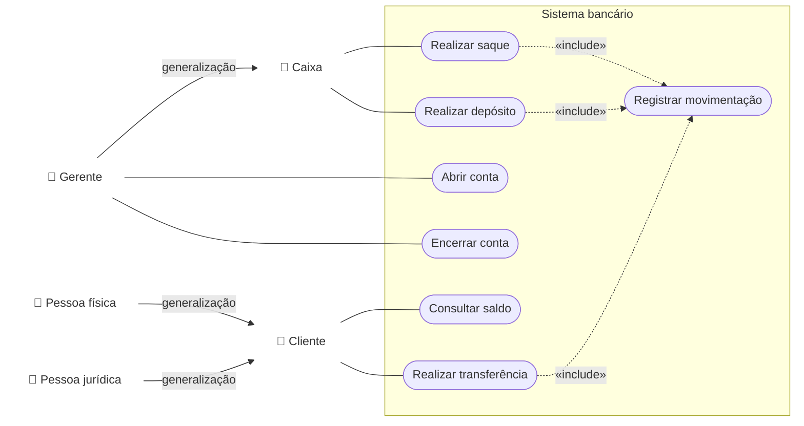

- **Cliente** é genérico: pessoa física e pessoa jurídica herdam dele.
- **Gerente** herda de **Caixa**: faz tudo o que o caixa faz e ainda abre e encerra contas.
- Saque, depósito e transferência sempre registram uma movimentação, por isso o «include».
- O tipo da conta (corrente ou poupança) é um dado de "Abrir conta", e não um caso de uso a mais.
- O enunciado não diz quem faz cada operação. Aqui o cliente consulta e transfere, o caixa saca e deposita, e o gerente abre e encerra. Outra divisão também seria válida.

### 1. Casos de uso no processo iterativo

> Descreva a posição dos diagramas de casos de uso no processo de desenvolvimento iterativo. Quando eles são utilizados? Para que são utilizados?

Ver solução

- **Posição**: o MCU é um **modelo de análise** que refina os requisitos funcionais. Ele vem logo depois do levantamento de requisitos, e a visão de casos de uso é criada cedo e **direciona** as outras visões do sistema (aula 06). Como o processo é iterativo, o modelo é revisado e detalhado a cada iteração.
- **Quando**: desde o início, para organizar os requisitos funcionais, e depois em cada iteração, quando os casos de uso escolhidos são especificados em detalhe.
- **Para quê**: representar as metas das interações entre usuários e sistema, definir e organizar os requisitos funcionais, delimitar o escopo e o contexto do sistema, e modelar o fluxo básico de eventos. Os cenários dos casos de uso também servem depois para os **testes**.

### 2. Serviço de entregas

> Clientes requisitam a entrega de volumes. Alguns volumes são de maior valor, e os clientes querem que eles sejam segurados durante o transporte. Uma companhia de seguro é contratada para segurar os volumes de valor.

Ver solução

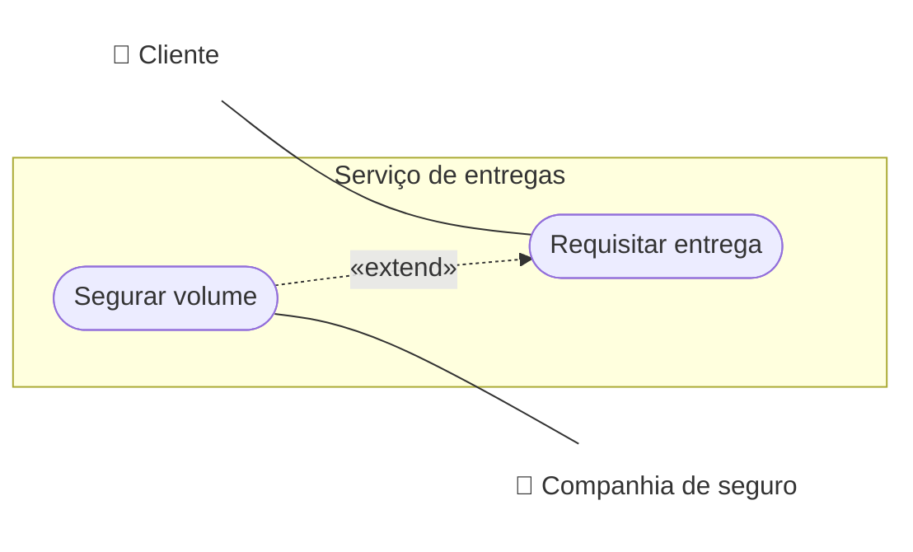

- Segurar o volume é **eventual**: só acontece quando o volume é de valor e o cliente quer o seguro. Por isso é um «extend» de "Requisitar entrega".
- A companhia de seguro é um **ator secundário**: é externa e participa só quando há seguro.

### 3. Corrigir a narrativa "Realizar Saque"

> Identifique os erros na narrativa do caso de uso Realizar Saque e escreva uma versão sem eles. (A narrativa original está na lista.)

Ver solução

**Erros, com base na aula**

| Erro | Por quê |
|---|---|
| Começa descrevendo a sessão no caixa eletrônico | iniciar a sessão é outro caso de uso. Aqui ela é uma **precondição** |
| "o que acarreta na execução da extensão" | não diz qual extensão. E saldo insuficiente é uma **exceção** do próprio caso de uso, não um comportamento opcional escolhido pelo ator |
| "uma mensagem adequada é reportada" | vago: não diz o que o cliente vê nem como o caso de uso continua |
| "os números da conta e da agência são enviados ao banco" | detalhe interno. A narrativa deve ficar em alto nível e na linguagem do domínio |
| Narrativa contínua, sem passos | fica difícil dizer onde cada desvio começa e para onde volta |
| Não diz quando o caso de uso termina | todo fluxo precisa indicar onde continua ou que termina |

**Versão corrigida**

| Item | Conteúdo |
|---|---|
| Ator primário | Cliente |
| Ator secundário | Banco |
| Precondição | o cliente iniciou uma sessão no caixa eletrônico |
| Pós-condição | o valor sacado foi debitado da conta do cliente |

Fluxo principal:
1. O cliente escolhe a opção de saque.
2. O sistema exibe as quantias disponíveis.
3. O cliente escolhe uma quantia.
4. O sistema verifica se o saldo da conta é suficiente.
5. O sistema pede ao banco a aprovação do saque.
6. O banco aprova o saque.
7. O sistema libera o dinheiro e emite o recibo.
8. O sistema informa ao banco que o saque foi concluído, e o banco debita a conta. O caso de uso termina.

Fluxos de exceção:
- **4a. Saldo insuficiente**: o sistema informa que o saldo não é suficiente e o caso de uso volta ao passo 2.
- **6a. Saque reprovado**: o sistema informa ao cliente que o saque não foi autorizado e o caso de uso termina.
- **7a. Falha ao liberar o dinheiro**: o sistema informa ao banco que o saque não foi concluído e o caso de uso termina.

### 4. Notação da UML

> Qual é a notação da UML para um caso de uso? E para um ator? E para o relacionamento de generalização?

Ver solução

| Elemento | Notação |
|---|---|
| Caso de uso | oval na horizontal com o nome (verbo no infinitivo) |
| Ator | boneco palito com o nome embaixo |
| Generalização | linha com um triângulo vazado na ponta, apontando para o caso de uso ou ator **base** (o mais genérico) |

Os slides mostram o símbolo da generalização só em figura. A descrição acima é a notação padrão da UML.

### 5. Ator e comunicação

> Defina o que é um ator. O que significa um ator estar associado a um caso de uso por um relacionamento de comunicação?

Ver solução

- **Ator**: qualquer elemento **externo** ao sistema que **interage** com ele, enviando informações para processar ou recebendo informações processadas. Pode ser uma pessoa, um grupo, uma organização ou outro sistema.
- **Comunicação**: o ator troca informações com o sistema por meio daquele caso de uso. É a linha que liga o ator ao caso de uso.

### 6. Objetivo dos diagramas de casos de uso

> Qual o objetivo dos diagramas de casos de uso?

Ver solução

Resumir os atores e as interações deles com o sistema, dando uma visão geral de casos de uso, atores e sistema. Com ele a equipe discute os cenários de interação, as metas que o sistema ajuda a atingir e o **escopo** do sistema. Ele complementa os casos de uso descritos em texto.

### 7. Requisitos e levantamento

> Defina requisito. Que tipos existem? O que é feito no levantamento de requisitos?

Ver solução

- **Requisito**: a descrição do que o sistema deve fazer, dos serviços que oferece e das restrições ao seu funcionamento (aula 07).
- **Tipos**: **funcionais** (o que o sistema faz) e **não funcionais** (qualidades e restrições), estes divididos em de produto, organizacionais e externos.
- **Levantamento**: descobrir os requisitos com os stakeholders e outras fontes (entrevistas, workshops, observação, documentos, protótipos). Tem três atividades: **elicitação** (conversar com os stakeholders), **análise** (ver se cada requisito está inacabado, incompleto, ambíguo ou contraditório) e **registro** (documentar em linguagem natural, casos de uso ou outra forma).

### 8. Relacionamentos possíveis

> Que relacionamento é possível entre ator e caso de uso? Entre casos de uso? Entre atores?

Ver solução

| Entre | Relacionamentos |
|---|---|
| Ator e caso de uso | comunicação (associação) |
| Casos de uso | inclusão, extensão e generalização |
| Atores | generalização |

### 9. Inclusão × extensão × herança

> Descreva as diferenças entre os relacionamentos de inclusão, extensão e herança.

Ver solução

| | Inclusão «include» | Extensão «extend» | Herança (generalização) |
|---|---|---|---|
| Entre | casos de uso | casos de uso | casos de uso ou atores |
| Acontece | sempre: é **obrigatória** para completar o fluxo principal | às vezes: é **eventual**, depende de uma condição ou da escolha do ator | o herdeiro herda tudo do base e especializa |
| Objetivo | reúso de um comportamento comum a vários casos de uso | descrever um comportamento opcional sem poluir o caso de uso base | agrupar casos de uso ou atores parecidos |
| Direção da seta | do base para o incluso | do extensor para o base | do herdeiro para o base |

### 10. Biblioteca: quatro descritivos

> Num sistema de biblioteca, escreva o descritivo dos casos de uso Reservar Livro, Obter Empréstimo de Livro, Cancelar Reserva e Devolver Cópia.

Ver solução

Ator primário de todos: **Usuário**. Precondição de todos: o usuário está identificado no sistema.

**CSU01 · Reservar Livro**
1. O usuário solicita a reserva de um livro.
2. O sistema pede os dados do livro.
3. O usuário informa o livro.
4. O sistema verifica que não há exemplar disponível e registra a reserva em nome do usuário.
5. O sistema informa a data da reserva e o caso de uso termina.
- **Exceção 4a. Há exemplar disponível**: o sistema informa que o livro pode ser emprestado na hora e o caso de uso termina.
- **Exceção 4b. O usuário já reservou esse livro**: o sistema informa e o caso de uso termina.

**CSU02 · Obter Empréstimo de Livro**
1. O usuário apresenta o exemplar que quer levar.
2. O sistema verifica se o usuário pode pegar livros emprestados.
3. O sistema registra o empréstimo e informa a data de devolução.
4. O caso de uso termina.
- **Alternativo 3a. O usuário tinha uma reserva desse livro**: o sistema registra o empréstimo, encerra a reserva e continua no passo 4.
- **Exceção 2a. O usuário tem livros em atraso**: o sistema informa que o empréstimo não é permitido e o caso de uso termina.
- **Exceção 2b. O exemplar está reservado para outro usuário**: o sistema informa e o caso de uso termina.

**CSU03 · Cancelar Reserva**
1. O usuário solicita o cancelamento de uma reserva.
2. O sistema exibe as reservas ativas do usuário.
3. O usuário escolhe a reserva.
4. O sistema pede confirmação.
5. O usuário confirma.
6. O sistema cancela a reserva e o caso de uso termina.
- **Alternativo 5a. O usuário desiste**: o caso de uso termina sem mudanças.
- **Exceção 2a. O usuário não tem reservas**: o sistema informa e o caso de uso termina.

**CSU04 · Devolver Cópia**
1. O usuário entrega o exemplar emprestado.
2. O sistema registra a devolução.
3. O sistema verifica se houve atraso.
4. O caso de uso termina.
- **Alternativo 3a. Houve atraso**: o sistema calcula e informa a multa, e continua no passo 4.
- **Alternativo 2a. Há reserva para esse livro**: o sistema marca o exemplar como reservado e avisa o usuário da reserva.

- "Cancelar Reserva" é o caso de uso **oposto** de "Reservar Livro", e "Devolver Cópia" sucede "Obter Empréstimo".
- As regras (multa, impedir empréstimo com atraso) não estão no enunciado. São escolhas desta solução e, num documento real, iriam para as regras de negócio.

### 11. Produto fora de estoque

> No caso de uso Realizar Pedido, o cliente pode pedir um produto que está fora de estoque. Como modelar essa situação? Desenhe o diagrama.

Ver solução

O produto fora de estoque é uma **situação de exceção** do próprio caso de uso, como no exemplo dos slides ("E se a loja não tem a quantidade requisitada?"). Ela fica na **especificação**, como fluxo de exceção, e não muda o diagrama.

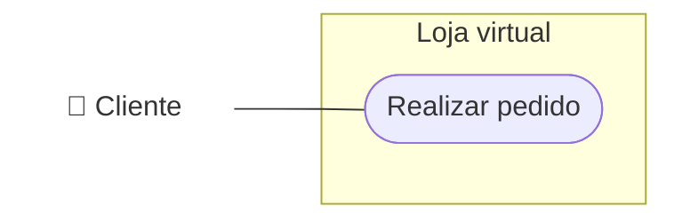

Trecho da especificação:
- **Exceção 3a. Produto sem estoque suficiente**: o sistema informa a quantidade disponível. O cliente pode ajustar a quantidade (volta ao passo 3) ou remover o produto do pedido (continua no passo 4).

Se a loja oferecesse algo **opcional** nesse caso, como "avisar quando o produto chegar", aí sim caberia um caso de uso extensor («extend») ligado a "Realizar pedido".

### 12. Produção televisiva

> Uma rede de TV quer um sistema para uma produção (novela, minissérie). A produção tem verba e é composta de cenas, escolhidas numa sequência. Cada cena tem duração e é gravada em uma ou mais fitas (cada fita tem número de série e capacidade em minutos). Cada cena pode ser gravada várias vezes, e o produtor depois escolhe uma tomada. Registra-se quais atores e dublês participaram de cada cena e qual dublê substituiu qual ator. Também se registram os funcionários de apoio (câmeras, iluminadores, contrarregras), que podem ter mais de uma função na mesma produção. Atores e dublês ganham por produção; os demais têm salário fixo por obra. No fim da obra, o sistema gera o relatório de pagamento de cada funcionário e um relatório das cenas e de quem participou. Construa o modelo de casos de uso e identifique as regras de negócio.

Ver solução

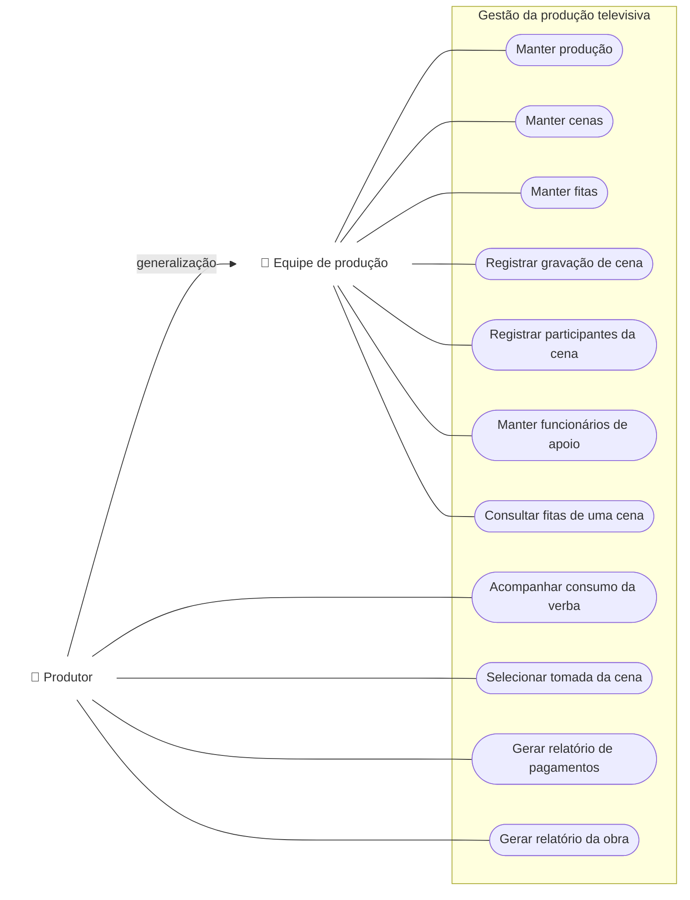

**Regras de negócio**

| ID | Regra |
|---|---|
| RN01 | Cada cena é gravada em uma ou mais fitas. |
| RN02 | O tempo gravado numa fita não pode passar da capacidade dela, em minutos. |
| RN03 | Uma cena pode ter várias tomadas, e só uma delas vai para a versão final. |
| RN04 | Um dublê substitui um ator numa cena específica. |
| RN05 | Atores e dublês recebem por produção em que participam. Os demais funcionários têm salário fixo por obra. |
| RN06 | Um funcionário de apoio pode exercer mais de uma função na mesma produção. |
| RN07 | O relatório de pagamentos só é gerado depois do término da obra. |

- O enunciado não diz quem usa o sistema. A solução supõe uma **equipe de produção**, que registra os dados, e o **produtor**, que herda tudo dela e ainda escolhe tomadas e gera relatórios.
- "Manter" reúne incluir, alterar, excluir e consultar num caso de uso só, como os slides sugerem para cadastros.

### 13. GNU Editor

> O GNU Editor é um editor gráfico em que o usuário cria e edita desenhos com linhas, retângulos, elipses e texto. Tem dois modos, um ativo por vez: no modo de seleção, o usuário seleciona um ou mais elementos e os manipula como um só, e arrasta pontos de controle para modificá-los; no modo de criação, escolhe um elemento predefinido e o cria com o mouse. Elabore um modelo de casos de uso inicial.

Ver solução

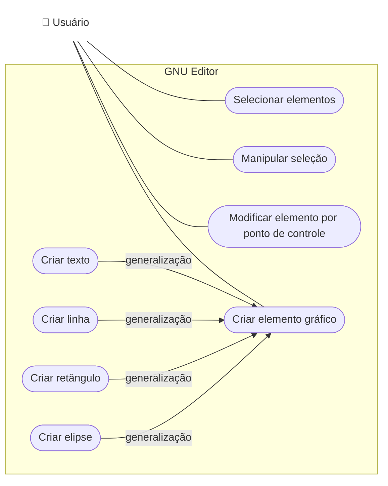

- Os quatro tipos de criação têm comportamento parecido (começam no clique, terminam ao soltar o botão), então viram especializações de um caso de uso genérico, **Criar elemento gráfico**.
- Os modos de operação não são casos de uso: são estados do editor. Eles aparecem nas precondições, por exemplo "o editor está no modo de seleção" para "Manipular seleção".

### 14. Livros por correio: atores

> "Após a ordem de compra do cliente ter sido registrada, o vendedor envia uma requisição ao depósito com detalhes da ordem de compra." Que atores em potencial aparecem?

Ver solução

- **Vendedor**: registra a ordem de compra e envia a requisição.
- **Depósito**: recebe a requisição. Pode ser um funcionário do depósito ou outro sistema.
- **Cliente**: só é ator se ele mesmo registrar a ordem no sistema. Pela frase, quem registra é o vendedor, então o cliente provavelmente não interage diretamente.

### 15. Editor de texto com extensões

> Desenhe o diagrama com o caso de uso Editar Documento e os extensores Corrigir Ortografia e Substituir Texto. Depois, estenda o diagrama com um novo requisito: criar um índice remissivo do documento.

Ver solução

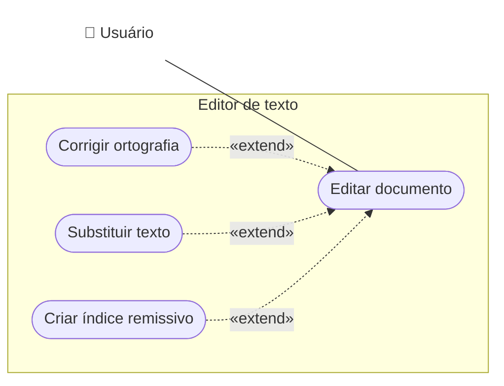

Criar o índice remissivo é opcional durante a edição, então entra como mais um «extend» de "Editar documento". O caso de uso base não muda.

### 16. Horas em projetos: atores e papéis

> Uma empresa tem 50 empregados, cada um em pelo menos um projeto. Os participantes marcam as horas trabalhadas, e outra pessoa gera, no fim do mês, os relatórios com o total de horas de cada um. Quantos atores e quantos papéis você definiria?

Ver solução

**Dois atores**, que são **dois papéis**: *Participante de projeto* (marca as horas) e *Responsável pelos relatórios* (gera os totais do mês). Um ator é um papel, não uma pessoa, então os 50 empregados são todos o mesmo ator Participante.

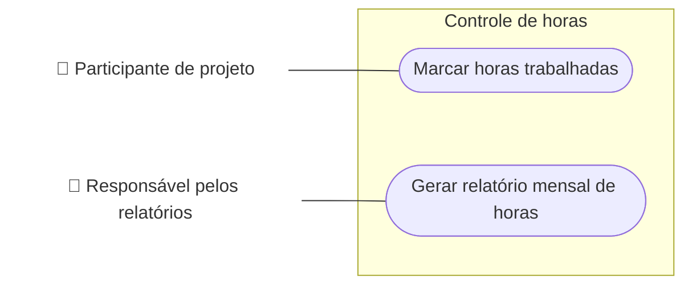

### 17. TurboNote+

> O TurboNote+ cria lembretes ("folhinhas") na área de trabalho. O usuário cria uma folhinha, escreve texto, move pela área de trabalho e remove quando não precisa mais. As folhinhas continuam lá quando o computador é reiniciado. Se o usuário escrever uma expressão aritmética, o resultado aparece.

Ver solução

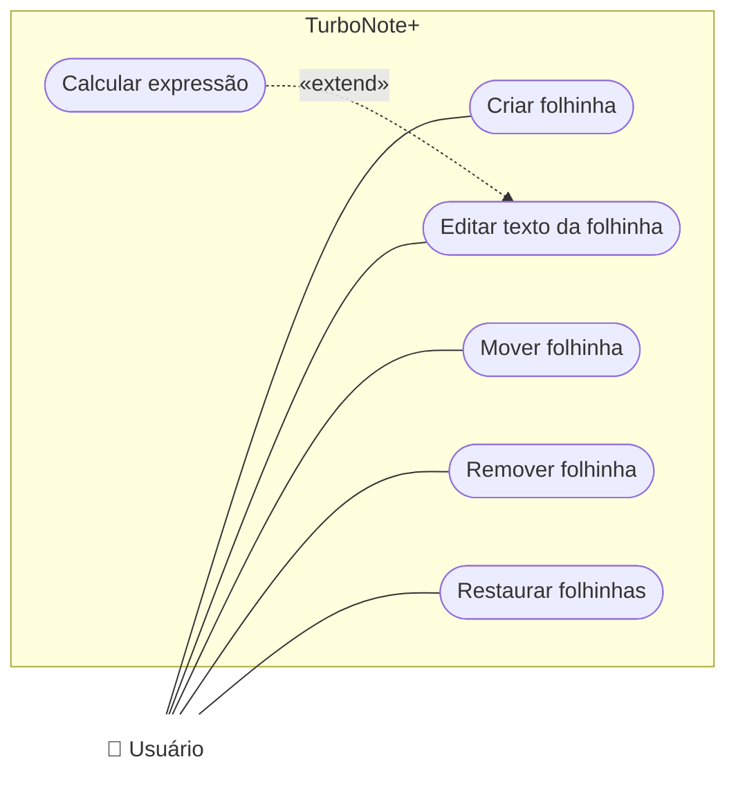

- "Calcular expressão" só acontece quando o texto tem uma expressão, então é um «extend» de "Editar texto".
- "Restaurar folhinhas" é um caso de uso de **condição interna**: o sistema reage ao início do computador. Ninguém o inicia, e o usuário é quem recebe o resultado.
- "Remover folhinha" é o caso de uso **oposto** de "Criar folhinha".

### 18. Estatísticas mensais

> Um sistema de vendas deve gerar automaticamente estatísticas para a diretoria no último dia útil de cada mês. Desenhe o diagrama. Há mais de uma maneira de representar?

Ver solução

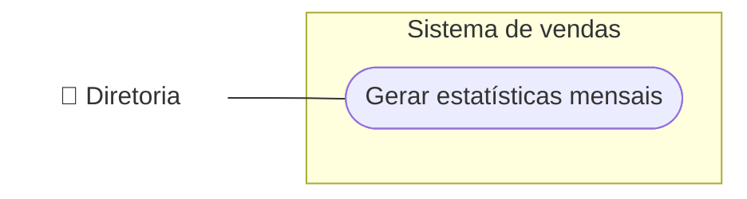

É um **caso de uso temporal**: ninguém o inicia, ele acontece no último dia útil do mês. Pelos slides, o ator é quem **recebe** a informação, a Diretoria.

Sim, há outra maneira: alguns modelos colocam um ator **Tempo** (ou Relógio) como quem inicia o caso de uso, e a Diretoria como ator secundário que recebe o resultado.

### 19. Navegador e Internet

> O usuário abre um navegador, que se comunica com servidores Web para mostrar as páginas. O que está errado no diagrama da lista? Desenhe dois diagramas: um em que o navegador é o sistema e outro em que a Internet é o sistema.

Ver solução

O diagrama original não veio no material (a lista diz "o diagrama a seguir", mas ele não está no arquivo), então não dá para apontar o erro. As duas alternativas de escopo:

**Navegador como sistema**: o servidor Web é externo, então vira ator secundário.

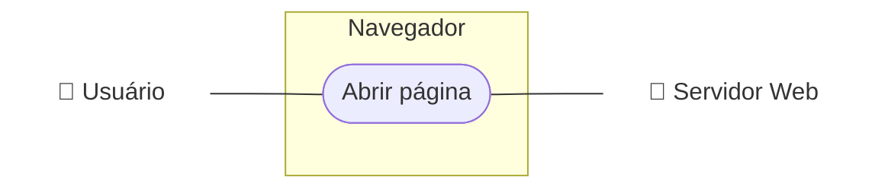

**Internet como sistema**: navegador e servidores ficam **dentro** do sistema, então não são atores. Só o usuário é ator.

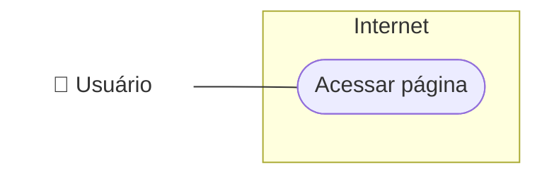

A diferença mostra que o **limite do sistema** decide quem é ator: o que fica fora do limite e interage é ator; o que fica dentro é parte do sistema.

### 20. Verdadeiro ou falso

> ( ) Pessoas com o mesmo cargo numa empresa podem representar papéis de diversos atores.
> ( ) Um ator pode representar pessoas de diferentes cargos.

Ver solução

- **(V)** Uma mesma pessoa, ou pessoas do mesmo cargo, podem fazer papéis diferentes no sistema, e cada papel é um ator.
- **(V)** Um ator é um papel, então pessoas de cargos diferentes podem fazer o mesmo papel.

### 21. Renomear casos de uso

> Corrija os nomes: a. Cliente realiza transferência de fundos em um caixa eletrônico. b. Clientes compram livros na livraria. c. É produzido um relatório de vendas para o gerente. d. Hóspede se registra em um hotel.

Ver solução

Regra: **verbo no infinitivo**, sem o nome do ator e sem detalhes de tecnologia.

| Original | Nome corrigido |
|---|---|
| a. Cliente realiza transferência de fundos em um caixa eletrônico | Transferir fundos |
| b. Clientes compram livros na livraria | Comprar livros |
| c. É produzido um relatório de vendas para o gerente | Gerar relatório de vendas |
| d. Hóspede se registra em um hotel | Registrar hospedagem |

O ator (cliente, gerente, hóspede) aparece no diagrama ligado ao caso de uso, e não no nome.

### 22. Biblioteca, celular e cartões

> Desenhe diagramas de casos de uso para: a. a biblioteca da sua universidade; b. o seu celular; c. um sistema de validação de cartões de crédito.

Ver solução

**a. Biblioteca da universidade**

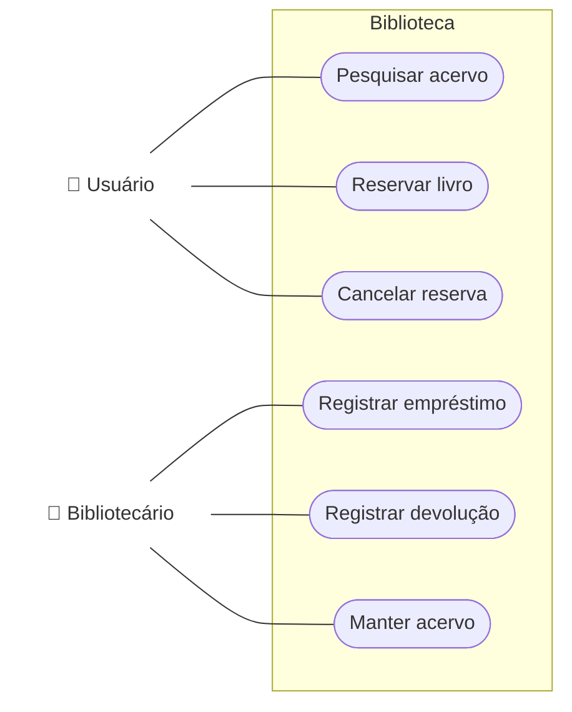

**b. Celular**

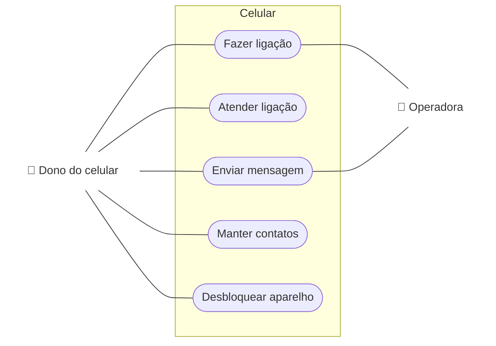

**c. Validação de cartões de crédito**

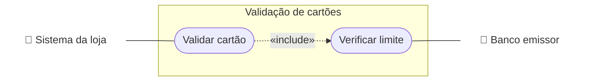

- Em (c), os atores são **outros sistemas**: quem pede a validação é o sistema da loja, e quem informa o limite é o banco emissor.
- Os casos de uso escolhidos são exemplos. O exercício é aberto e aceita outras escolhas.

### 23. A partir de "Pagar Pedido"

> Existe o caso de uso Pagar Pedido, realizado pelo Cliente, que paga um pedido feito no passado. Que outros casos de uso você consegue pensar?

Ver solução

Usando as estratégias dos slides:

| Estratégia | Caso de uso |
|---|---|
| Caso de uso que **precede** | Realizar Pedido (só dá para pagar um pedido que existe) e Cadastrar Cliente |
| Caso de uso **oposto** | Cancelar Pagamento (ou Estornar Pagamento) e Cancelar Pedido |
| Caso de uso que **sucede** | Agendar Entrega e Emitir Comprovante |
| Caso de uso **temporal** | Cobrar Pedidos em Atraso (o sistema avisa os clientes de tempos em tempos) |

### 24. Controle acadêmico com períodos

> Modifique o modelo de casos de uso do Sistema de Controle Acadêmico para incluir: a. o coordenador define as datas inicial e final em que os professores podem lançar notas e informar a disponibilidade para o semestre seguinte; b. também há períodos de inscrição e de cancelamento, fora dos quais o sistema não aceita essas operações, e o coordenador define esses períodos; além disso, o coordenador quer ser avisado (por e-mail, por exemplo) quando o sistema cria uma nova lista de espera para uma disciplina.

Ver solução

O modelo inicial citado pela lista não está no material. A solução mostra só os casos de uso novos e os que mudam.

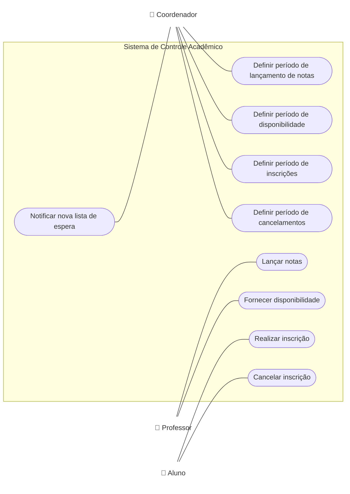

- Os quatro "Definir período" são casos de uso **novos** do coordenador.
- Lançar notas, fornecer disponibilidade, inscrever e cancelar **não mudam no diagrama**: ganham **regras de negócio** (só são aceitos dentro do período) e um **fluxo de exceção** ("fora do período: o sistema informa e o caso de uso termina").
- "Notificar nova lista de espera" é um caso de uso de **condição interna**: o sistema reage à criação da lista, e o coordenador é quem recebe o aviso.

