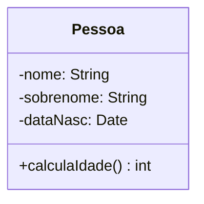
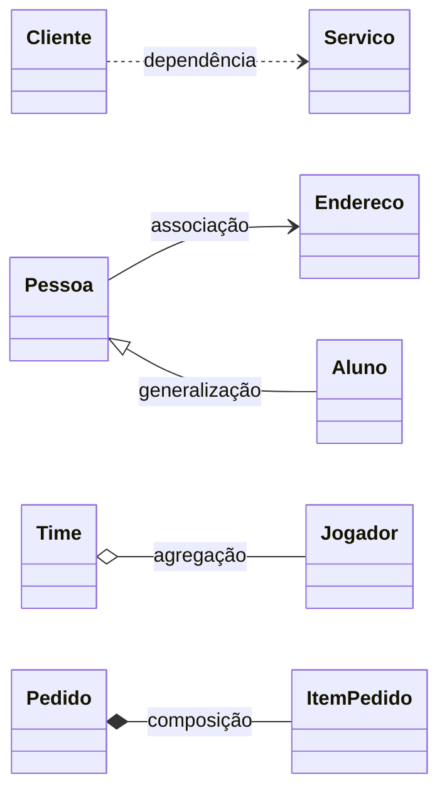
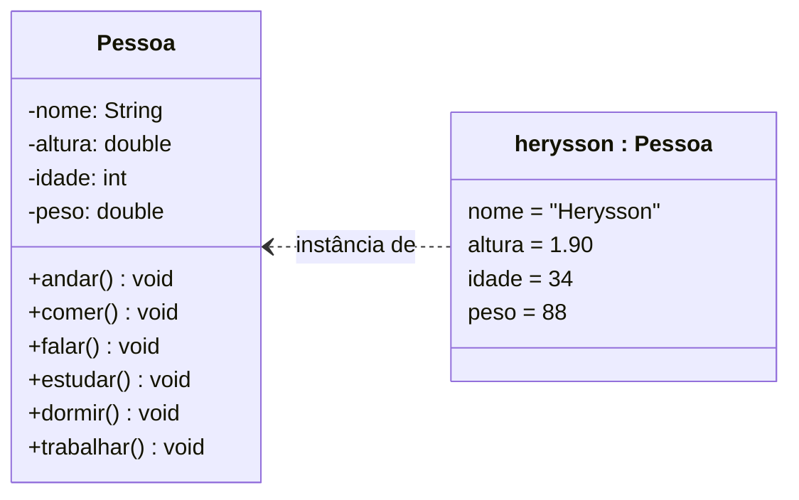
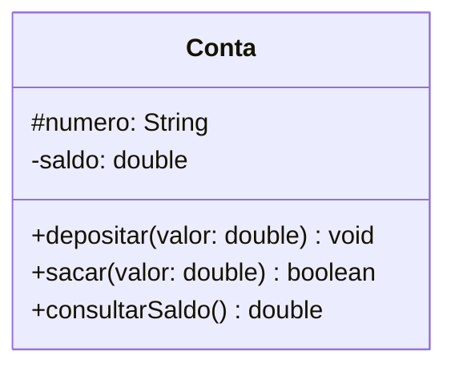

# Aula 10: Diagrama de Classes

Introdução ao diagrama de classes: o que ele representa, como desenhar uma classe com atributos, métodos e visibilidade, e quais relacionamentos existem entre classes. As associações e a herança em detalhe ficam na [aula 11](../aula11).

Tipo: exercícios e exemplos · Exercícios com solução em [exercicios.md](exercicios.md)

Material do professor: [slides](https://github.com/Herysson/Engenharia-de-Software/blob/main/Aula%2010%20-%20Diagrama%20de%20Classes.pptx)

## Tópicos

- Visões estática e dinâmica, e os 13 diagramas da UML
- Orientação a objetos, objeto e classe
- O diagrama de classes e para que serve
- Representação de uma classe: os três compartimentos
- Visibilidade dos membros
- Os tipos de relacionamento entre classes

---

## O que um diagrama representa

| Visão | Mostra | Por meio de |
|---|---|---|
| **Estática** (estrutural) | a estrutura do sistema | objetos, operações, relações e atributos |
| **Dinâmica** (comportamental) | o comportamento | colaboração entre objetos e mudanças de estado |

### Os 13 diagramas da UML

| Estruturais (7) | Comportamentais (6) |
|---|---|
| Classes ([aulas 10](../aula10) e [11](../aula11)) | Caso de uso ([aula 09](../aula09)) |
| Objetos ([aula 14](../aula14)) | Sequência ([aula 13](../aula13)) |
| Pacotes | Máquina de estados ([aula 08](../aula08)) |
| Componentes | Atividade ([aula 08](../aula08)) |
| Implantação | Visão geral de interação |
| Estrutura composta | Temporização |
| Perfil | |

## Orientação a objetos

- **Orientado a objetos**: o software é organizado como uma coleção de objetos distintos, cada um com **estrutura de dados** e **comportamento**.
- **Objeto**: um elemento computacional que representa, no domínio da solução, uma entidade (abstrata ou concreta) do domínio do problema.
- **Classe**: a representação de um item do mundo real, físico ou abstrato, como um tipo de dados personalizado.
  - **Atributos** guardam os dados dos objetos.
  - **Métodos** são as operações que os objetos da classe podem executar.
  - Uma instância de uma classe é um **objeto**.

| | Classe `Pessoa` | Objeto (instância) |
|---|---|---|
| Atributos | nome, altura, idade, peso | nome: Herysson · altura: 1,90 m · idade: 34 · peso: 88 kg |
| Métodos | andar, comer, falar, estudar, dormir, trabalhar | os mesmos, executados por esse objeto |

## Diagrama de classes

Descreve a **estrutura estática** das classes: atributos, operações (métodos) e relacionamentos. Mostra a organização lógica das classes, é um dos diagramas mais populares e serve de **base para outros diagramas** da UML.

### Representação de uma classe

Um retângulo com três compartimentos:

| Compartimento | Conteúdo | Formato |
|---|---|---|
| Nome | nome da classe e, se houver, o **estereótipo** (interface, controller, abstrata...) | `«estereótipo» Nome` |
| Atributos | os dados | `nome: tipo` ou `nome: tipo = valor` |
| Operações | os métodos | `método(parâmetros): tipoRetorno` |

### Visibilidade

| Símbolo | Visibilidade |
|---|---|
| `+` | pública |
| `#` | protegida |
| `-` | privada |
| `~` | pacote |
| `/` | derivado |

### Exemplo dos slides: classe Pessoa

> Representar uma classe Pessoa com os atributos nome, sobrenome e dataNasc, e o método calculaIdade.

- Os atributos ficam **privados** (`-`): só a própria classe mexe neles.
- O método fica **público** (`+`): outros objetos podem pedir a idade.
- `calculaIdade()` não recebe parâmetros e devolve um inteiro. No diagrama, o Mermaid mostra o retorno como `calculaIdade() : int`.

## Relacionamentos entre classes

Um relacionamento é uma conexão entre itens. Cada tipo tem um desenho próprio:

| Relacionamento | Desenho |
|---|---|
| Dependência | linha tracejada com seta aberta |
| Associação | linha contínua |
| Agregação | linha com losango vazio do lado do todo |
| Composição | linha com losango cheio do lado do todo |
| Generalização | linha com triângulo vazado do lado da classe mais genérica |

O significado de cada um, com multiplicidade e papéis, está na [aula 11](../aula11).

---

## Exemplos resolvidos

### Exemplo 1: classe e objeto

> Desenhar a classe Pessoa do exemplo dos slides e o objeto que representa o professor.

- A classe tem **tipos**; o objeto tem **valores**.
- O objeto não repete os métodos: ele usa os da classe.
- Na UML, o nome do objeto é sublinhado (`herysson : Pessoa`). O Mermaid não sublinha, então o nome aparece com o formato `objeto : Classe`.

### Exemplo 2: escolhendo a visibilidade

> Uma conta tem número e saldo. O saldo só pode mudar por depósitos e saques. Uma subclasse de conta precisa ler o número.

| Membro | Visibilidade | Por quê |
|---|---|---|
| `numero` | `#` protegida | a subclasse precisa acessar |
| `saldo` | `-` privada | só muda pelos métodos da própria classe |
| `depositar`, `sacar`, `consultarSaldo` | `+` pública | são os serviços que a conta oferece |

Esconder o saldo e expor só os métodos é o **encapsulamento** da [aula 06](../aula06).

## Para lembrar

- Diagrama de classes = visão **estática**: classes, atributos, métodos e relacionamentos.
- Classe é o tipo; objeto é a instância, com valores.
- Três compartimentos: nome, atributos (`nome: tipo`) e operações (`método(params): tipo`).
- Visibilidade: `+` pública, `#` protegida, `-` privada, `~` pacote, `/` derivado.
- Cinco relacionamentos: dependência, associação, agregação, composição e generalização.

## Pontos em aberto

- O desenho de cada relacionamento aparece só na figura do slide. A coluna "Desenho" segue a notação padrão da UML, que é a mesma que o Mermaid desenha.
- Os slides não têm exercícios. Os exercícios desta aula foram montados a partir do conteúdo dos slides, e a [lista de exercícios de diagrama de classes](https://github.com/Herysson/Engenharia-de-Software/blob/main/Exerc%C3%ADcios/Diagrama%20de%20Classes%20-%20Lista%20de%20Exerc%C3%ADcios.docx) está resolvida na [aula 11](../aula11).
- O símbolo `/` (derivado) indica um valor que pode ser calculado a partir de outros, por exemplo `/idade` a partir de `dataNasc`. Os slides só listam o símbolo, sem explicar.
