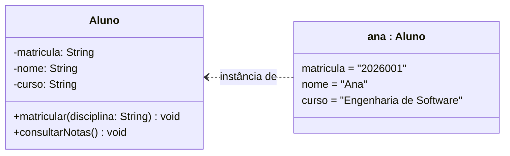
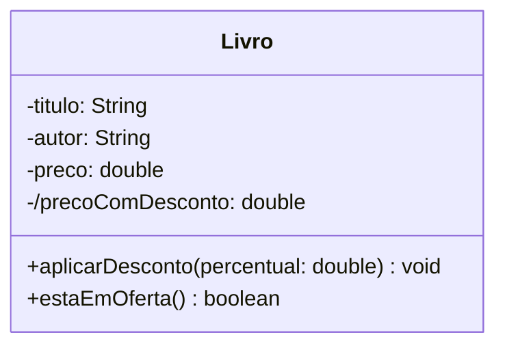
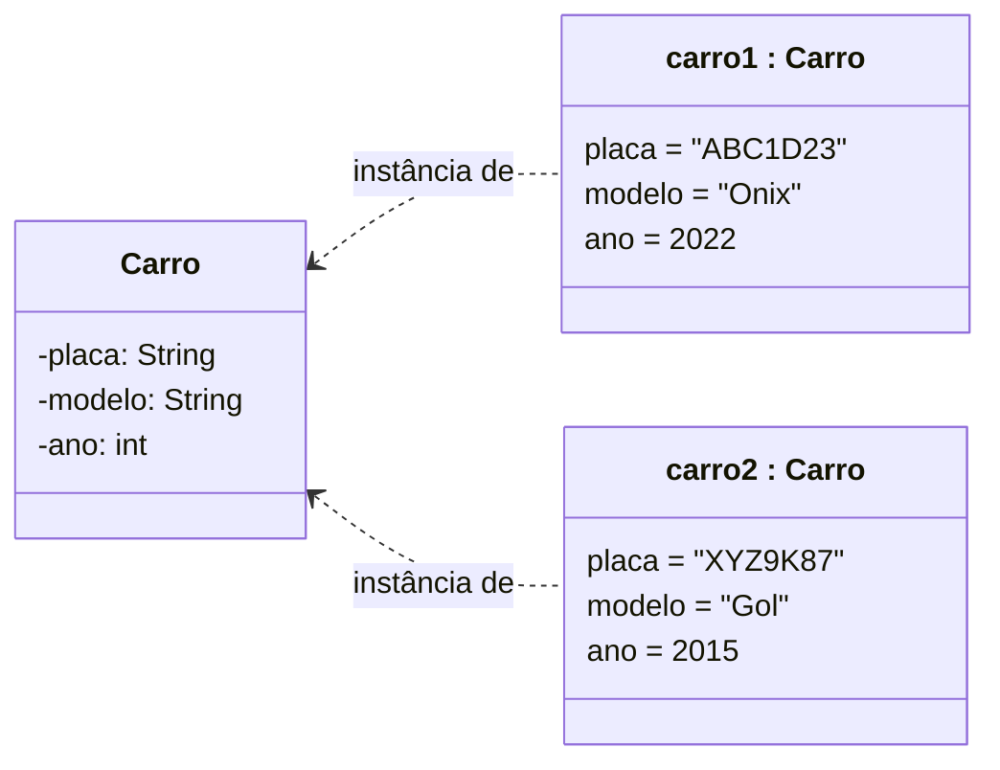
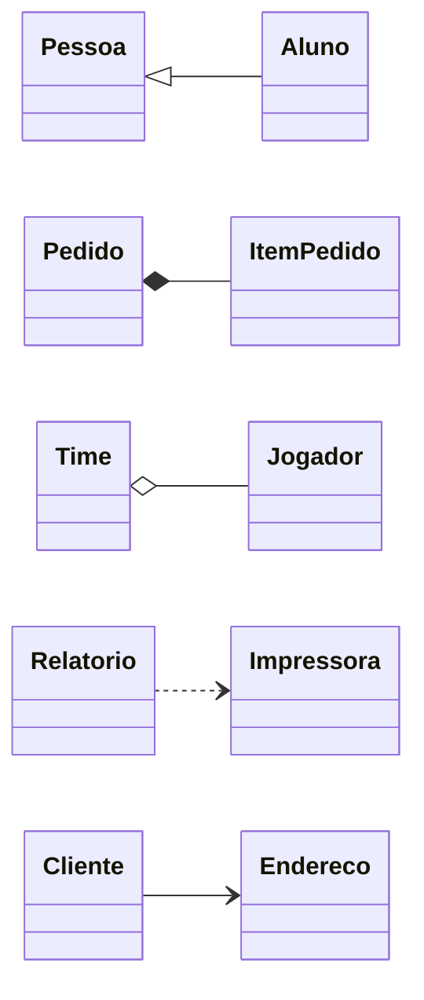

# Aula 10: Exercícios

Os slides desta aula não têm exercícios. Os exercícios abaixo foram montados a partir do conteúdo deles, para praticar a notação de classe. A [lista de exercícios de diagrama de classes](https://github.com/Herysson/Engenharia-de-Software/blob/main/Exerc%C3%ADcios/Diagrama%20de%20Classes%20-%20Lista%20de%20Exerc%C3%ADcios.docx) do professor trata de associações e herança, e está resolvida na [aula 11](../aula11/exercicios.md). Os conceitos estão no [resumo da aula](README.md).

Cada exercício tem **uma** solução possível, escondida: clique em **Ver solução** para abrir. Tente fazer antes de olhar.

## Sumário

| # | Exercício |
|---|---|
| 1 | [Estrutural ou comportamental?](#1-estrutural-ou-comportamental) |
| 2 | [Classe, atributo, método ou objeto?](#2-classe-atributo-método-ou-objeto) |
| 3 | [Classe Livro](#3-classe-livro) |
| 4 | [Classe e dois objetos](#4-classe-e-dois-objetos) |
| 5 | [Corrigir a notação](#5-corrigir-a-notação) |
| 6 | [Qual relacionamento?](#6-qual-relacionamento) |

---

### 1. Estrutural ou comportamental?

> Classifique cada diagrama da UML como estrutural ou comportamental: atividade, classes, implantação, caso de uso, objetos, sequência, componentes, máquina de estados, pacotes, temporização, estrutura composta, visão geral de interação, perfil.

Ver solução

| Estruturais (visão estática) | Comportamentais (visão dinâmica) |
|---|---|
| classes, objetos, pacotes, componentes, implantação, estrutura composta, perfil | caso de uso, sequência, máquina de estados, atividade, visão geral de interação, temporização |

Regra prática: se o diagrama mostra **do que o sistema é feito**, é estrutural; se mostra **o que acontece ao longo do tempo**, é comportamental.

### 2. Classe, atributo, método ou objeto?

> No texto abaixo, diga o que é classe, atributo, método e objeto.
>
> "Todo aluno tem matrícula, nome e curso, e pode se matricular em disciplinas e consultar as notas. A aluna Ana, matrícula 2026001, faz Engenharia de Software."

Ver solução

| Termo | O que é |
|---|---|
| Aluno | classe |
| matrícula, nome, curso | atributos |
| matricular em disciplina, consultar notas | métodos |
| Ana (matrícula 2026001, curso Engenharia de Software) | objeto: uma instância de Aluno, com valores |

### 3. Classe Livro

> Desenhe a classe Livro com: título, autor e preço, acessíveis só pela própria classe; um preço com desconto que é calculado a partir do preço; um método público que aplica um desconto recebendo o percentual; e um método público que diz se o livro está em oferta.

Ver solução

- "Acessíveis só pela própria classe" = privado (`-`).
- O preço com desconto é **derivado** (`/`): é calculado a partir do preço e não precisa ser guardado separado.
- `estaEmOferta()` responde sim ou não, então retorna `boolean`.

### 4. Classe e dois objetos

> Desenhe a classe Carro (placa, modelo, ano) e dois objetos dela.

Ver solução

Os dois objetos têm os mesmos atributos (definidos pela classe), mas cada um com os seus valores.

### 5. Corrigir a notação

> O que está errado em cada linha, considerando os formatos da aula?
>
> a. `+ String nome`
> b. `calcularTotal: double()`
> c. `*idade: int`
> d. `-desconto: double = 10%`

Ver solução

| Linha | Problema | Correção |
|---|---|---|
| a | o formato da aula é `nome: tipo`, e não tipo antes do nome | `+nome: String` |
| b | parênteses e tipo trocados de lugar: é `método(parâmetros): tipoRetorno` | `+calcularTotal(): double` |
| c | `*` não é um símbolo de visibilidade. Os da aula são `+ # - ~ /` | `-idade: int` |
| d | o valor inicial precisa ser do tipo declarado. `10%` não é um `double` | `-desconto: double = 0.10` |

### 6. Qual relacionamento?

> Para cada par, diga qual dos cinco relacionamentos da aula combina melhor: a. Aluno e Pessoa. b. Pedido e ItemPedido (o item não existe sem o pedido). c. Time e Jogador (o jogador continua existindo se o time acabar). d. Relatório usa uma Impressora só enquanto imprime. e. Cliente e Endereço.

Ver solução

| Par | Relacionamento | Por quê |
|---|---|---|
| a. Aluno e Pessoa | generalização | todo aluno **é uma** pessoa |
| b. Pedido e ItemPedido | composição | o item faz parte do pedido e não existe sem ele |
| c. Time e Jogador | agregação | o jogador faz parte do time, mas existe sozinho |
| d. Relatório e Impressora | dependência | o relatório só usa a impressora por um momento |
| e. Cliente e Endereço | associação | o cliente se liga ao endereço de forma duradoura |

A diferença entre agregação e composição (se a parte sobrevive ao todo) é detalhada na [aula 11](../aula11).

