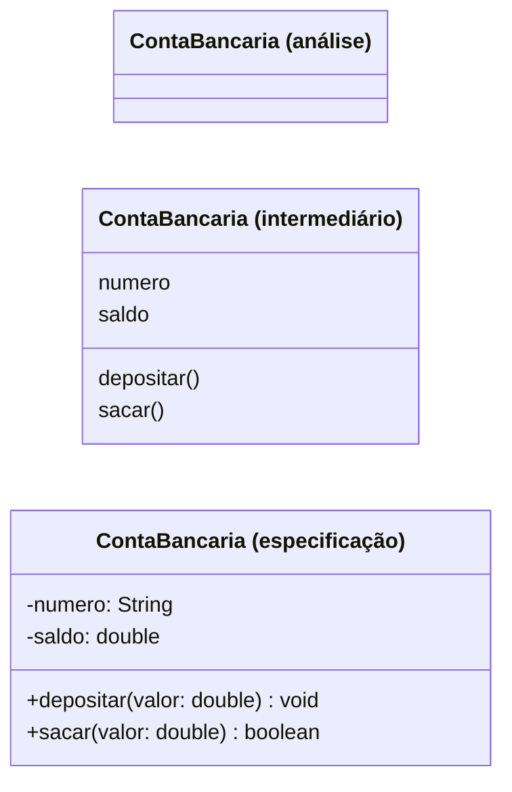
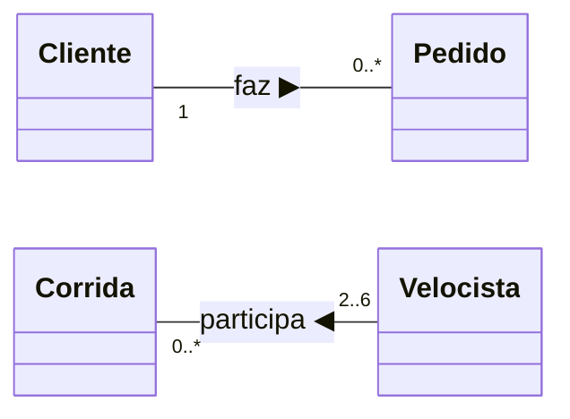
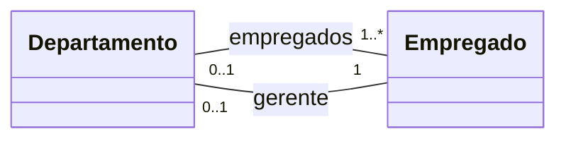
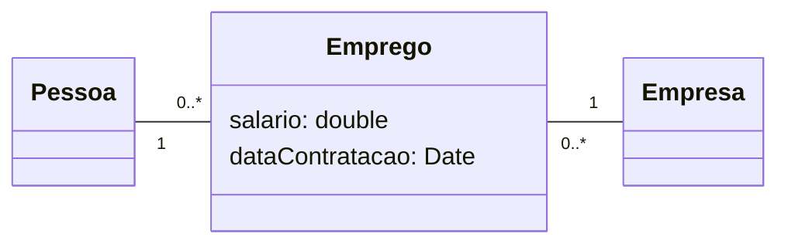
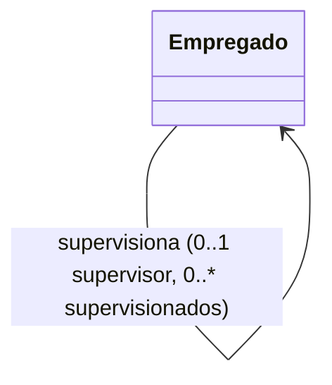
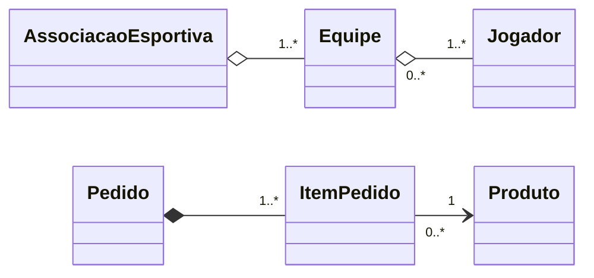
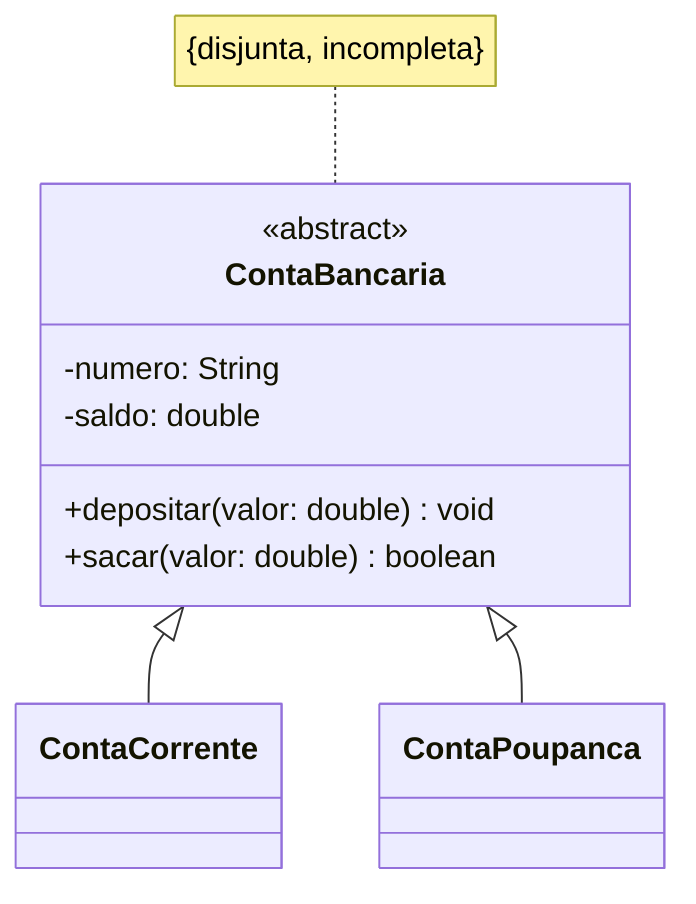
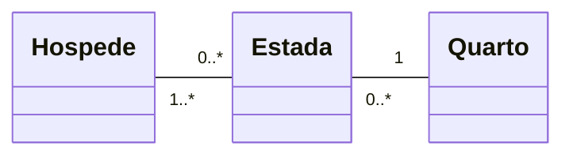
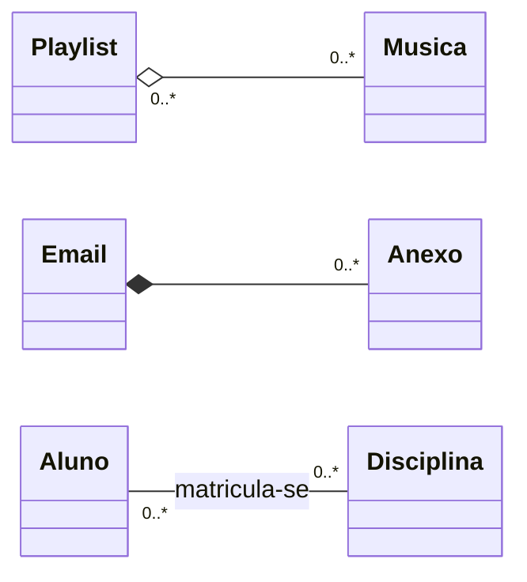

# Aula 11: Diagrama de Classes (parte 2)

O diagrama de classes é o mais rico em notação da UML. Esta aula detalha as associações (multiplicidade, participação, papéis, classes associativas, ternárias e reflexivas), a agregação e a composição, as restrições e a generalização/especialização.

Tipo: exercícios e exemplos · Exercícios com solução em [exercicios.md](exercicios.md)

Material do professor: [slides](https://github.com/Herysson/Engenharia-de-Software/blob/main/Aula%2011%20-%20Diagrama%20de%20Classes%20pt2_4.pptx) · [lista de exercícios de diagrama de classes](https://github.com/Herysson/Engenharia-de-Software/blob/main/Exerc%C3%ADcios/Diagrama%20de%20Classes%20-%20Lista%20de%20Exerc%C3%ADcios.docx)

## Tópicos

- Classes, atributos e operações em diferentes graus de abstração
- Associações: multiplicidade, conectividade, participação, nome, direção de leitura e papéis
- Classes associativas, associações ternárias e reflexivas
- Agregação e composição
- Restrições: subset, xor e OCL
- Generalização e especialização: propriedades, refinamento e restrições

---

## Classes

- O diagrama de classes é usado no modelo de classes **desde a análise até a especificação**. Na [aula 10](../aula10) está a notação básica (três compartimentos e visibilidade).
- O **grau de abstração** do momento define quanto mostrar: na análise, pode bastar o nome; na especificação, entram tipos, visibilidade e parâmetros.
- **Atributos** descrevem os dados que cada objeto guarda. Cada atributo tem um conjunto de valores que pode assumir.
- **Operações** descrevem as ações que os objetos sabem realizar. Os objetos de uma classe **compartilham** as mesmas operações. O nome da operação tem um verbo e um complemento e termina com parênteses.

## Associações

Objetos se relacionam e, por isso, trocam mensagens e colaboram para produzir as funcionalidades. A **associação** representa esses relacionamentos e é desenhada como uma linha entre as classes. Exemplos dos slides: um cliente **compra** produtos; uma conta-corrente **possui** um histórico de transações; hóspedes **ocupam** quartos.

Características: multiplicidade, nome, direção de leitura, papéis, participação e conectividade.

### Multiplicidade

Os limites inferior e superior de objetos com que outro objeto pode se associar. Cada associação tem **duas**, uma em cada ponta.

| Nome | Símbolo |
|---|---|
| Apenas um | `1` |
| Zero ou muitos | `0..*` (ou `*`) |
| Um ou muitos | `1..*` |
| Zero ou um | `0..1` |
| Intervalo específico | `li..ls` |

O `*` quer dizer que não há limite superior. A multiplicidade é parecida com a cardinalidade do diagrama entidade-relacionamento.

- Um cliente pode ter vários pedidos, ou nenhum (`0..*`). Cada pedido é de um cliente (`1`).
- Uma corrida tem no mínimo 2 e no máximo 6 velocistas (`2..6`).

### Conectividade e participação

| Conectividade | Uma ponta | Outra ponta |
|---|---|---|
| Um para um | `0..1` ou `1` | `0..1` ou `1` |
| Um para muitos | `0..1` ou `1` | `*`, `1..*` ou `0..*` |
| Muitos para muitos | `*`, `1..*` ou `0..*` | `*`, `1..*` ou `0..*` |

**Participação**: se o mínimo da multiplicidade é `1`, a participação é **obrigatória**; se é `0`, é **opcional**.

> **Exemplo dos slides**: entre Empregado e Departamento, o `1` perto de Empregado diz que um departamento só existe se tiver um empregado (obrigatória para Departamento). O `0..1` perto de Departamento diz que pode haver empregado sem departamento (opcional para Empregado).

### Nome, direção de leitura e papéis

- **Nome**: no meio da linha. Simples, com significado, nem vago nem óbvio demais.
- **Direção de leitura**: um triângulo pequeno ao lado do nome (aqui, ▶ ou ◀).
- **Papel** (*role*): o que cada classe é naquela associação. Só use quando ajuda; se a associação é intuitiva, o papel só "carrega" o diagrama.

Um departamento precisa saber quem são os seus **empregados** e quem é o seu **gerente**: são duas associações entre as mesmas classes, diferenciadas pelo papel.

### Classe associativa

Uma classe ligada a uma **associação**, e não a outras classes, para guardar informações **da associação**. É mais comum em associações muitos para muitos, mas serve para qualquer conectividade. Desenho: uma classe comum ligada por linha tracejada à linha da associação, que não deve receber nome. Ela é híbrida: tem características de classe e de associação, e pode participar de outros relacionamentos.

Dá para retirar uma classe associativa sem perder informação, em dois passos:
1. eliminar a associação à qual ela está ligada
2. criar associações diretas dela com as classes que eram ligadas pela associação eliminada

Aqui `Emprego` já aparece **sem** a classe associativa: o muitos para muitos entre Pessoa e Empresa virou duas associações um para muitos. (O Mermaid não desenha a linha tracejada até o meio de uma associação.)

### Associação ternária e reflexiva

- **Grau** de uma associação = quantas classes participam. A maioria é **binária** (grau 2). Com grau 3, é **ternária**: liga três objetos distintos.
  - Exemplo dos slides: um técnico usa exatamente um computador em cada projeto em que trabalha.
  - Também existe a **classe associativa ternária**: uma classe associativa ligada a uma associação ternária.
- **Reflexiva** (autoassociação): liga objetos da **mesma classe**, cada um com um papel diferente. Não quer dizer que o objeto se liga a si mesmo, e sim a outros objetos da mesma classe.

## Agregação e composição

Relações **todo-parte**: um objeto está contido no outro.

Características que as diferem da associação simples:
- são **assimétricas**: se A é parte de B, B não pode ser parte de A
- **propagam comportamento**: o que vale para o todo vale para as partes
- as partes costumam ser **criadas e destruídas pelo todo**, que tem operações para adicionar e remover partes

| | Agregação | Composição |
|---|---|---|
| Desenho | losango **branco** perto do todo | losango **negro** perto do todo |
| A parte existe sem o todo? | sim: se o todo for destruído, a parte pode continuar | não: quando o todo deixa de existir, as partes também |
| A parte pode estar em vários todos? | sim | não: pertence a **um** todo só (agregação não compartilhada) |
| Exemplo dos slides | associação esportiva → equipes → jogadores | pedido de compra → itens do pedido |

## Restrições sobre associações

| Restrição | Significado |
|---|---|
| `{subset}` | os objetos ligados por uma associação são um **subconjunto** dos ligados por outra (exemplo dos slides: quem *administra* é um subconjunto de quem *reside*) |
| `{xor}` | duas ou mais associações com uma classe em comum, das quais **só uma** pode ocorrer |
| OCL | *Object Constraint Language*: restrições formais com expressões `Item.seletor` |

Exemplos em OCL citados nos slides: as horas de treinamento do piloto devem ser maiores ou iguais ao mínimo exigido para o avião do voo; para participar de uma sociedade, a pessoa deve ter mais de 21 anos; uma pessoa e o gerente dela devem trabalhar na mesma empresa.

## Generalização e especialização

O relacionamento de **herança**, ou **gen/espec**. Generalização e especialização são dois pontos de vista do mesmo relacionamento: se A generaliza B, B especializa A.

| Mais genérica | Mais específica |
|---|---|
| superclasse | subclasse |
| supertipo | subtipo |
| classe base | classe herdeira |
| ancestral | descendente |

Desenho: uma flecha da **subclasse** para a **superclasse**, com triângulo vazado.

**Propriedades**:
- **Transitividade**: a classe herda da superclasse imediata e também das que estão acima dela.
- **Assimetria**: se A generaliza B, B não pode generalizar A. Não há ciclos na hierarquia.

**Refinando o modelo**:
- **Generalizar**: duas ou mais classes parecidas → criar uma superclasse e torná-las subclasses. Se a superclasse não tem instâncias próprias e só organiza a hierarquia, ela é **abstrata**.
- **Especializar**: criar classes mais específicas a partir de uma que já existe.

**Restrições** (entre chaves, perto da linha):

| Restrição | Significado |
|---|---|
| `{sobreposta}` | depois podem surgir subclasses que herdam de mais de uma subclasse (herança múltipla) |
| `{disjunta}` | as subclasses criadas depois só podem herdar de uma subclasse |
| `{completa}` | todas as subclasses possíveis estão no diagrama |
| `{incompleta}` | nem todas as subclasses foram enumeradas |

Exemplo dos slides: conta-corrente e conta-poupança **são tipos de** conta bancária, e tudo o que vale para a superclasse vale para as duas.

---

## Exemplos resolvidos

### Exemplo 1: ler um diagrama

> O que o diagrama abaixo diz?

- Uma estada tem pelo menos um hóspede (`1..*`), e um hóspede pode ter várias estadas, ou nenhuma (`0..*`).
- Cada estada é em **um** quarto (`1`), e um quarto pode ter várias estadas ao longo do tempo (`0..*`).
- A participação do hóspede na estada é opcional (mínimo `0`). A da estada no quarto é obrigatória (mínimo `1`).

### Exemplo 2: agregação, composição ou associação?

> Uma playlist tem músicas. Uma música pode estar em várias playlists e continua existindo se a playlist for apagada. Um e-mail tem anexos, que somem quando o e-mail é apagado. Um aluno se matricula em disciplinas.

| Par | Relação | Por quê |
|---|---|---|
| Playlist e Música | agregação | todo-parte, mas a música existe sem a playlist e está em várias |
| E-mail e Anexo | composição | o anexo pertence a um e-mail só e some junto com ele |
| Aluno e Disciplina | associação | não é todo-parte: um não "contém" o outro |

## Para lembrar

- Toda associação tem duas multiplicidades. Mínimo 1 = participação obrigatória; mínimo 0 = opcional.
- Papéis e nomes só quando esclarecem.
- Classe associativa guarda dados da associação e pode ser trocada por duas associações diretas.
- Agregação (losango branco): a parte sobrevive. Composição (losango negro): a parte morre com o todo e pertence a um todo só.
- Herança: flecha da subclasse para a superclasse; é transitiva e assimétrica; restrições `{sobreposta | disjunta}` e `{completa | incompleta}`.

## Pontos em aberto

- O slide do diagrama de objetos pede "Fazer exercício - Juca está fazendo compras online para volta às aulas", mas o texto do exercício não está no material.
- Quase todos os exemplos da aula (ContaBancária em graus de abstração, Empregado e Departamento, classes associativas, ternárias, subset, xor, OCL, gen/espec) estão em figuras. Os diagramas daqui foram montados a partir do texto e das notas dos slides; os atributos da ContaBancária são ilustrativos.
- O Mermaid não desenha a ligação tracejada de uma classe associativa nem o losango de uma associação ternária. Por isso os exemplos mostram a forma equivalente, com uma classe comum no meio.
