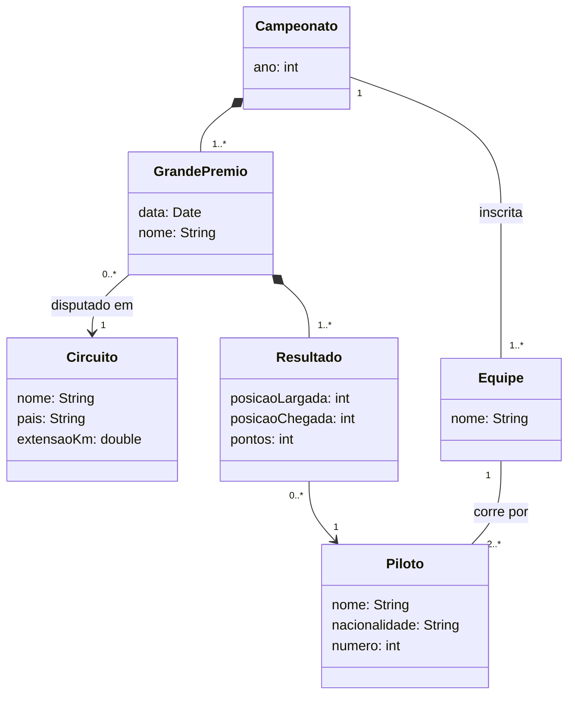
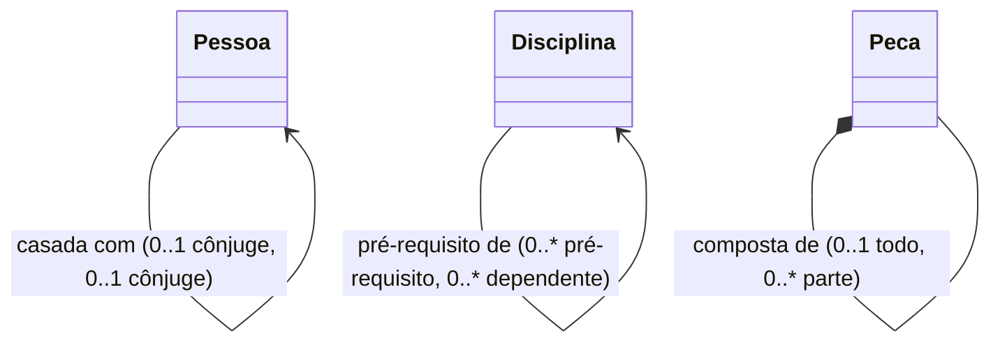
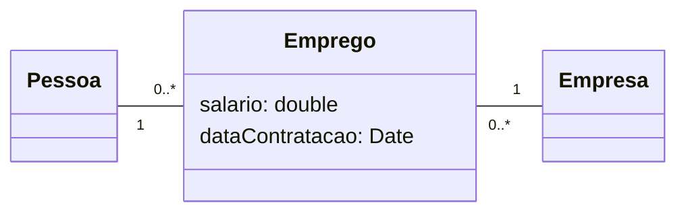
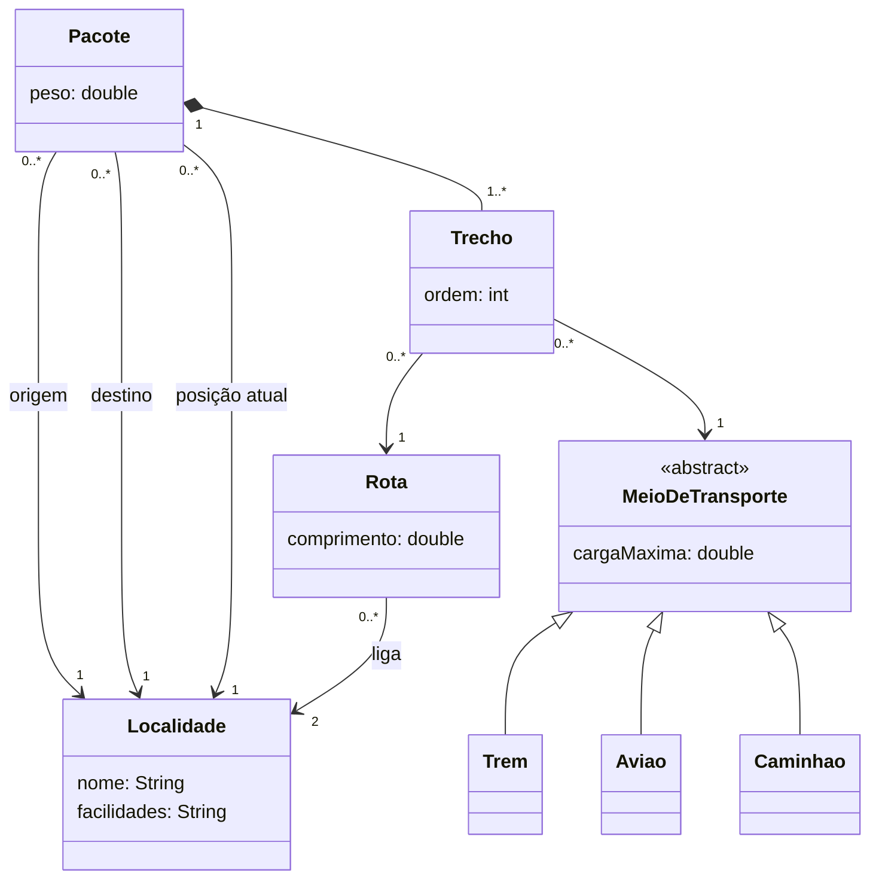
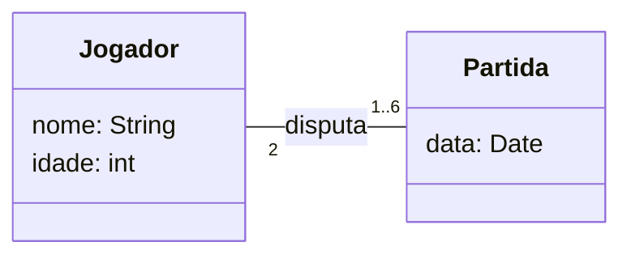
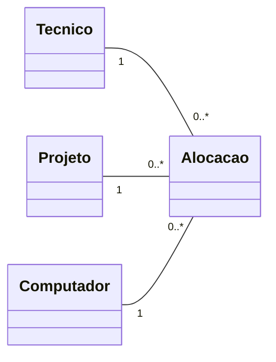
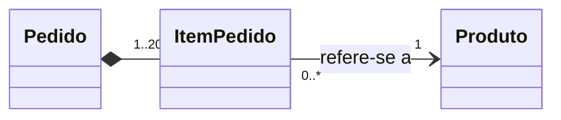
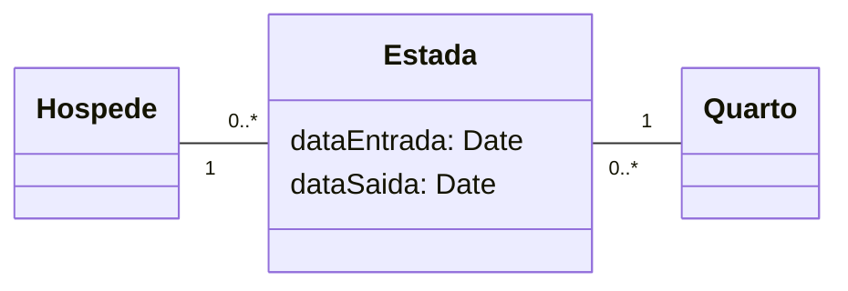
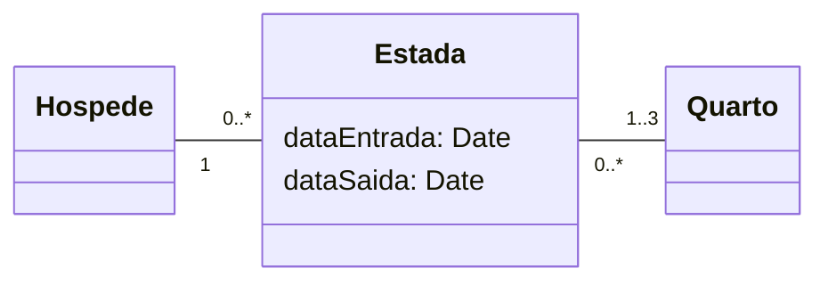

# Aula 11: Exercícios

A [lista de exercícios de diagrama de classes](https://github.com/Herysson/Engenharia-de-Software/blob/main/Exerc%C3%ADcios/Diagrama%20de%20Classes%20-%20Lista%20de%20Exerc%C3%ADcios.docx) do professor. Os conceitos estão no [resumo da aula](README.md) e na [aula 10](../aula10).

Cada exercício tem **uma** solução possível, escondida: clique em **Ver solução** para abrir. Tente fazer antes de olhar.

Alguns exercícios da lista dependem de figuras que não vieram no arquivo, ou de assuntos que as aulas não cobrem (categorização BCE e DDD). Eles estão marcados no sumário, e a solução diz o que dá para responder.

## Sumário

| # | Exercício | Situação |
|---|---|---|
| 1 | [Diagrama de classes no processo iterativo](#1-diagrama-de-classes-no-processo-iterativo) | resolvido |
| 2 | ["Entidade" em BCE e DDD](#2-entidade-em-bce-e-ddd) | fora do conteúdo das aulas |
| 3 | [Campeonato de Fórmula 1](#3-campeonato-de-fórmula-1) | resolvido |
| 4 | [Associações reflexivas](#4-associações-reflexivas) | resolvido |
| 5 | [Retirar a classe associativa Pessoa–Empresa](#5-retirar-a-classe-associativa-pessoaempresa) | resolvido com suposição (figura ausente) |
| 6 | [Transporte de pacotes](#6-transporte-de-pacotes) | resolvido |
| 7 | [Torneio de tênis](#7-torneio-de-tênis) | resolvido |
| 8 | [Classe ordinária e associação ternária](#8-classe-ordinária-e-associação-ternária) | só a técnica (figura ausente) |
| 9 | [Regras do pedido](#9-regras-do-pedido) | resolvido |
| 10 | [Hotel: um quarto ou até três](#10-hotel-um-quarto-ou-até-três) | resolvido |
| 11 | [Tamanho do cartão CRC](#11-tamanho-do-cartão-crc) | reflexão |
| 12 | [Atributos e associações](#12-atributos-e-associações) | reflexão |
| 13 | [Responsabilidades na categorização BCE](#13-responsabilidades-na-categorização-bce) | fora do conteúdo das aulas |
| 14 | [Instâncias possíveis](#14-instâncias-possíveis) | figura ausente |
| 15 | [Modelo sem gen/espec](#15-modelo-sem-genespec) | só a técnica (figura ausente) |
| 16 | [Dois fragmentos equivalentes?](#16-dois-fragmentos-equivalentes) | figura ausente |

---

### 1. Diagrama de classes no processo iterativo

> Descreva a posição do diagrama de classes no desenvolvimento incremental e iterativo. Quando ele é usado e para quê?

Ver solução

- É usado **do nível de análise ao nível de especificação**. Nas primeiras iterações, mostra as classes do domínio com pouco detalhe (às vezes só o nome). Nas seguintes, ganha atributos com tipo, operações com parâmetros e visibilidade.
- Serve para descrever a **estrutura estática** do sistema (classes, atributos, operações e relacionamentos) e é a **base para outros diagramas** da UML.
- Em cada iteração, os casos de uso escolhidos ajudam a descobrir novas classes e a refinar as que já existem.

### 2. "Entidade" em BCE e DDD

> O nome "entidade" aparece na categorização BCE e nos padrões táticos do DDD. Discuta as diferenças e semelhanças.

Ver solução

Nenhuma aula da disciplina apresenta a categorização BCE (*Boundary, Control, Entity*) nem o DDD (*Domain-Driven Design*). Este exercício precisa de um material que não está no repositório do professor, então ficou sem resposta aqui.

### 3. Campeonato de Fórmula 1

> Construa o modelo de classes de domínio de um sistema para controlar o campeonato de Fórmula 1.

Ver solução

- **Resultado** guarda o que acontece entre um piloto e um grande prêmio (posição e pontos). É a forma sem classe associativa de um muitos para muitos entre Piloto e GrandePremio.
- Um grande prêmio é parte do campeonato (composição). O circuito existe sozinho e é usado em vários anos, por isso é só uma associação.
- A pontuação do campeonato é **derivada**: é a soma dos pontos dos resultados de cada piloto.
- O enunciado é curto. Os atributos e as multiplicidades (como 2 ou mais pilotos por equipe) são escolhas desta solução.

### 4. Associações reflexivas

> Desenhe com relacionamentos, papéis e multiplicidades: a. Uma Pessoa pode ser casada com outra Pessoa. b. Uma Disciplina é pré-requisito para outra Disciplina. c. Uma Peça pode ser composta de diversas outras Peças.

Ver solução

| Situação | Papéis | Multiplicidades |
|---|---|---|
| a. Pessoa casada com Pessoa | cônjuge / cônjuge | `0..1` nas duas pontas: pode não ser casada, e no máximo com uma pessoa |
| b. Disciplina pré-requisito | pré-requisito / dependente | `0..*` nas duas pontas: uma disciplina pode exigir várias e ser exigida por várias |
| c. Peça composta de Peças | todo / parte | `0..1` todo e `0..*` partes, em composição: cada peça é parte de no máximo uma peça maior |

São todas **reflexivas**: ligam objetos diferentes da mesma classe, cada um com um papel. Nenhuma liga o objeto a si mesmo. (O Mermaid repete as multiplicidades em laços, então elas estão no rótulo.)

### 5. Retirar a classe associativa Pessoa–Empresa

> Crie um diagrama equivalente ao da lista (classe associativa entre Pessoa e Empresa), sem usar classe associativa.

Ver solução

A figura não veio no arquivo. A solução supõe o caso mais comum: uma pessoa trabalha em várias empresas e uma empresa tem várias pessoas, e a classe associativa **Emprego** guarda os dados de cada vínculo (salário, data de contratação).

Aplicando os dois passos da aula:
1. eliminar a associação muitos para muitos entre Pessoa e Empresa
2. ligar Emprego diretamente a Pessoa e a Empresa

- Cada emprego é de **uma** pessoa em **uma** empresa (`1` nas pontas de Pessoa e Empresa).
- A multiplicidade original (`*` de cada lado) passa para o lado de Emprego (`0..*`).

### 6. Transporte de pacotes

> Pacotes, com peso, são enviados de uma localidade a outra. Localidades têm facilidades de transporte (rodoviárias, aeroportos, autoestradas). Algumas são vizinhas: há uma rota direta entre elas, com um comprimento. Trens, aviões e caminhões transportam pacotes, e cada um suporta uma carga máxima. É preciso saber a localidade atual de cada pacote e qual meio de transporte é usado em cada parte da rota de um pacote.

Ver solução

- **Rota** representa a vizinhança: cada rota liga **duas** localidades e guarda o comprimento. É a forma sem classe associativa de uma associação reflexiva de Localidade.
- **Trecho** responde a "que meio de transporte é usado em cada parte da rota para um certo pacote": liga um pacote, uma rota e um meio de transporte. É a forma com classe comum de uma **associação ternária**.
- Trem, avião e caminhão são **especializações** de um meio de transporte abstrato, que tem a carga máxima.

### 7. Torneio de tênis

> "Num torneio de tênis, cada partida é disputada entre dois jogadores. Pretende-se manter informação sobre o nome e a idade dos jogadores, a data da partida e a atribuição dos jogadores às partidas. Um jogador realiza no máximo seis partidas e no mínimo uma."

Ver solução

- Cada partida tem exatamente **2** jogadores.
- Cada jogador está em **1 a 6** partidas: a participação é obrigatória (mínimo 1) e o limite superior é 6.

### 8. Classe ordinária e associação ternária

> Desenhe um diagrama equivalente ao da figura da lista de duas formas: com uma classe ordinária no lugar da classe associativa, e com uma associação ternária.

Ver solução

A figura não veio no arquivo, então não dá para desenhar a resposta exata. A técnica, usando o exemplo de ternária dos slides (um técnico usa um computador em cada projeto):

**Com classe ordinária**: o vínculo vira uma classe comum, ligada às três classes.

**Com associação ternária**: uma associação só, desenhada na UML com um losango no centro ligado às três classes. Cada alocação liga exatamente um técnico, um projeto e um computador. O Mermaid não desenha esse losango, por isso o desenho acima é o que dá para mostrar aqui.

### 9. Regras do pedido

> Identifique classes e relacionamentos a partir das regras: pedidos são compostos de vários itens; um item diz respeito a exatamente um produto; um pedido pode ter até 20 itens.

Ver solução

| Regra | Vira |
|---|---|
| Pedidos são compostos de itens | composição Pedido → ItemPedido |
| Um item diz respeito a exatamente um produto | associação com `1` do lado de Produto |
| Um pedido pode ter até 20 itens | multiplicidade `1..20` do lado de ItemPedido |

O lado de Produto em relação a ItemPedido é `0..*`: um produto pode aparecer em vários itens, ou em nenhum.

### 10. Hotel: um quarto ou até três

> Normalmente, um hóspede ocupa um quarto por estada. Uma nova regra permite que ele use até três quartos. Desenhe as duas situações.

Ver solução

**Antes: um quarto por estada**

**Depois: até três quartos por estada**

A regra de negócio muda **uma multiplicidade** só: o lado do Quarto passa de `1` para `1..3`. Por isso vale a pena ter a classe Estada: a mudança fica num lugar só.

### 11. Tamanho do cartão CRC

> Reflita: "O tamanho do cartão CRC ajuda a limitar e a restringir a complexidade das classes identificadas nas sessões CRC."

Ver solução

Os cartões CRC (*Class Responsibilities and Collaborators*) aparecem na [aula 03](../aula03), no projeto do XP. Cada cartão tem o nome da classe, as responsabilidades e os colaboradores. Se as responsabilidades não cabem num cartão pequeno, é sinal de que a classe faz coisas demais e deveria ser dividida. O limite físico força classes menores e com um foco só, o que combina com o princípio KIS do XP. A prática de CRC da disciplina está na [aula 14](../aula14/exercicios.md).

### 12. Atributos e associações

> Reflita: "Atributos são similares a associações. Um atributo de uma classe é apenas uma notação para associá-la a um conceito que tem um valor atômico."

Ver solução

Faz sentido: tanto um atributo quanto uma associação ligam um objeto a outra coisa. A diferença é o que fica do outro lado:
- **Atributo**: um **valor atômico** (um número, um texto, uma data), sem identidade própria e sem comportamento.
- **Associação**: outro **objeto**, com identidade, atributos e operações próprios, com quem é possível trocar mensagens.

Regra prática: se a "coisa" tem dados e comportamento próprios, ou é compartilhada por vários objetos (como o endereço de vários clientes), ela vira uma classe ligada por associação. Se é só um valor, fica como atributo.

### 13. Responsabilidades na categorização BCE

> No contexto da categorização BCE, qual categoria de objeto (fronteira, controle ou entidade) é mais adequada para cada responsabilidade: criar ou destruir objetos; formar ou destruir associações entre entidades; obter ou modificar atributos de uma entidade; exibir mensagens para o ator; realizar cálculos complexos?

Ver solução

Assim como no exercício 2, a categorização BCE não é apresentada em nenhuma aula da disciplina, então o exercício ficou sem resposta aqui.

### 14. Instâncias possíveis

> Considere as instâncias do diagrama da lista. Quais situações são possíveis? (e1 contém d1, que contém e2, que contém b2; a1 contém c1, que contém d1; b1 contém d1, que contém e2; c1 contém a1, que contém b1.)

Ver solução

O diagrama de classes da questão não veio no arquivo, e a resposta depende dele. Para resolver com o diagrama em mãos: veja se cada "contém" segue uma associação (ou composição) que existe na direção certa, e se nenhuma multiplicidade é ultrapassada. Numa **composição**, lembre que a parte pertence a um único todo.

### 15. Modelo sem gen/espec

> Há como construir um modelo equivalente ao da lista sem gen/espec? Qual seria a vantagem?

Ver solução

O diagrama não veio no arquivo, mas a técnica geral é: trocar as subclasses por um **atributo de tipo** na superclasse (por exemplo, `tipo: String` com os valores "corrente" e "poupança" numa ContaBancaria), ou por uma associação com uma classe que descreve o tipo.

Vantagem: um objeto pode **mudar de tipo** sem ser recriado, e um tipo novo pode ser criado sem mudar o diagrama. Desvantagem: os atributos e o comportamento específicos de cada tipo deixam de ficar separados nas subclasses.

### 16. Dois fragmentos equivalentes?

> Analise os dois fragmentos de diagrama da lista. Eles são equivalentes?

Ver solução

Os dois fragmentos não vieram no arquivo, então não dá para comparar. Para decidir se dois diagramas são equivalentes, compare se eles permitem exatamente as mesmas situações de objetos: mesmas multiplicidades mínimas e máximas, mesmas participações obrigatórias e mesmo tipo de relação todo-parte.

