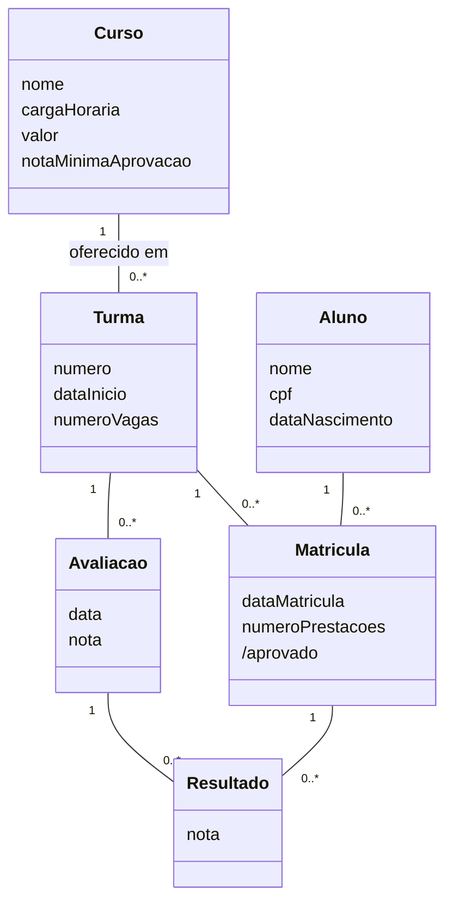

# Aula 12: Modelo de Domínio

O modelo de domínio é um diagrama de classes **conceitual**: mostra as coisas do mundo real que importam para o sistema (as classes conceituais), os atributos delas e como se relacionam. Não tem operações nem classes de software.

Tipo: exercícios e exemplos · Exercícios com solução em [exercicios.md](exercicios.md)

Material do professor: [slides](https://github.com/Herysson/Engenharia-de-Software/blob/main/Aula%2012%20-%20Modelo%20de%20Dom%C3%ADnio_.pptx)

## Tópicos

- Domínio de negócio e modelo de domínio
- O diagrama de modelo de domínio na UML: o que mostra e o que não mostra
- Elementos: classe, associação, generalização e multiplicidade
- Exemplo resolvido: sistema acadêmico (Exemplo 2 dos slides)

---

## Domínio e modelo de domínio

- **Domínio de negócio** (domínio do problema ou da aplicação): a área em que o software será usado, com os seus conceitos e termos. É a parte do mundo real relevante para o software (ver [aula 07](../aula07)).
- **Modelo de domínio**: uma representação visual das **classes conceituais** (ou objetos do mundo real) de um domínio e dos seus relacionamentos: entidades e inter-relações.

## O diagrama de modelo de domínio na UML

É um conjunto de diagramas de classes **sem operações**.

| Mostra | Não mostra |
|---|---|
| objetos do domínio (classes conceituais) | classes de software |
| associações entre as classes conceituais | objetos com responsabilidades |
| atributos das classes conceituais | operações (métodos) |

| Compartimento | No modelo de domínio |
|---|---|
| Superior: nome | sempre necessário |
| Meio: atributos | as qualidades da classe |
| Inferior: operações | **não** é necessário |

> Dica dos slides: as entidades costumam ser **substantivos** no texto dos requisitos.

## Elementos

| Elemento | O que é | Desenho |
|---|---|---|
| Classe | um conceito do domínio | caixa com nome e atributos |
| Associação (bidirecional) | a relação padrão: as duas classes conhecem uma à outra | linha reta |
| Generalização (hereditariedade) | a subclasse assume as características da superclasse | linha com ponta de seta fechada apontando para a superclasse |
| Multiplicidade | o mínimo e o máximo de objetos de cada lado da associação | números nas pontas da linha |

| Multiplicidade | Significado |
|---|---|
| `0..1` | no mínimo zero e no máximo um: relacionamento não obrigatório |
| `1..1` | um e somente um |
| `0..*` | no mínimo nenhum e no máximo muitos |
| `1..*` | no mínimo um e no máximo muitos |
| `*` | muitos |
| `2..7` | no mínimo 2 e no máximo 7 |

As multiplicidades funcionam como na [aula 11](../aula11). A diferença do modelo de domínio está no que entra no diagrama: só conceitos do negócio.

---

## Exemplo resolvido: sistema acadêmico (Exemplo 2 dos slides)

> **Enunciado**: um sistema acadêmico registra os **cursos**, cada um com nome, carga horária e valor. Quando um curso é oferecido, registra-se uma **turma**, com número, data de início e número de vagas. A **matrícula** de um **aluno** numa turma tem a data e o número de prestações. Cada aluno tem nome, CPF e data de nascimento. Cada aluno passa por várias **avaliações**, que têm nota e data. Depois de cada avaliação, registra-se o **resultado** de cada aluno (a nota que ele tirou). Um aluno é aprovado se a nota total for maior ou igual à **nota mínima de aprovação** do curso.

**Passo 1: substantivos → classes candidatas**

Curso, turma, matrícula, aluno, avaliação, resultado. "Nota", "data", "vagas" etc. são **valores**, então viram atributos.

**Passo 2: atributos**

| Classe | Atributos |
|---|---|
| Curso | nome, cargaHoraria, valor, notaMinimaAprovacao |
| Turma | numero, dataInicio, numeroVagas |
| Aluno | nome, cpf, dataNascimento |
| Matricula | dataMatricula, numeroPrestacoes |
| Avaliacao | data, nota (o valor da avaliação) |
| Resultado | nota (a nota que o aluno tirou) |

**Passo 3: associações e multiplicidades**

- **Matrícula** liga um aluno a uma turma e guarda os dados desse vínculo. É uma classe associativa já transformada em classe comum (técnica da [aula 11](../aula11)).
- **Resultado** faz o mesmo entre a avaliação e a matrícula do aluno: guarda a nota que ele tirou.
- **aprovado** é **derivado** (`/`): sai da soma das notas dos resultados comparada com a nota mínima do curso. Por isso não precisa de uma classe própria.
- As classes não têm operações nem tipos: é um modelo **conceitual**.

## Para lembrar

- Modelo de domínio = classes conceituais + atributos + associações. **Sem operações.**
- Representa o mundo real, não o software.
- Substantivos viram classes; valores (nome, data, nota) viram atributos.
- Quando um vínculo entre duas classes tem dados próprios (matrícula, resultado), ele vira uma classe.

## Pontos em aberto

- O Exemplo 1 dos slides é só figura, sem texto, e não foi reproduzido.
- A resolução do Exemplo 2 também está em figuras nos slides. A solução acima foi feita a partir do enunciado e pode diferir da do professor, por exemplo na escolha de ligar o resultado à matrícula ou diretamente ao aluno.
- O texto do Exemplo 2 diz que a avaliação "possui nota e data" e, depois, que se registra "a nota que ele tirou". Aqui a primeira foi tratada como o valor da avaliação e a segunda como o resultado do aluno.
