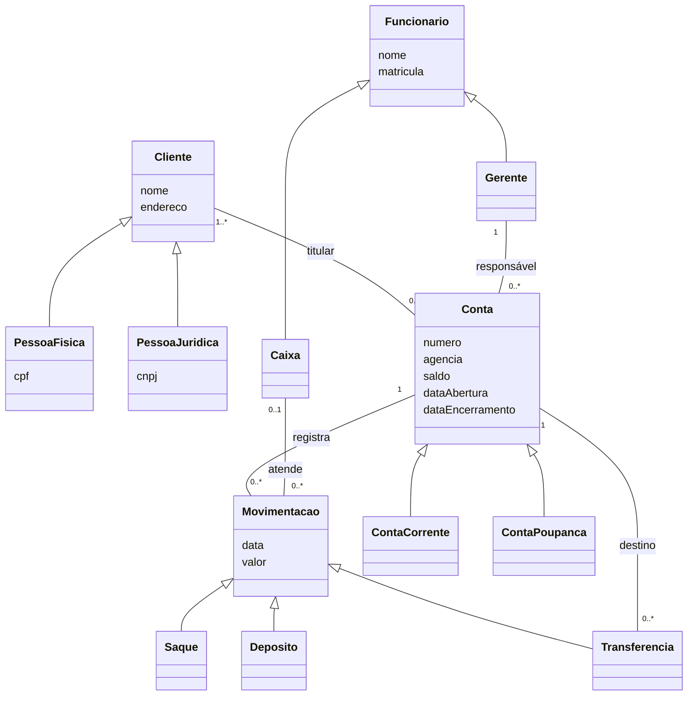
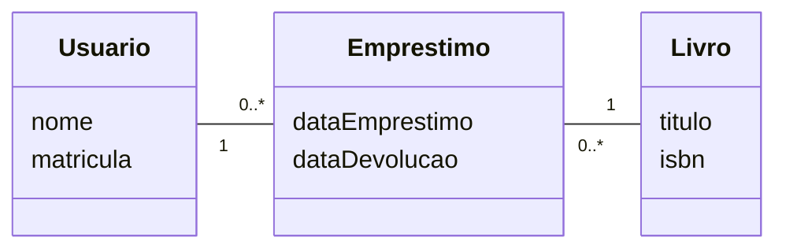
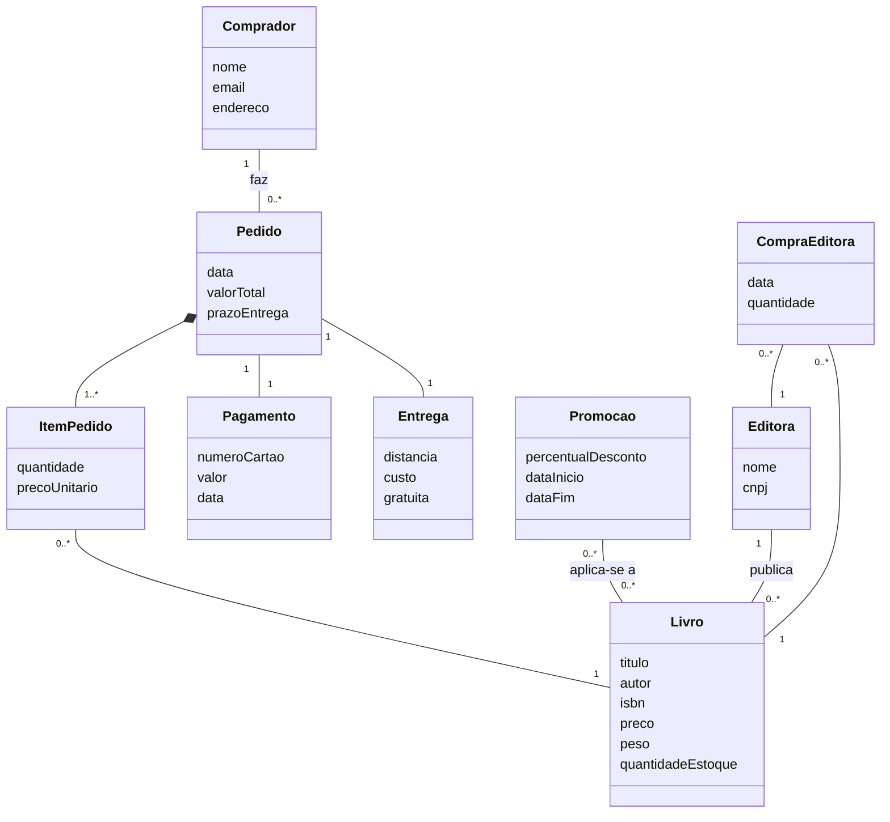

# Aula 12: Exercícios

O exercício do slide final e outros montados a partir do conteúdo das aulas. Os conceitos estão no [resumo da aula](README.md).

Cada exercício tem **uma** solução possível, escondida: clique em **Ver solução** para abrir. Tente fazer antes de olhar.

## Sumário

| # | Exercício | Origem |
|---|---|---|
| 1 | [Sistema bancário](#1-sistema-bancário) | slides |
| 2 | [Domínio ou software?](#2-domínio-ou-software) | montado a partir da aula |
| 3 | [Lendo multiplicidades](#3-lendo-multiplicidades) | montado a partir da aula |
| 4 | [Livraria virtual Livir](#4-livraria-virtual-livir) | texto do Livir (aula 08) |

---

### 1. Sistema bancário

> Com base nos requisitos, desenvolva o diagrama de domínio: um sistema bancário que permita abrir e encerrar contas, consultar saldo, registrar movimentações e fazer saques, depósitos e transferências. As contas podem ser corrente ou poupança. Pessoas físicas e jurídicas interagem com o sistema, assim como os caixas e os gerentes do banco.

Ver solução

- Os **substantivos** do texto viraram as classes: conta, movimentação, saque, depósito, transferência, pessoa física, pessoa jurídica, caixa, gerente.
- "Corrente ou poupança", "física ou jurídica", "caixa ou gerente" e "saque, depósito ou transferência" são **tipos de** algo, então viraram generalizações.
- "Consultar saldo" e "abrir e encerrar contas" são **ações**: no modelo de domínio elas não viram operações. O que fica é o resultado delas nos dados (`saldo`, `dataAbertura`, `dataEncerramento`).
- A transferência tem uma conta de **destino**, além da conta de origem que a registra.
- Compare com o diagrama de caso de uso do mesmo enunciado, no [exercício 0 da aula 09](../aula09/exercicios.md#0-sistema-bancário): lá aparecem as **ações** dos atores; aqui, os **conceitos** e os dados.

### 2. Domínio ou software?

> O que está errado neste modelo de domínio de uma biblioteca?
>
> - classe `TelaDeEmprestimo` com o atributo `botaoConfirmar`
> - classe `Livro` com os atributos `titulo`, `isbn` e a operação `emprestar()`
> - classe `LivroDAO` com a operação `salvarNoBanco()`
> - classe `Usuario` com os atributos `nome` e `matricula`

Ver solução

| Elemento | Problema | Correção |
|---|---|---|
| `TelaDeEmprestimo` | é uma classe de **software** (interface), não um conceito do mundo real | remover. Se o conceito é o empréstimo, criar `Emprestimo` com `dataEmprestimo` e `dataDevolucao` |
| `emprestar()` em Livro | modelo de domínio **não tem operações** | remover a operação e representar o empréstimo como classe ligada a Livro e Usuario |
| `LivroDAO` | é uma classe de software (acesso a banco de dados) | remover |
| `Usuario` | está certo: conceito do domínio com atributos | manter |

### 3. Lendo multiplicidades

> Explique em português o que diz cada associação: a. `Pedido "1" -- "1..*" Item`. b. `Pessoa "0..1" -- "0..1" Passaporte`. c. `Time "1" -- "11..*" Jogador`. d. `Turma "0..*" -- "2..7" Professor`.

Ver solução

| Associação | Leitura |
|---|---|
| a | Um pedido tem pelo menos um item. Cada item é de exatamente um pedido. |
| b | Uma pessoa pode ter um passaporte ou nenhum. Um passaporte pode estar ligado a uma pessoa ou a nenhuma (por exemplo, ainda não emitido). |
| c | Um time tem pelo menos 11 jogadores. Cada jogador está em exatamente um time. |
| d | Uma turma tem de 2 a 7 professores. Um professor pode estar em várias turmas, ou em nenhuma. |

Cada multiplicidade se lê **a partir da outra ponta**: em (a), o `1..*` perto de Item diz quantos itens **um pedido** tem.

### 4. Livraria virtual Livir

> Com base no texto do sistema Livir (aula 08), desenvolva o diagrama de domínio: a livraria gerencia a aquisição e a venda de livros pela Web; compradores pagam com cartão de crédito; há promoções eventuais com desconto; os livros novos são comprados de editoras; o custo de entrega depende do peso dos livros e da distância, e pode haver entrega gratuita para algumas localidades; o gerente emite relatórios de livros mais vendidos e de compradores mais assíduos; se o livro pedido não está em estoque, ele é solicitado ao fornecedor e um prazo é informado ao comprador.

Ver solução

- **CompraEditora** representa o livro solicitado ao fornecedor quando não há estoque.
- Os relatórios do gerente (mais vendidos, compradores mais assíduos) **não** viram classes: eles são calculados a partir de Pedido e ItemPedido.
- `gratuita` em Entrega registra as promoções de entrega gratuita, e `custo` sai do peso dos livros e da distância.
- O texto não detalha os atributos. Os de cada classe são escolhas desta solução.

